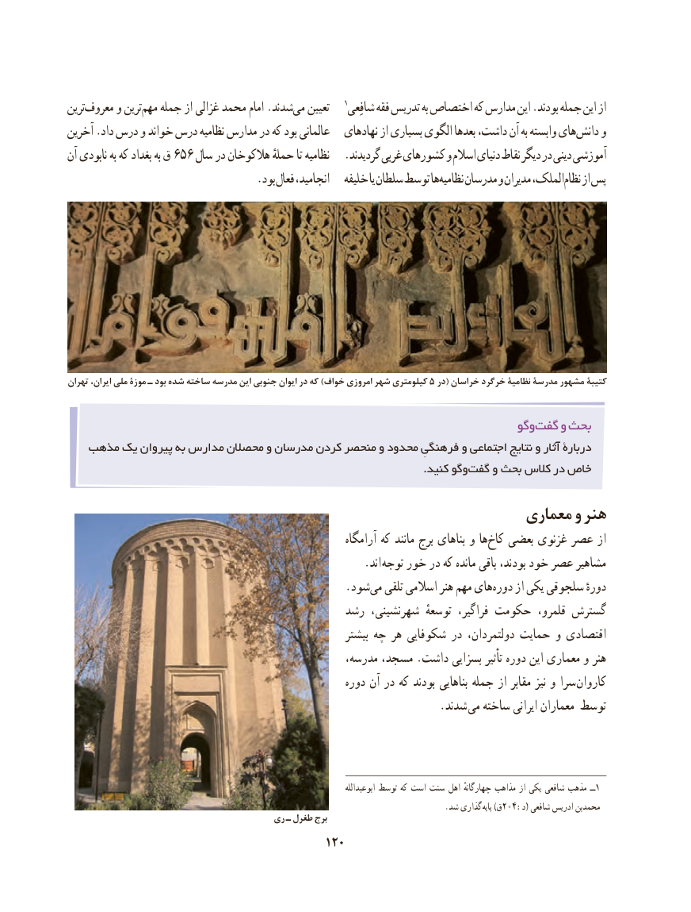

# PDF page 130

ترینمعروف‌     و ترینمهم‌   جمله از غزالی محمد امام .شدندمی‌   تعیین   1شافِعی فقه تدریس به اختصاص که مدارس این .بودند جمله این از
آخرین .داد درس و خواند درس نظامیه مدارس در که بود عالمانی   نهادهای از بسیاری الگوی بعدها داشت، آن به وابسته های دانش و
آن نابودی به که بغداد به ق 656 سال در هالکوخان حملهٔ تا نظامیه   .گردیدند غربی کشورهای و اسالم دنیای نقاط دیگر در دینی آموزشی
                                  .بود فعال انجامید،   خلیفه یا سلطان توسط هانظامیه‌    مدرسان و مدیران الملک،نظام‌   از پس

تهران ایران، ملی موزة ـ بود شده ساخته مدرسه این جنوبی ایوان در که )خواف امروزی شهر کیلومتری 5 در( خراسان خرگرد نظامیۀ مدرسۀ مشهور کتیبۀ

                                                                           وگوگفت‌    و بحث
   مذهب یک پیروان به مدارس محصالن و مدرسان کردن منحصر و محدود فرهنگیِ و اجتماعی نتایج و آثار دربارۀ
               .‌کنید وگوگفت و بحث کالس در خاص

                                                           معماری و هنر
                                                               آرامگاه که مانند برج بناهای و هاکاخ‌   بعضی غزنوی عصر از
                                                      .اند توجه خور در که مانده باقی بودند، خود عصر مشاهیر
                                                  .شود‌می تلقی اسالمی هنر مهم های‌دوره از یکی سلجوقی دورهٔ
                                           رشد شهرنشینی، توسعهٔ فراگیر، حکومت قلمرو، گسترش
                                                             بیشتر چه هر شکوفایی در دولتمردان، حمایت و اقتصادی
                                                   مدرسه، مسجد، .داشت بسزایی ‌ تأثیر دوره این معماری و هنر
                                                       دوره آن در که بودند بناهایی جمله از مقابر نیز و سرا کاروان
                                                                   .شدند می ساخته ایرانی معماران توسط

                                                                                              ابوعبدالله توسط که است سنت اهل چهارگانهٔ مذاهب از یکی شافعی مذهب ــ1
                                                                                               .شد گذاری  2پایه )ق 04:د( شافعی ادریس محمدبن
                                      ری ـ طغرل برج
                                          120

