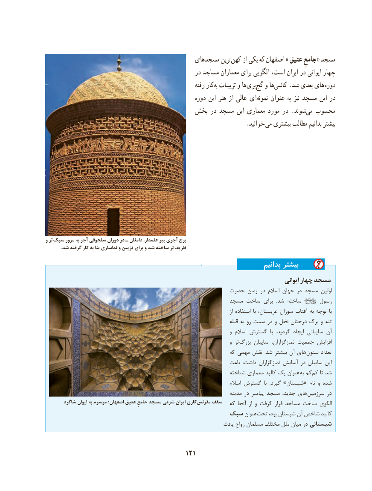

# PDF page 131

مسجدهای ترین کهن از یکی که اصفهان » عتیق جامعِ « مسجد
                                                   در مساجد معماران برای الگویی است، ایران در ایوانی چهار
                                                              رفته کاربه‌  تزیینات و ها ‌بری گچ و هاکاشی‌    .شد بعدی های  دوره
                                                       دوره این هنر از عالی ای‌نمونه عنوان به نیز مسجد این در
                                    بخش در مسجد این معماری مورد در .شوند‌می محسوب
                    . خوانید می بیشتری مطالب بدانیم بیشتر

و تر سبک مرور به آجر سلجوقی دوران در ـ دامغان علمدار، پیر آجری برج
. شد گرفته کار به بنا نماسازی و تزیین برای و شد ساخته تر ظریف
                                                                            بدانیم بیشتر
                                                                                                 ایوانی چهار مسجد
                                                حضرت زمان در اسالم جهان در مسجد اولین
                                                      مسجد ساخت برای   .شد ساخته      رسول
                                                                                                                 از استفاده  با عربستان، سوزان آفتاب به توجه  با
                                                                                       قبله به رو سمت در و نخل درختان برگ و تنه
                                                                                 و اسالم گسترش  با   .گردید ایجاد سایبانی آن
                                                                                 و تر بزرگ سایبان نمازگزاران، جمعیت افزایش
                                                                  که مهمی نقش  .شد بیشتر آن های ستون تعداد
                                                                       باعث داشت، نمازگزاران آسایش در سایبان این
                                                                     شناخته معماری کالبد یک عنوان  به کم کم تا شد
                                                                                اسالم گسترش  با  .گیرد »شبستان« نام و شده
                                                                           مدینه در پیامبر مسجد جدید، های  سرزمین در
       شاگرد ایوان به موسوم اصفهان؛ عتیق جامعِ مسجد شرقی ایوان کاری مقرنس سقف   که آنجا  از و گرفت قرار مساجد ساخت الگوی
                                        سبک عنوان تحت بود، شبستان آن شاخص کالبد
                                                                                                                                                          .یافت رواج مسلمان مختلف ملل میان در شبستانی

                                           121

