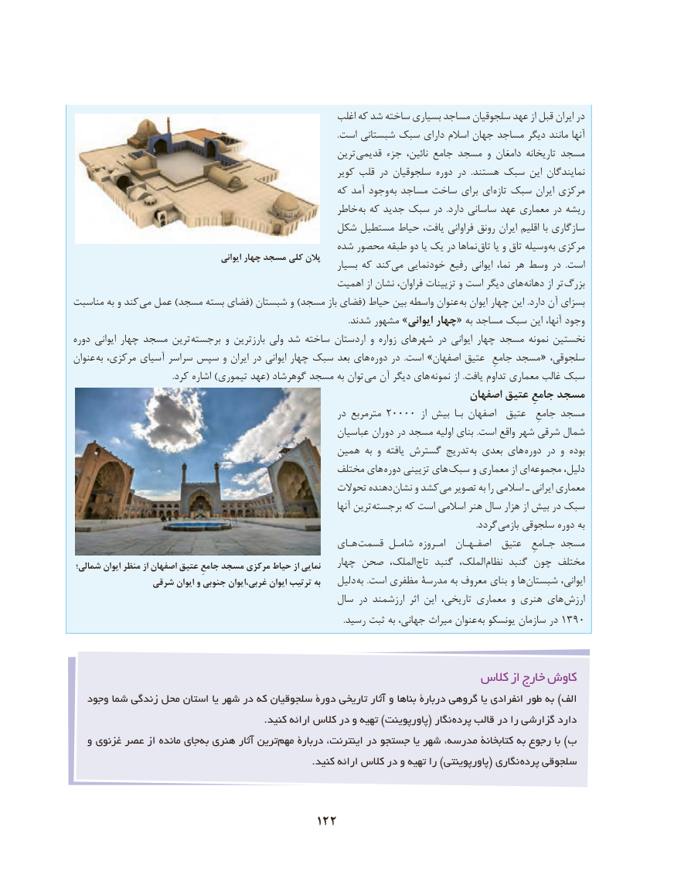

# PDF page 132

اغلب که شد ساخته بسیاری مساجد سلجوقیان عهد از قبل ایران در
                                                                                                                               .است شبستانی سبک دارای اسالم جهان مساجد دیگر مانند آنها
                                                          ترین  قدیمی جزء نائین، جامع مسجد و دامغان تاریخانه مسجد
                                                             کویر قلب در سلجوقیان دوره در  .هستند سبک این نمایندگان
                                                    که آمد وجود  به مساجد ساخت برای ای  تازه سبک ایران مرکزی
                                                    خاطر  به که جدید سبک در  .دارد ساسانی عهد معماری در ریشه
                                        شکل مستطیل حیاط یافت، فراوانی رونق ایران اقلیم با سازگاری
                                                شده محصور طبقه دو یا یک در نماها تاق یا و تاق وسیله  به مرکزی
                                           ایوانی چهار مسجد کلی پالن                                                                 بسیار که کند می خودنمایی رفیع ایوانی نما، هر وسط در  .است
                                                   اهمیت از نشان فراوان، تزیینات و است دیگر های  دهانه از تر بزرگ
مناسبت به و کند می عمل )مسجد بسته فضای( شبستان و )مسجد باز فضای( حیاط بین واسطه عنوان  به ایوان چهار این .دارد آن بسزای
                                                                                                                                    .شدند مشهور »ایوانی چهار« به مساجد سبک این آنها، وجود
دوره ایوانی چهار مسجد ترین  برجسته و بارزترین ولی شد ساخته اردستان و زواره شهرهای در ایوانی چهار مسجد نمونه نخستین
عنوان به مرکزی، آسیای سراسر سپس و ایران در ایوانی چهار سبک بعد های دوره در  .است »اصفهان عتیق  جامعِ مسجد  « ،سلجوقی
 . کرد اشاره )تیموری عهد( گوهرشاد مسجد به توان می آن دیگر های نمونه از .یافت تداوم معماری غالب سبک
                                                                         اصفهان عتیق جامعِ مسجد
                                                           در مترمربع ٢٠٠٠٠  از بیش  بـا اصفهان  عتیق  جامعِ مسجد
                                                          عباسیان دوران در مسجد اولیه بنای .است واقع شهر شرقی شمال
                                               همین به و یافته گسترش تدریج  به بعدی های دوره در و بوده
                                                مختلف های دوره تزیینی های  سبک و معماری از ای مجموعه دلیل،
                                                      تحوالت دهنده نشان و کشد  می تصویر به را اسالمی ـ ایرانی معماری
                                                                                آنها ترین  برجسته که است اسالمی هنر سال هزار از بیش در سبک
                                 . گردد بازمی سلجوقی دوره به
                                                    هـای قسمت شامـل امـروزه  اصفـهـان  عتیق  جـامعِ مسجد
 شمالی؛ ایوان منظر از اصفهان عتیق جامعِ مسجد مرکزی حیاط از نمایی    چهار صحن الملک، تاج گنبد الملک،  نظام گنبد چون مختلف
               شرقی ایوان و جنوبی غربی،ایوان ایوان ترتیب به    دلیل به  .است مظفری مدرسۀ به معروف بنای و ها  شبستان ایوانی،
                                                 سال در ارزشمند  اثر این تاریخی، معماری و هنری های ارزش
    . رسید ثبت به جهانی، میراث عنوان به١٣٩٠یونسکو سازمان در

                                                           کالس از خارج کاوش
   وجود شما زندگی محل استان یا شهر در که سلجوقیان دورۀ تاریخی آثار و بناها دربارۀ گروهی یا انفرادی طور به )الف
                                                            .کنید ارائه کالس در و تهیه )پاورپوینت( نگار  پرده قالب در را گزارشی دارد
   و غزنوی عصر از مانده جای ‌به هنری آثار ترین‌مهم دربارۀ اینترنت، در جستجو یا شهر مدرسه، کتابخانۀ به رجوع با )ب
  . کنید ارائه کالس در و تهیه را )پاورپوینتی( نگاری پرده سلجوقی

                                     122

