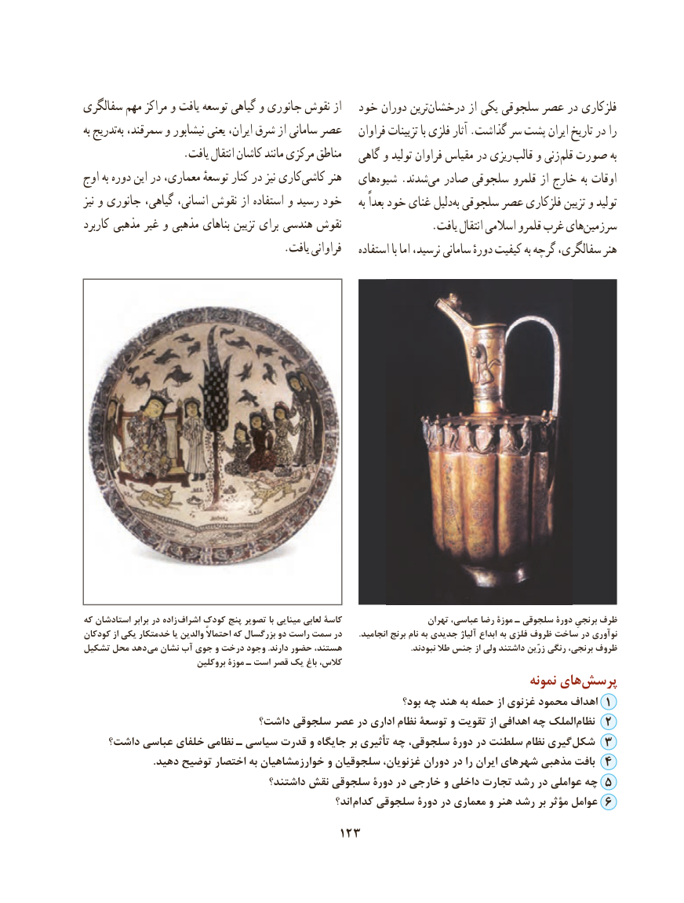

# PDF page 133

سفالگری مهم مراکز و یافت توسعه گیاهی و جانوری نقوش از   خود دوران تریندرخشان‌         از یکی سلجوقی عصر در فلزکاری
به تدریجبه‌ سمرقند، و نیشابور یعنی ایران، شرق از سامانی عصر    فراوان تزیینات با فلزی آثار .گذاشت سر پشت ایران تاریخ در را
                  .یافت انتقال کاشان مانند مرکزی مناطق   گاهی و تولید فراوان مقیاس در ریزی قالب و زنی قلم صورت به
اوج به دوره این در معماری، توسعهٔ کنار در نیز کاریکاشی‌     هنر   هایشیوه‌    .شدندمی‌  صادر سلجوقی قلمرو از خارج به اوقات
نیز و جانوری گیاهی، انسانی، نقوش از استفاده و رسید خود     به بعداً خود غنای دلیلبه‌ سلجوقی عصر فلزکاری تزیین و تولید
کاربرد مذهبی غیر و مذهبی بناهای تزیین برای هندسی نقوش                .یافت انتقال اسالمی قلمرو غرب هایسرزمین‌
                                     .یافت فراوانی    استفاده با اما نرسید، سامانی دورهٔ کیفیت به گرچه سفالگری، هنر

که استادشان برابر در زاده اشراف کودک پنج تصویر با مینایی لعابی کاسۀ                    تهران عباسی، رضا موزة ـ سلجوقی دورۀ برنجیِ ظرف
کودکان از یکی خدمتکار یا والدین احتماالً که بزرگسال دو راست سمت در        .انجامید برنج نام به جدیدی آلیاژ ابداع به فلزی ظروف ساخت در نوآوری
تشکیل محل دهد می نشان آب جوی و درخت وجود .دارند حضور هستند،                                .نبودند طال جنس از ولی داشتند زرّین رنگی برنجی، ظروف
                           بروکلین موزة ـ است قصر یک باغ کالس،
                                                                                   نمونه های‌پرسش
                                                                    بود؟ چه هند به حمله از غزنوی محمود اهداف 1
                            داشت؟ سلجوقی عصر در اداری نظام توسعۀ و تقویت از اهدافی چه الملک ‌نظام 2
    داشت؟ عباسی خلفای نظامی ـ سیاسی قدرت و جایگاه بر تأثیری چه سلجوقی، دورۀ در سلطنت نظام گیری  شکل 3
                           .دهید توضیح اختصار به خوارزمشاهیان و سلجوقیان غزنویان، دوران در را ایران شهرهای مذهبی بافت 4
                                   داشتند؟ نقش سلجوقی دورۀ در خارجی و داخلی تجارت رشد در عواملی چه 5
                                                            اند؟ کدام سلجوقی دورۀ در معماری و هنر رشد بر مؤثر عوامل 6
                                     123

