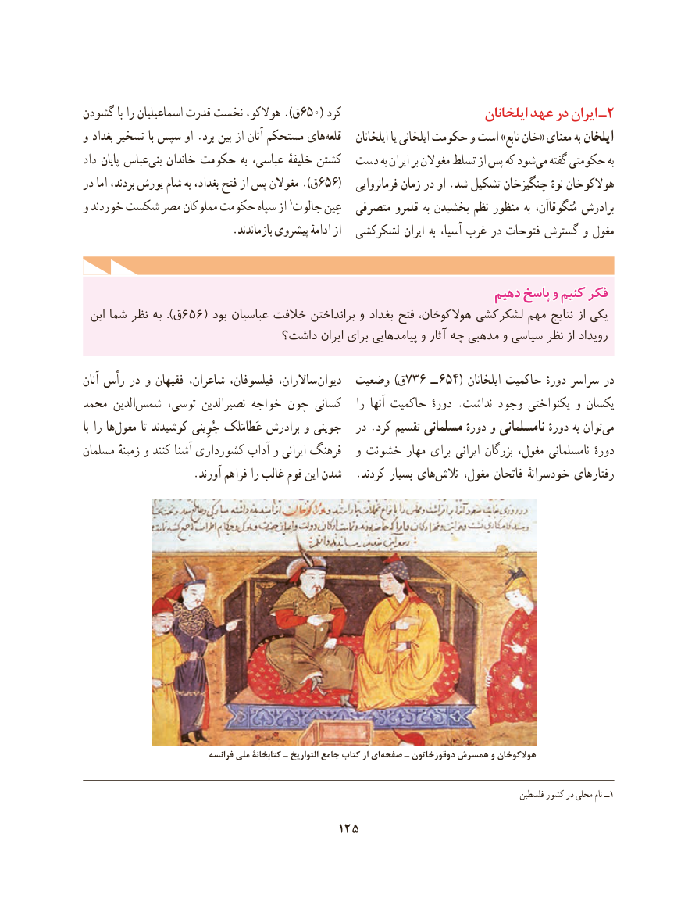

# PDF page 135

گشودن با را اسماعیلیان قدرت نخست هوالكو، ).ق650( كرد                          ایلخانان عهد در ایران ـ2
و بغداد تسخیر با سپس او .برد بین از آنان مستحكم هایقلعه‌       ایلخانان یا ایلخانی حکومت و است »تابع خان« معنای به ایلخان
داد پایان عباسبنی‌   خاندان حكومت به عباسی، خلیفهٔ كشتن  دست به ایران بر مغوالن تسلط از پس که شودمی‌  گفته حکومتی به
در اما بردند، یورش شام به بغداد، فتح از پس مغوالن ).ق656(   فرمانروایی زمان در او .شد تشکیل چنگیزخان نوهٔ هوالکوخان
و خوردند شكست مصر مملوکان حکومت سپاه از 1جالوت عِین  متصرفی قلمرو به بخشیدن نظم منظور به مُنگوقاآن، برادرش
                           .بازماندند پیشروی ادامهٔ از  لشكركشی ایران به آسیا، غرب در فتوحات گسترش و مغول

                                                              دهیمدهیم پاسخپاسخ وو کنیمکنیم فکرفکر
 این شما نظر به ).ق 656( بود عباسیان خالفت برانداختن و بغداد فتح هوالکوخان، لشکرکشی مهم نتایج از یکی
                            داشت؟ ایران برای پیامدهایی و آثار چه مذهبی و سیاسی نظر از رویداد

آنان رأس در و فقیهان شاعران، فیلسوفان، ساالران،  دیوان  وضعیت )ق736 ــ 654( ایلخانان حاکمیت دورهٔ سراسر در
محمد الدین‌شمس توسی، نصیرالدین خواجه چون کسانی   را  آنها حاكمیت دورهٔ .نداشت وجود یکنواختی و یکسان
با را ها‌مغول تا كوشیدند جُوِینی عَطامَلک برادرش و جوینی   در .کرد تقسیم مسلمانی دورهٔ و نامسلمانی دورهٔ به توان‌می
مسلمان زمینهٔ و كنند آشنا کشورداری آداب و ایرانی فرهنگ   و خشونت مهار برای ایرانی بزرگان مغول، نامسلمانی دورهٔ
                    .آورند فراهم را غالب قوم این شدن   .كردند بسیار های ‌تالش مغول، فاتحان خودسرانهٔ رفتارهای

                               فرانسه ملی کتابخانۀ ـ التواریخ جامع کتاب از ای صفحه ـ دوقوزخاتون همسرش و هوالكوخان

                                                                                                             فلسطین كشور در محلی نام ــ1

                                     125

