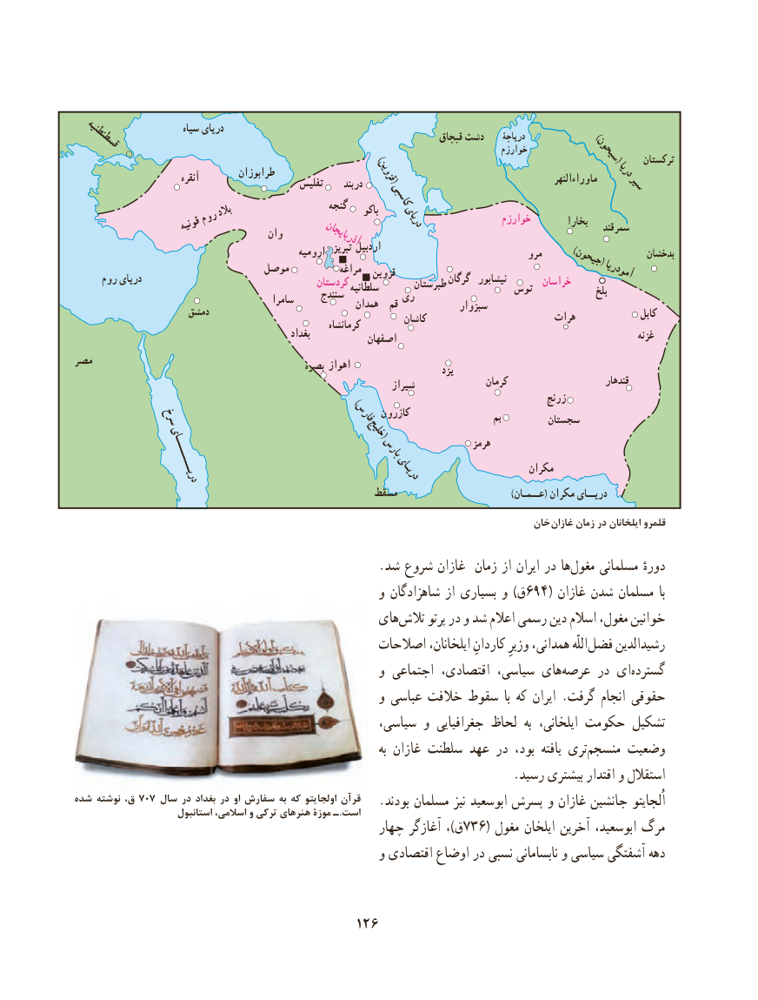

# PDF page 136

سىاه درىاى                                                                               قپچاق دشت     درىاچۀ    )  قسطنطنىه                                                                                                 خوارزم               )                             سىحون(   ترکستان
                             آنقره                                    طرابوزان                قزوین(                                      ماوراءالنهر   درىا                                                تفلىس     دربند                              سىر                                                   کاسپی                            بالد                     گنجه    باکو                 روم                              درىاى               خوارزم         بخارا                    قونىه                                                                                          سمرقند                                       وان                                                    آذرباىجان                                                                     تبرىز اردبیل                                                  ارومىه                                                                                              مرو   )جىحون(        بدخشان                               موصل           مراغه                                                                 قزوین                                         آمودرىا                                                                                     گرگان  نىشابور                                                                                                 خراسان     روم درىاى                                      کردستان                                                                        طبرستان                                                                   سلطانىه                                                                       توس                                                                                                                                          بلخ                                                     سنندج                                                     رى                                             سامرا                                                             همدان  قم             سبزوار                      دمشق                                                                         کاشان                        هرات                کابل                                                                کرمانشاه                                                       بغداد                                                           اصفهان                                                           غزنه
مصر                                               بصره اهواز                                                                                             یزد
                                                                    شىراز                کرمان                        قندهار
                                                                                                     زرنج
                                                                کازرون          سرخ          ) فارس                                                                                                       بم         سجستان                                          خلیج(
                                         پارس              هرمز
                                                                                           مکران                                درىـــــــــاى                                  درىـاى
                                                    مسقط                                      )عــمـان( مکران درىــاى
                                                                                  خان غازان زمان در ایلخانان قلمرو

                                                  .شد شروع غازان  زمان از ایران در هامغول‌     مسلمانی دورهٔ
                                                  و شاهزادگان از بسیاری و )ق694( غازان شدن مسلمان  با
                                              های‌تالش پرتو در و شد اعالم رسمی دین اسالم مغول، خوانین
                                             اصالحات ایلخانان، كاردانِ وزیرِ همدانی، اللّه‌فضل رشیدالدین
                                                  و اجتماعی اقتصادی، سیاسی، های‌عرصه در ای‌گسترده
                                                  و عباسی خالفت سقوط  با که ایران .گرفت انجام حقوقی
                                                 سیاسی، و جغرافیایی لحاظ  به ایلخانی، حکومت تشکیل
                                                                                 به غازان سلطنت عهد در بود،  یافته تری‌منسجم وضعیت
                                                                        .رسید بیشتری اقتدار و استقالل
شده نوشته ق، 707 سال در بغداد در او سفارش به که اولجایتو قرآن   .بودند مسلمان نیز ابوسعید پسرش و غازان جانشین اُلجایتو                       استانبول اسالمی، و ترکی هنرهای موزۀ ـ  .است
                                                چهار آغازگر ،)ق736( مغول ایلخان آخرین ابوسعید، مرگ
                                                  و اقتصادی اوضاع در نسبی نابسامانی و سیاسی آشفتگی دهه

                                      126

