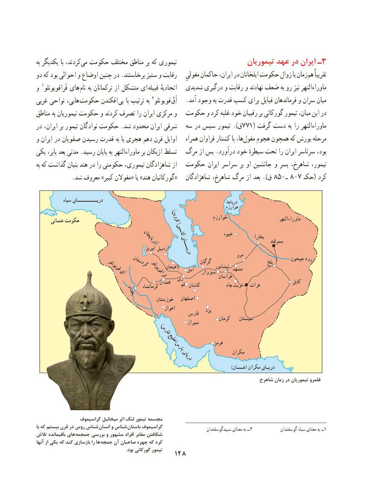

# PDF page 138

به یكدیگر با كردند،می‌  حكومت مختلف مناطق بر كه تیموری                     تیموریان عهد در ایران ـ 3
دو كه بود احوالی و اوضاع چنین در .برخاستند ستیز و رقابت ِزمانمغولی حاکمان ایران، در ایلخانان حکومت زوال با    هم‌   تقریباً
و 1قَراقویونلو های  نام به ترکمانان از متشکل ای قبیله اتحادیهٔ   شدیدی درگیری و رقابت و نهادند ضعف به رو نیز ماوراءالنهر
غربی نواحی هایی،  حکومت افکندن  پی با ترتیب به 2قویونلو  ْآق   .آمد وجود به قدرت کسب برای قبایل فرماندهان و سران میان
مناطق به تیموریان حكومت و كردند تصرف را ایران مركزی و  حکومت و کرد غلبه خود رقیبان بر گوركانی تیمور میان، این در
در ایران، بر تیمور نوادگان حكومت .شد محدود ایران شرقی   سه در سپس تیمور ).ق771( گرفت دست به را ماوراءالنهر
و ایران در صفویان رسیدن قدرت به با هجری دهم قرن اوایل   همراه فراوان کشتار با ها،مغول‌    هجوم همچون که یورش مرحله
یکی بابر، بعد مدتی .رسید پایان به ماوراءالنهر بر ازبكان تسلط  مرگ از پس .درآورد خود سیطرهٔ تحت را ایران سرتاسر بود،
به كه گذاشت بنیان هند در را حكومتی تیموری، شاهزادگان از  حکومت ایران سراسر بر او جانشین و پسر شاهرخ، تیمور،
            .شد معروف »کبیر مغوالن« یا »هند گورکانیان«   شاهزادگان شاهرخ، مرگ از بعد ).ق 850ـ 807 حکـ( کرد

             سىاه درىــــــــــاى                                                                   درىاچۀ
             )                     خوارزم
                                                                         خوارزم                           ماوراءالنهر       عثمانى حکومت                                 قزوین(
                                                  کاسپی                خىوه                                                                                                           بخارا                                                آذرباىجان                                                  سمرقند                                                           تبرىز اردبیل                                                                               درىــــاى                                                                                     مرو                                                                                                جىحون رود                                                                            گرگان                              بلخ                                   کردستان                                                                                         نىشابور                                                                               مشهد                             قوىونلو                     الهیجان    آمل               آق                               وار سبز                                                       قراقوىونلو                     خراسان                                               رى                                                       همدان                                                              کابل                                                       کرمانشاه           قم  کاشان            جام تربت   هرات                                بغداد
                                                 خوزستان   اصفهان
                                                           اهواز                                                                                        یزد                                                          فارس                                                                                    کرمان    سىستان              )         شىراز
                                 فارس
                                      خلىج(                                     پارس            هرمز
                                                دریای               مکران
                                                                                                                                      )عـمـان( مکران درىـاى
                                                                                 شاهرخ زمان در تیموریان قلمرو

                 گراسیموف میخائیل اثر لنگ تیمور مجسمه
با که بیستم قرن در روس شناس انسان و شناس باستان گراسیموف                                                                                   سپیدگوسفندان معنای به ــ2             گوسفندان سیاه معنای به ــ1تالش باقیمانده های جمجمه بررسی و مشهور افراد مقابر شکافتن
آنها از یکی که کند بازسازی را ها جمجه آن صاحبان چهره که کرد
                                                                             .بود گورکانی تیمور   128

