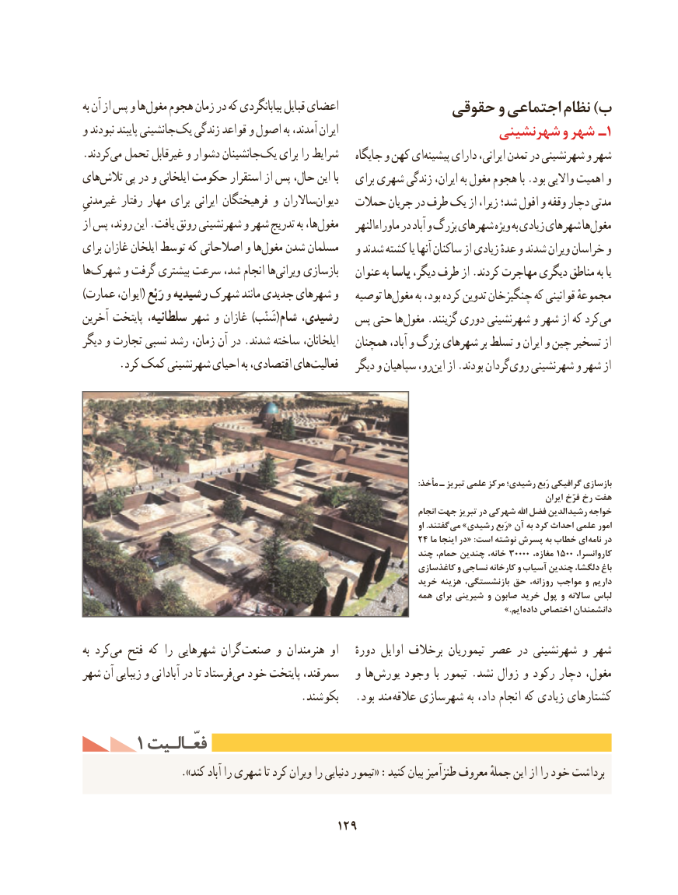

# PDF page 139

به آن از پس و ها مغول هجوم زمان در که بیابانگردی قبایل اعضای             حقوقی و اجتماعی نظام )ب
و نبودند پایبند جانشینی یک زندگی قواعد و اصول به آمدند، ایران                     شهرنشینی و شهر ـ1
.کردندمی‌  تحمل غیرقابل و دشوار جانشینان یک برای را شرایط    جایگاه و كهن ایپیشینه‌     دارای ایرانی، تمدن در شهرنشینی و شهر
هایتالش‌    پی در و ایلخانی حکومت استقرار از پس حال، این با   برای شهری زندگی ایران، به مغول هجوم با .بود واالیی اهمیت و
غیرمدنیِ رفتار مهار برای ایرانی فرهیختگان و ساالراندیوان‌      حمالت جریان در طرف ‌یک از زیرا، شد؛ افول و وقفه دچار مدتی
از پس روند، این .یافت رونق شهرنشینی و شهر تدریج به ها،مغول‌         ماوراءالنهر در آباد و بزرگ شهرهای ویژه به زیادی شهرهای هامغول‌
برای غازان ایلخان توسط که اصالحاتی و هامغول‌   شدن مسلمان   و شدند کشته یا آنها ساکنان از زیادی عدهٔ و شدند ویران خراسان و
هاشهرک‌     و گرفت بیشتری سرعت شد، انجام هاویرانی‌     بازسازی   عنوان به یاسا دیگر، طرف از .کردند مهاجرت دیگری مناطق به یا
)عمارت ایوان،( رَبْع و رشیدیه شهرک مانند جدیدی شهرهای و   توصیه هامغول‌      به بود، کرده تدوین چنگیزخان که قوانینی مجموعهٔ
آخرین پایتخت سلطانیه، شهر و غازان )شَنْب(شام رشیدی،  پس حتی ها مغول .گزینند دوری شهرنشینی و شهر از که کرد می
دیگر و تجارت نسبی رشد زمان، آن در .شدند ساخته ایلخانان،   همچنان آباد، و بزرگ شهرهای بر تسلط و ایران و چین تسخیر از
.‌کرد کمک شهرنشینی احیای به اقتصادی، هایفعالیت   دیگر و سپاهیان رو،این‌   از‌ .بودند گردان روی شهرنشینی و شهر از

                                                                                                                                                                :مأخذ ـ تبریز علمی مرکز رشیدی؛ رَبع گرافیکی بازسازی
                                                                                                                                 ایران فرّخ رخ هفت
                                                                                             انجام جهت تبریز در شهرکی اهلل فضل الدین رشید خواجه
                                                                                                               او .گفتند  می »رشیدی رَبع« آن به کرد احداث علمی امور
                                                                24 ما اینجا در« :است نوشته پسرش به خطاب ای  نامه در
                                                                  چند حمام، چندین خانه، 30000 ،مغازه 1500 ،کاروانسرا
                                                                        کاغذسازی و نساجی کارخانه و آسیاب چندین دلگشا، باغ
                                                                      خرید هزینه بازنشستگی، حق روزانه، مواجب و داریم
                                                                      همه برای شیرینی و صابون خرید پول و ساالنه لباس
                                                                 .» ایم داده اختصاص دانشمندان

به کرد‌می فتح که را شهرهایی گران صنعت و هنرمندان او    دورهٔ اوایل برخالف تیموریان عصر در شهرنشینی و شهر
شهر آن زیبایی و آبادانی در تا فرستادمی‌  خود پایتخت سمرقند،   و هایورش‌    وجود با تیمور .نشد زوال و رکود دچار مغول،
                                        .بکوشند   .بود مند  عالقه شهرسازی به داد، انجام که زیادی کشتارهای
     1 فعّـالـیتفعّـالـیت
                    .»کند آباد را شهری تا کرد ویران را دنیایی تیمور« :کنید بیان طنزآمیز معروف جملهٔ این از را خود برداشت

                                       129

