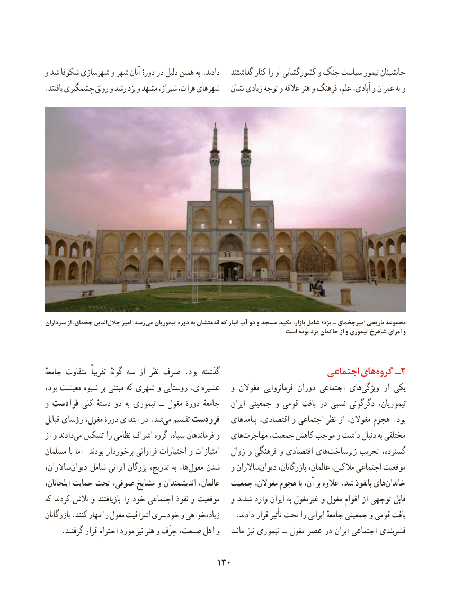

# PDF page 140

و شد شکوفا شهرسازی و شهر آنان دورهٔ در دلیل همین به .دادند    گذاشتند کنار را او کشورگشایی و جنگ سیاست تیمور جانشینان
.یافتند چشمگیری رونق و رشد یزد و مشهد شیراز، هرات، شهرهای   نشان زیادی توجه و عالقه هنر و فرهنگ علم، آبادی، و عمران به و

سرداران از چخماق، الدین  جالل امیر .رسد می تیموریان دوره به قدمتشان که انبار آب دو و مسجد تکیه، بازار، شامل يزد؛ ـ اميرچخماق تاریخی مجموعۀ
                                                                                                                                                                      .است بوده یزد حاکمان از و تیموری شاهرخ امرای و

جامعهٔ متفاوت  تقریباً  گونهٔ سه از نظر صرف .بود گذشته                       اجتماعی های گروه ـ2
بود، معیشت شیوه بر مبتنی که شهری و روستایی ای،عشیره‌       و مغوالن  فرمانروایی دوران اجتماعی هایویژگی‌       از یکی
و فرادست کلی دستهٔ دو  به تیموری  ــ مغول دورهٔ جامعهٔ    ایران جمعیتی و قومی بافت در نسبی دگرگونی تیموریان،
قبایل رؤسای مغول، دورهٔ ابتدای در .شد‌می تقسیم فرودست   پیامدهای اقتصادی، و اجتماعی نظر از مغوالن، هجوم .بود
از و دادندمی‌  تشکیل را نظامی اشراف گروه سپاه، فرماندهان و   های‌مهاجرت جمعیت، کاهش موجب و داشت دنبال به مختلفی
مسلمان با اما .بودند برخوردار فراوانی اختیارات و امتیازات   زوال و فرهنگی و اقتصادی هایزیرساخت‌        تخریب گسترده،
ساالران،دیوان‌    شامل ایرانی بزرگان تدریج، به ها، مغول شدن   و ساالران ‌دیوان بازرگانان، عالمان، مالکین، اجتماعی موقعیت
ایلخانان، حمایت تحت صوفی، مشایخ و اندیشمندان عالمان،   جمعیت مغوالن، هجوم با آن، بر عالوه .شد بانفوذ های ‌خاندان
که کردند تالش و بازیافتند را خود اجتماعی نفوذ و موقعیت   و شدند وارد ایران به غیرمغول و مغول اقوام از توجهی قابل
بازرگانان .کنند مهار را مغول اشرافیت خودسری و خواهیزیاده‌       .دادند قرار تأثیر تحت را ایرانی جامعهٔ جمعیتی و قومی بافت
     .گرفتند قرار احترام مورد نیز هنر و حِرَف صنعت، اهل و    مانند نیز تیموری ــ مغول عصر در ایران اجتماعی قشربندی

                                        130

