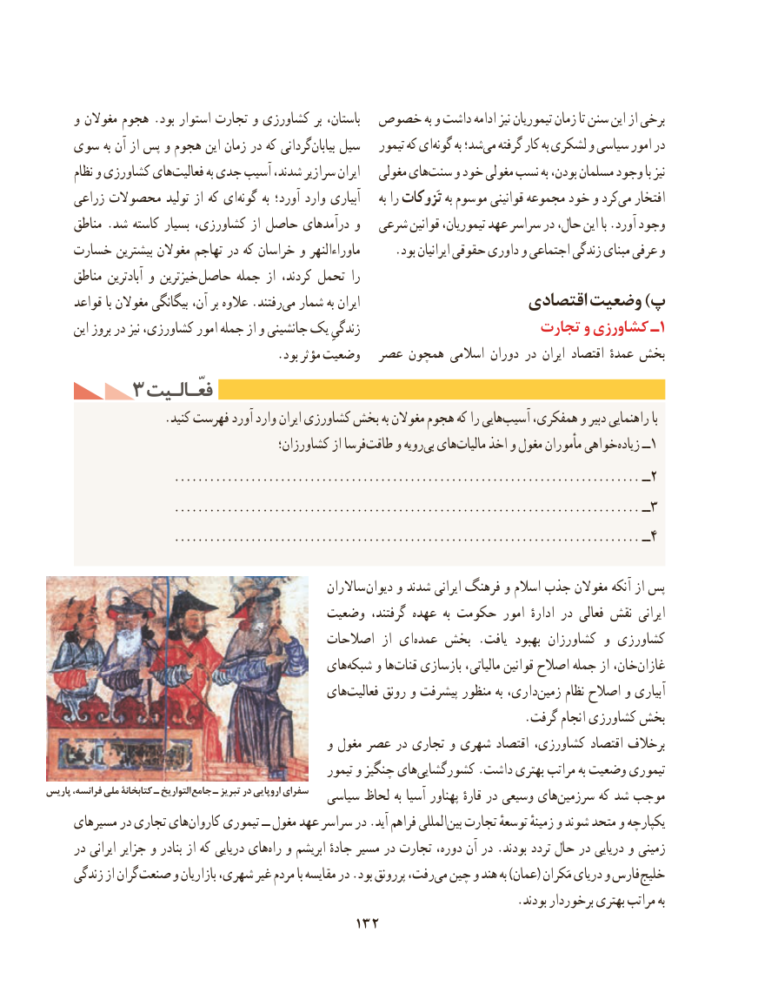

# PDF page 142

و مغوالن هجوم .بود استوار تجارت و كشاورزی بر باستان،  خصوص به و داشت ادامه نیز تیموریان زمان تا سنن این از برخی
   سوی به آن از پس و هجوم این زمان در كه گردانیبیابان‌   سیل    تیمور که ایگونه‌     به شد؛می‌  گرفته کار به لشکری و سیاسی امور در
      نظام و كشاورزی هایفعالیت‌        به جدی آسیب شدند، سرازیر ایران   مغولی هایسنت‌    و خود مغولی نسب به بودن، مسلمان وجود با نیز
     زراعی محصوالت تولید از که ایگونه‌      به آورد؛ وارد آبیاری     به را تَزوکات به موسوم قوانینی مجموعه‌     خود و کردمی‌   افتخار
     مناطق .شد کاسته بسیار کشاورزی، از حاصل درآمدهای و   شرعی قوانین تیموریان، عهد سراسر در حال، این با .آورد وجود
    خسارت بیشترین مغوالن تهاجم در كه خراسان و ماوراءالنهر      .بود ایرانیان حقوقی داوری و اجتماعی زندگی مبنای عرفی و
     مناطق آبادترین و خیزترین حاصل جمله از كردند، تحمل را
     قواعد با مغوالن بیگانگی آن، بر عالوه .رفتندمی‌  شمار به ایران                    اقتصادی وضعیت )پ
      این بروز در نیز كشاورزی، امور جمله از و جانشینی یک زندگیِ                      تجارت و کشاورزی ـ 1
                                      .بود مؤثر وضعیت  عصر همچون اسالمی دوران در ایران اقتصاد عمدهٔ بخش
       ۳ فعّـالـیتفعّـالـیت
                    .کنید فهرست آورد وارد ایران كشاورزی بخش به مغوالن هجوم كه را هاییآسیب‌    همفكری، و دبیر راهنمایی با
                                        كشاورزان؛ از فرساطاقت‌    و رویهبی‌  هایمالیات‌    اخذ و مغول مأموران خواهیزیاده‌     ــ1
                      ............................................................................... ــ 2
                      ............................................................................... ــ 3
                      ............................................................................... ــ 4

                                                   ساالران دیوان و شدند ایرانی فرهنگ و اسالم جذب مغوالن آنكه از پس
                                     وضعیت گرفتند، عهده  به حكومت امور  ادارهٔ در فعالی نقش ایرانی
                                          اصالحات  از ای‌عمده بخش .یافت بهبود كشاورزان و كشاورزی
                                          های‌شبكه و ها‌قنات بازسازی مالیاتی، قوانین اصالح جمله از خان،غازان‌
                                          های‌فعالیت رونق و پیشرفت منظور به داری،‌زمین نظام اصالح و آبیاری
                                                                               .گرفت انجام كشاورزی بخش
                                               و مغول عصر در تجاری و شهری اقتصاد کشاورزی، اقتصاد برخالف
                                                      تیمور و چنگیز هایكشورگشایی‌         .داشت بهتری مراتب به وضعیت تیموری
پاریس فرانسه، ملی کتابخانة ـ التواریخ جامع ـ تبریز در اروپایی سفرای   سیاسی لحاظ به آسیا پهناور قارهٔ در وسیعی هایسرزمین‌       كه شد موجب
     مسیرهای در تجاری هایكاروان‌     تیموری ــ مغول عهد سراسر در .آید فراهم المللیبین‌  تجارت توسعهٔ زمینهٔ و شوند متحد و یكپارچه
     در ایرانی جزایر و بنادر از که دریایی هایراه‌  و ابریشم جادهٔ مسیر در تجارت دوره، آن در .بودند تردد حال در دریایی و زمینی
     زندگی از گران صنعت و بازاریان شهری، غیر مردم با مقایسه در .بود پررونق رفت،می‌  چین و هند به )عمان( مَكران دریای و فارس خلیج
                                                                              .بودند برخوردار بهتری مراتب به
                                        132

