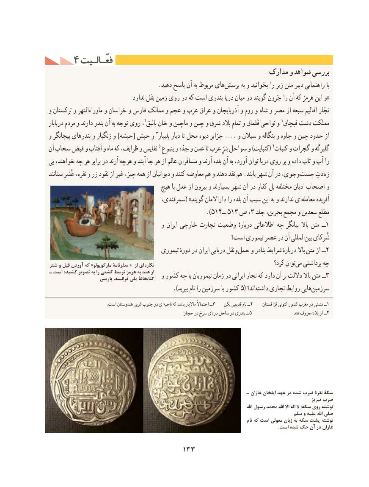

# PDF page 143

۴ فعّـالـیتفعّـالـیت
                                                          مدارک و شواهد بررسی
   .‌دهید پاسخ آن به مربوط هایپرسش به و بخوانید را زیر متن دبیر راهنمایی با
                           .ندارد بَدَل زمین روی در كه است بندری دریا میان در گویند جَرون را آن كه هرمز این و«
و تركستان و ماوراءالنهر و خراسان و فارس ممالک و عجم و عرب عراق و آذربایجان و روم و شام و مصر از سبعه اقالیم تجّار
دریابار مردم و دارند بندر آن به توجه روی ،2بالیق خان و ماچین و چین و شرق بالد تمام و قَلماق نواحی و 1قبچاق دشت مملكت
و بیجانگر بندرهای و زنگبار و ]حبشه[ حبش و 3بلیبار دیار تا محل دیوه جزایر .... و سیالن و بنگاله و جاوه و چین حدود از
آن سحاب فیض و آفتاب و ماه كه ظرایف، و نفایس 5 ینبوع و جدّه و عدن تا عرب بَـرِّ سواحل و )كنبایت( 4كنبات و گجرات و گلبرگه
بی خواهند، چه هر برابر در آرند هرچه و آیند جا هر از عالم مسافران و آرند بلده آن به آورد، توان دریا روی بر و داده تاب و آب را
ستانند عُشر نقره، و زر نقود از غیر چیز، همه از دیوانیان و كنند معاوضه هم و دهند نقد هم .یابند شهر آن در جوی، و جست زیادتِ
                                      هیچ با عدل از بیرون و بسیارند شهر آن در كفار بل مختلفه ادیان اصحاب و
                                     سمرقندی،( »گویند داراالمان را بلده آن سبب این به و ندارند ایمعامله‌      آفریده
                                                 ).514ــ 513 ص ،3 جلد بحرین، مجمع و سعدین مطلع‌
                                      و ایران خارجی تجارت وضعیت دربارهٔ اطالعاتی چه بیانگر باال متن ــ1
                                                      است؟ تیموری عصر در آن المللیبین‌   شُركای
                                      تیموری دورهٔ در ایران دریایی نقل و حمل و بنادر شرایط دربارهٔ باال متن از ــ2
شتر و فیل آوردن که »مارکوپولو سفرنامة «  از ای  نگاره                                              كرد؟ توانمی‌  برداشتی چه
ـ است کشیده تصویر به را                 کشتی                       توسط هرمز                                               به                                     هند از  و كشور چه با تیموریان زمان در ایرانی تجار كه دارد آن بر داللت باال متن ــ3                    پاریس                               فرانسه،                                ملی                                              کتابخانة
                                                   .)ببرید نام را سرزمین یا كشور 5( اند؟داشته‌    تجاری روابط هاییسرزمین‌
  .‌است هندوستان غربی جنوب در ایناحیه كه باشد ماالبار احتماالً ــ 3    پكن قدیمی نام ــ2     قزاقستان كنونی كشور مغرب در دشتی ــ1
                                                        حجاز در سرخ دریای ساحل در بندری ــ 5                      هند معروف بالد از ــ4

                                                                            ـ غازان ايلخان عهد در شده ضرب نقرۀ سکة
                                                                                                                                 تبریز ضرب
                                                                                                                                            اهلل رسول محمد اهلل اال اله ال :سکه روی نوشته
                                                                                        سلم و علیه اهلل صلی
                                                                                                               نام که است مغولی زبان به سکه پشت نوشته
                                                                                                                                                                                                        .است شده حک آن در غازان

                                  133

