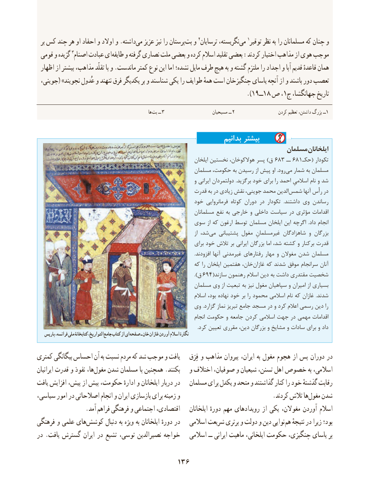

# PDF page 146

بر کس چند هر او احفاد و اوالد و .داشتهمی‌   عزیز نیز را پرستانبت‌  و 2ترسایان نگریسته،می‌   1توقیر نظر به را مسلمانان که چنان و
 قومی و گزیده 3اصنام عبادت ایطایفه‌    و گرفته نصاری ملت بعضی و کرده اسالم تقلید بعضی :کردند اختیار مذاهب از هوی موجب
 اظهار از بیشتر مذاهب، تقلّد با و .ماندست کمتر نوع این اما نشده؛ مایل طرف هیچ به و گشته ملتزم را اجداد و آبا قدیم قاعدهٔ همان
 جوینی،( »نجویند عُدول و ننهند فرق یکدیگر بر و شناسند یکی را طوایف همهٔ است چنگیزخان یاسای آنچه از و باشند دور تعصب
                                                                                   ). 19ــ18 ص ، 1ج جهانگشا، تاریخ

                                                                 ها بت ــ 3                      مسیحیان ــ 2                    کردن تعظیم داشتن، بزرگ ــ1

                                                                بدانیم بیشتر
                                                                        مسلمان ایلخانان
                                                                    ایلخان نخستین هوالکوخان، پسر )ق    683 ــ 681 حکـ( تکودار
                                                        مسلمان حکومت، به رسیدن از پیش او .رود‌می شمار به مسلمان
                                                                    و ایرانی دولتمردان .برگزید خود برای را احمد اسالمیِ نام و شد
                                                   قدرت به در زیادی نقش جوینی، محمد الدین‌شمس آنها رأس در
                                                    خود فرمانروایی کوتاه دوران در تکودار  .داشتند وی رساندن
                                                                مسلمانان نفع به خارجی و داخلی سیاست در مؤثری اقدامات
                                           سوی از که ارغون توسط مسلمان ایلخان این اگرچه  .داد انجام
                                                                                               از شد، ‌می پشتیبانی مغول غیرمسلمانِ شاهزادگان و بزرگان
                                                                  برای خود تالش بر ایرانی بزرگان اما شد، کشته و برکنار قدرت
                                                                                                                                      .افزودند آنها غیرمدنی رفتارهای مهار و مغوالن شدن مسلمان
                                                        که را ایلخان هفتمین خان، ‌غازان که شدند موفق سرانجام آنان
                                                                                                   ).ق   694(سازند رهنمون اسالم دین به داشت مقتدری شخصیت
                                                        مسلمان وی از تبعیت به نیز مغول سپاهیان و امیران از بسیاری
                                                                   اسالم بود، نهاده خود بر را محمود اسالمی نام که غازان  .شدند
                                             وی .گزارد نماز تبریز جامع مسجد در و کرد اعالم رسمی دین را
                                                                          انجام حکومت و جامعه کردن اسالمی جهت در مهمی اقدامات
                                                                                                                                         .کرد تعیین مقرری دین، بزرگان و مشایخ و سادات برای و داد
    پاریس فرانسه، ملی کتابخانۀ التواریخ، جامع کتاب از ای صفحه ـ خان غازان آوردن اسالم نگارۀ

کمتری بیگانگی احساس آن به نسبت مردم که شد موجب و یافت     فِرَق و مذاهب پیروان ایران، به مغول هجوم از پس دوران در
ایرانیان قدرت و نفوذ ها،مغول‌   شدن مسلمان با همچنین .بکنند   و اختالف صوفیان، و شیعیان تسنن، اهل خصوص به اسالمی،
یافت افزایش پیش، از بیش حکومت، ادارهٔ و ایلخانان دربار در   مسلمان برای یکدل و متحد و گذاشتند کنار را خود گذشتهٔ رقابت
سیاسی، امور در اصالحاتی انجام و ایران بازسازی برای زمینه و     .‌کردند تالش هامغول شدن
                .آمد فراهم فرهنگی و اجتماعی اقتصادی،    ایلخانان دورهٔ مهم رویدادهای از یکی مغوالن، آوردن اسالم
فرهنگی و علمی هایکوشش‌        دنبال به ویژه به ایلخانان دورهٔ در   اسالمی شریعت برتری و دولت و دین نوایی هم نتیجهٔ در زیرا بود؛
در .یافت گسترش ایران در تشیع توسی، نصیرالدین خواجه   اسالمی ــ ایرانی ماهیت ایلخانی، حکومت چنگیزی، یاسای بر

                                    136

