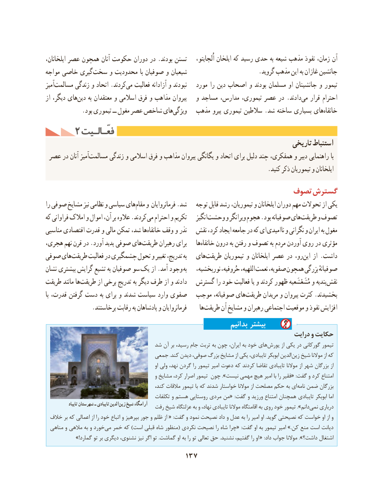

# PDF page 147

ایلخانان، عصر همچون آنان حکومت دوران در .بودند تسنن ،آناُلجایتو ایلخان که رسید حدی به شیعه مذهب نفوذ زمان،
مواجه خاصی گیری سخت و محدودیت با صوفیان و شیعیان                        .گروید مذهب این به غازان جانشین
آمیزمسالمت‌       زندگی و اتحاد .کردندمی‌   فعالیت آزادانه و نبودند   مورد را دین اصحاب و بودند مسلمان او جانشینان و تیمور
از دیگر، هایدین‌     به معتقدان و اسالمی فرق و مذاهب پیروان   و مساجد مدارس، تیموری، عصر در .دادندمی‌   قرار احترام
 .‌بود تیموری ــ مغول عصر شاخص هایویژگی   مذهب پیرو تیموری سالطین .شد ساخته بسیاری هایخانقاه‌
     2 فعّـالـیتفعّـالـیت
                                                                             تاریخی استنباط
 عصر در آنان آمیزمسالمت‌       زندگی و اسالمی فرق و مذاهب پیروان یگانگی و اتحاد برای دلیل چند همفکری، و دبیر راهنمایی با
                                                                          .کنید ذکر تیموریان و ایلخانان
                                                    تصوف گسترش
را صوفی مشایخ نیز نظامی و سیاسی هایمقام‌   و فرمانروایان .شد   توجه قابل رشد تیموریان، و ایلخانان دوران مهم تحوالت از یکی
که فراوانی امالک و اموال آن، بر عالوه .کردند می احترام و تکریم    انگیزوحشت‌      و ویرانگر هجوم .بود صوفیانه هایطریقت‌     و تصوف
مناسبی اقتصادی قدرت و مالی تمکن شد، هاخانقاه‌    وقف و نذر   نقش کرد، ایجاد جامعه در که ای ناامیدی و نگرانی و ایران به مغول
هجری، نهم قرن در .آورد پدید صوفی هایطریقت‌      رهبران برای    هاخانقاه‌    درون به رفتن و تصوف به مردم آوردن روی در مؤثری
صوفی هایطریقت‌      فعالیت در چشمگیری تحول و تغییر تدریج، به   هایطریقت‌       تیموریان و ایلخانان عصر در رو،این‌   از .داشت
نشان بیشتری گرایش تشیع به صوفیان سو‌ یک از .آمد وجود به   نوربخشیه، حُروفیه، اللهیه، نعمت صفویه، همچون بزرگی صوفیانهٔ
طریقت مانند هاطریقت‌       از برخی تدریج به دیگر طرف از و دادند  گسترش را خود فعالیت یا و کردند ظهور مُشَعْشَعیه و بندیه نقش
با قدرت، گرفتن دست به برای و شدند سیاست وارد صفوی  موجب صوفیانه، هایطریقت‌      مریدان و پیروان کثرت .بخشیدند
               .برخاستند رقابت به پادشاهان و فرمانروایان     هاطریقت‌      آن مشایخ و رهبران اجتماعی موقعیت و نفوذ افزایش
                                                                بدانیم بیشتر
                                                                               درایت و حکایت
                               شد آن بر رسید، جام تربت به چون ایران، به خود هاییورش‌        از یکی در گورکانی تیمور
                                جمعی .کند دیدن صوفی، بزرگ مشایخ از یکی تایبادی، ابوبکر الدینزین‌  شیخ موالنا از که
                                                                   او ولی نهد، گردن را تیمور امیر دعوت که کردند تقاضا تایبادی موالنا از شهر بزرگان از
                                                و مشایخ کرد، اصرار تیمور چون ».نیست مهمی هیچ امیر با را فقیر« :گفت و کرد امتناع
                                              کند، مالقات تیمور با که شدند خواستار موالنا از مصلحت حکم به اینامه‌  ضمن بزرگان
                                            تکلفات و هستم روستایی مردی من«  :گفت و ورزید امتناع همچنان تایبادی ابوبکر اما
                تايباد شهرستان ـ تايبادی الدينزين‌   شيخ آرامگاه                                    رفت شیخ عزلتگاه به و نهاد، تایبادی موالنا اقامتگاه به روی خود تیمور ».دانمنمی‌   درباری
 خالف بر که اعمالی از را خود اتباع و بپرهیز جور و ظلم از « :گفت و نمود نصیحت داد و عدل به را امیر او .گوید نصیحتی که خواست او از و
  مناهی و مالهی به و خوردمی‌  خمر که )است قبلی شاه منظور( نکردی نصیحت را شاه چرا« :گفت او به تیمور امیر .»کن منع است دیانت
               !»گمارد تو بر دیگری نشنوی، نیز اگر تو .گماشت او به را تو تعالی حق .نشنید گفتیم، را او « :داد جواب موالنا ».داشت؟ اشتغال
                                   137

