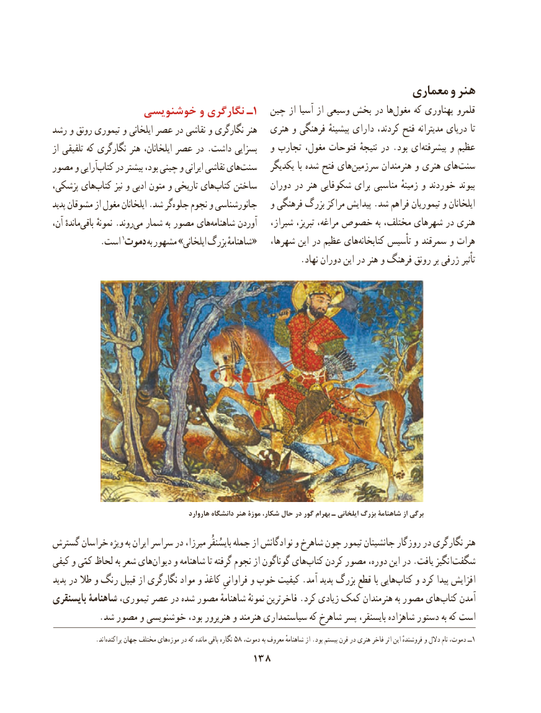

# PDF page 148

معماری و هنر
              خوشنویسی و نگارگری ـ1   چین از آسیا از وسیعی بخش در ها‌مغول که پهناوری قلمرو
رشد و رونق تیموری و ایلخانی عصر در نقاشی و نگارگری هنر   هنری و فرهنگی پیشینهٔ دارای کردند، فتح مدیترانه دریای تا
از تلفیقی که نگارگری هنر ایلخانان، عصر در .داشت بسزایی   و تجارب مغول، فتوحات نتیجهٔ در .بود ای ‌پیشرفته و عظیم
مصور و آراییکتاب‌    در بیشتر بود، چینی و ایرانی نقاشی هایسنت‌       یکدیگر با شده فتح های ‌سرزمین هنرمندان و هنری های‌سنت
پزشکی، هایکتاب‌      نیز و ادبی متون و تاریخی هایکتاب‌    ساختن   دوران در هنر شکوفایی برای مناسبی زمینهٔ و خوردند پیوند
پدید مشوقان از مغول ایلخانان .شد گرجلوه‌    نجوم و جانورشناسی   و فرهنگی بزرگ مراکز پیدایش .شد فراهم تیموریان و ایلخانان
آن، ماندهٔباقی‌     نمونهٔ .روندمی‌  شمار به مصور هایشاهنامه‌      آوردن   شیراز، تبریز، مراغه، خصوص به مختلف، شهرهای در هنری
 .1«است دموت به مشهور »ایلخانی بزرگ شاهنامهٔ    شهرها، این در عظیم های‌کتابخانه تأسیس و سمرقند و هرات
                                                         .نهاد دوران این در هنر و فرهنگ رونق بر ژرفی تأثیر

                                              هاروارد دانشگاه هنر موزۀ شكار، حال در گور بهرام ـ ایلخانی بزرگ شاهنامة از برگي
گسترش خراسان ویژه به ایران سراسر در میرزا، بایسُنقُر جمله از نوادگانش و شاهرخ چون تیمور جانشینان روزگار در نگارگری هنر
کیفی و کمّی لحاظ به شعر های ‌دیوان و شاهنامه تا گرفته نجوم از گوناگون های‌کتاب کردن مصور دوره، این در .یافت انگیز ‌شگفت
پدید در طال و رنگ قبیل از نگارگری مواد و کاغذ فراوانیِ و خوب کیفیت .آمد پدید بزرگ قطع با هایی‌کتاب و کرد پیدا افزایش
بایسنقری شاهنامۀ تیموری، عصر در شده مصور شاهنامهٔ نمونهٔ فاخرترین .کرد زیادی کمک هنرمندان به مصور های‌کتاب آمدن
           .شد مصور و خوشنویسی بود، هنرپرور و هنرمند سیاستمداری که شاهرخ پسر بایسنقر، شاهزاده دستور به که است
              .اند‌پراکنده جهان مختلف هایموزه‌    در که مانده باقی نگاره 58 ،ــدموت به معروف شاهنامهٔ از .بود بیستم قرن در هنری فاخر اثر این فروشندهٔ و دالل نام دموت، 1
                                  138

