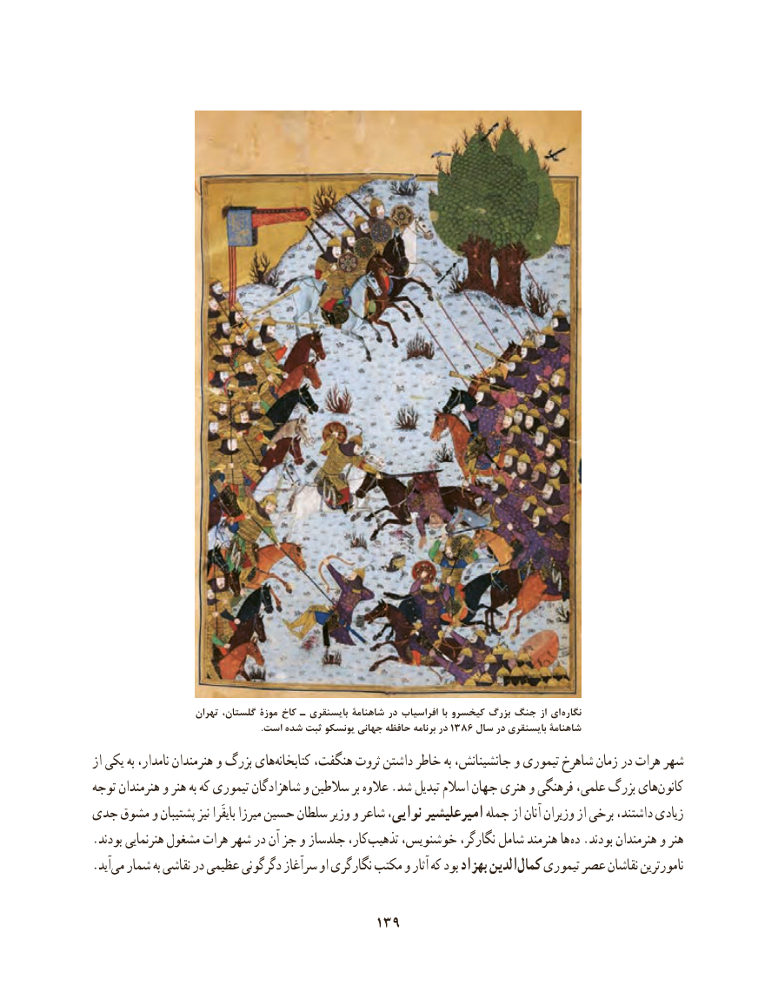

# PDF page 149

تهران گلستان، موزۀ کاخ ـ بایسنقری شاهنامۀ در افراسیاب با کیخسرو بزرگ جنگ از ای  نگاره
    .1386است شده ثبت یونسکو جهانی حافظه برنامه در     سال در بایسنقری شاهنامۀ
از یکی به نامدار، هنرمندان و بزرگ هایکتابخانه‌      هنگفت، ثروت داشتن خاطر به جانشینانش، و تیموری شاهرخ زمان در هرات شهر
توجه هنرمندان و هنر به که تیموری شاهزادگان و سالطین بر عالوه .شد تبدیل اسالم جهان هنری و فرهنگی علمی، بزرگ هایکانون‌
جدی مشوق و پشتیبان نیز بایقَرا میرزا حسین سلطان وزیر و شاعر نوایی، امیرعلیشیر جمله از آنان وزیران از برخی داشتند، زیادی
.بودند هنرنمایی مشغول هرات شهر در آن جز و جلدساز کار،تذهیب‌    خوشنویس، نگارگر، شامل هنرمند ها ده .بودند هنرمندان و هنر
.‌آیدمی شمار به نقاشی در عظیمی دگرگونی سرآغاز او نگارگری مکتب و آثار که بود بهزاد الدینکمال‌    تیموری عصر نقاشان نامورترین

                                     139

