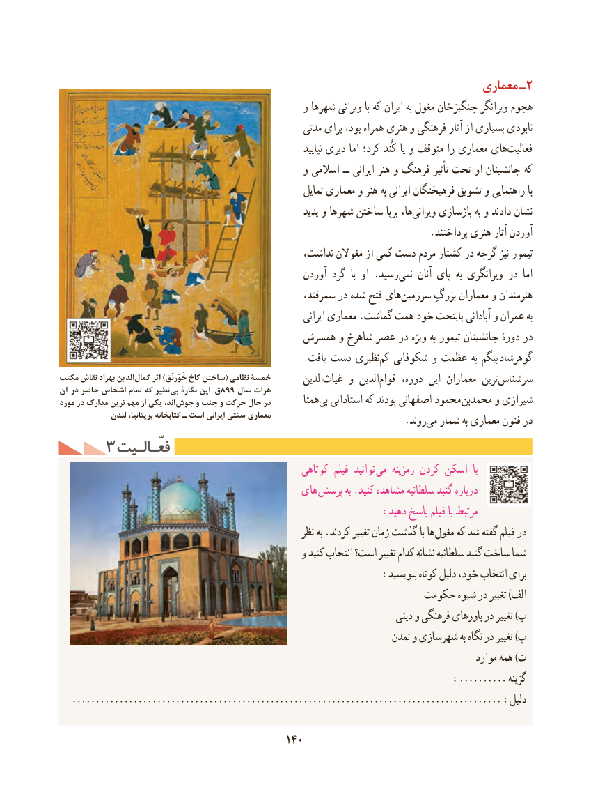

# PDF page 150

معماری ـ2
                                                  و شهرها ویرانی با که ایران به مغول چنگیزخان ویرانگر هجوم
                                                     مدتی برای بود، همراه هنری و فرهنگی آثار از بسیاری نابودی
                                                                              نپایید دیری اما کرد؛ کُند یا و متوقف را معماری های ‌فعالیت
                                                  و اسالمی ــ ایرانی هنر و فرهنگ تأثیر تحت او جانشینان که
                                                             تمایل معماری و هنر به ایرانی فرهیختگان تشویق و راهنمایی با
                                                                پدید و شهرها ساختن برپا ها،ویرانی‌     بازسازی به و دادند نشان
                                                                            .پرداختند هنری آثار آوردن
                                                 نداشت، مغوالن از کمی دست مردم کشتار در گرچه نیز تیمور
                                                    آوردن گرد  با او .رسیدنمی‌     آنان پای  به ویرانگری در  اما
                                                      سمرقند، در شده فتح های‌سرزمین بزرگِ معماران و هنرمندان
                                                                    ایرانی معماری .گماشت همت خود پایتخت آبادانی و عمران به
                                      همسرش و شاهرخ عصر در ویژه به تیمور جانشینان دورهٔ در
                                                  .یافت دست نظیری‌کم شکوفایی و عظمت به بیگم گوهرشاد
مكتب نقاش بهزاد الدين  كمال اثر )خَوَرنَق كاخ ساختن( نظامي خمسۀ                                                              الدین‌غیاث و الدین‌قوام دوره، این معماران ترینسرشناس‌آن در حاضر اشخاص تمام که نظیر بی نگارة این .ق899 سال هرات
مورد در مدارک ترین مهم از یکی ،اند جوش و جنب و حرکت حال در        همتابی‌  استادانی که بودند اصفهانی محمود  محمدبن و شیرازی
             لندن بریتانیا، کتابخانه ـ است ایرانی سنتی معماری           .‌روندمی شمار به معماری فنون در
     3 فعّـالـیتفعّـالـیت
                                                      کوتاهی فیلم  توانید  می رمزینه کردن اسکن  با
                                             های  پرسش به .کنید مشاهده سلطانیه گنبد درباره
                                                     :دهید پاسخ فیلم با مرتبط
                                                          نظر به .کردند تغییر زمان گذشت با ها مغول که شد گفته فیلم در
                                                  و کنید انتخاب است؟ تغییر کدام نشانه سلطانیه گنبد ساخت شما
                                                     :بنویسید کوتاه دلیل خود، انتخاب برای
                                                         حکومت شیوه در تغییر )الف
                                                                                دینی و فرهنگی باورهای در تغییر )ب
                                                                        تمدن و شهرسازی به نگاه در تغییر )پ
                                                                                                 موارد همه )ت
                                                                                 ..........: گزینه
   ........................................................................................... :دلیل

                                          140

