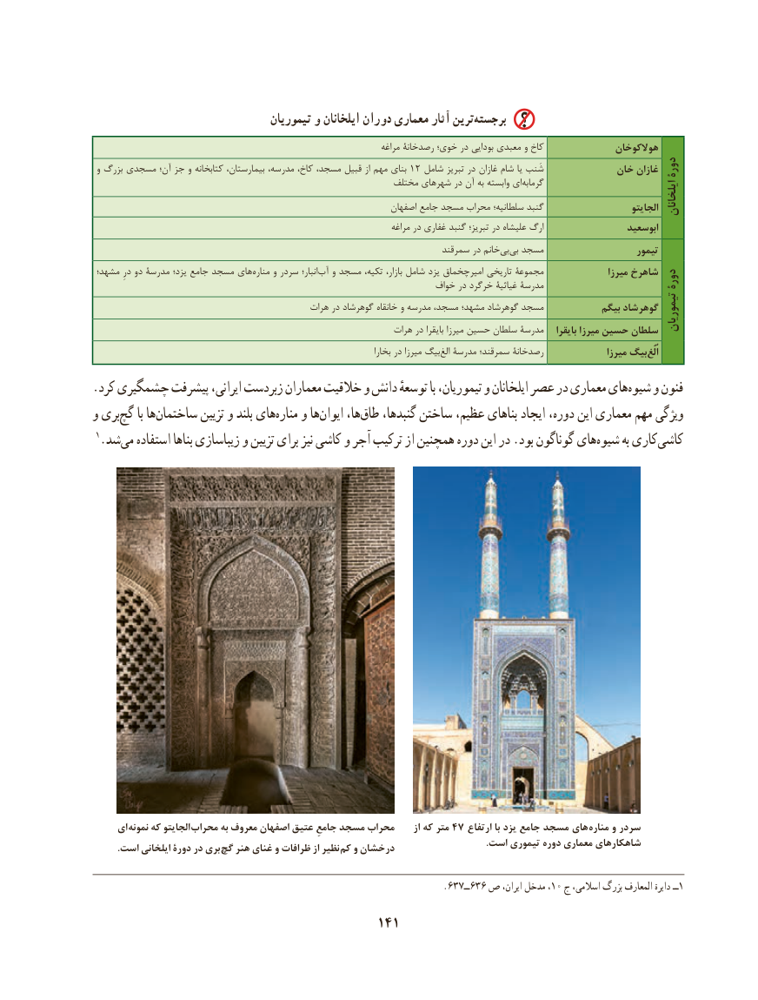

# PDF page 151

تیموریان و ایلخانان دوران معماری آثار ترین‌برجسته
                                                                            مراغه رصدخانة خوی؛ در بودایی معبدی و کاخ               هوالکوخان
 و بزرگ مسجدی آن؛ جز و کتابخانه ،کاخ،بیمارستان مدرسه،         ،مسجد قبیل از مهم بنای 12 شامل تبریز در غازان شام یا شَنب             خان غازان دورة
                                                            مختلف شهرهای در آن به وابسته ای‌گرمابه
                                                                     اصفهان جامع مسجد محراب سلطانیه؛ گنبد                       الجایتو ایلخانان
                                                                               مراغه در غفاری گنبد تبریز؛ در علیشاه ارگ                  ابوسعید
                                                                           سمرقند در خانم‌بیبی‌  مسجد                     تیمور
 مشهد؛ درِ دو مدرسة یزد؛ جامع مسجد های‌مناره و سردر انبار؛ ‌آب و مسجد تکیه، بازار، شامل یزد امیرچخماق تاریخی مجموعة                میرزا شاهرخ                                                                                                    دورة                                                                     خواف در خرگرد غیاثیة مدرسة
                                              هرات در گوهرشاد خانقاه و مدرسه مسجد، مشهد؛ گوهرشاد مسجد            بیگم گوهرشاد                                                                                                                                                                                                         تیموریان                                                                هرات در بایقرا میرزا حسین سلطان مدرسة    بایقرا میرزا حسین سلطان
                                                                                     بخارا در میرزا بیگ‌الغ مدرسة سمرقند؛ رصدخانة                میرزا بیگ‌اُلُغ
.کرد چشمگیری پیشرفت ایرانی، زبردست معماران خالقیت و دانش توسعهٔ با تیموریان، و ایلخانان عصر در معماری هایه‌ شیو‌   و فنون
و بریگچ‌    با هاساختمان‌         تزیین و بلند هایمناره‌    و هاایوان‌     ها،طاق‌    گنبدها، ساختن عظیم، بناهای ایجاد دوره، این معماری مهم ویژگی
 1.شدمی‌   استفاده بناها زیباسازی و تزیین برای نیز کاشی و آجر ترکیب از همچنین دوره این در .بود گوناگون هایشیوه‌      به کاریکاشی‌

     ای نمونه که الجایتو محراب به معروف اصفهان عتیق جامعِ مسجد محراب      از که متر 47 ارتفاع با یزد جامع مسجد های مناره و سردر
                                                                                                                                                                       .است تیموری دوره معماری شاهکارهای. است ایلخانی دورة در بری گچ هنر غنای و ظرافات از نظیر  کم و درخشان

                                                                   .637ــ636 ص ایران، مدخل ،10 ج اسالمی، بزرگ المعارف ‌دایرة ــ1
                                          141

