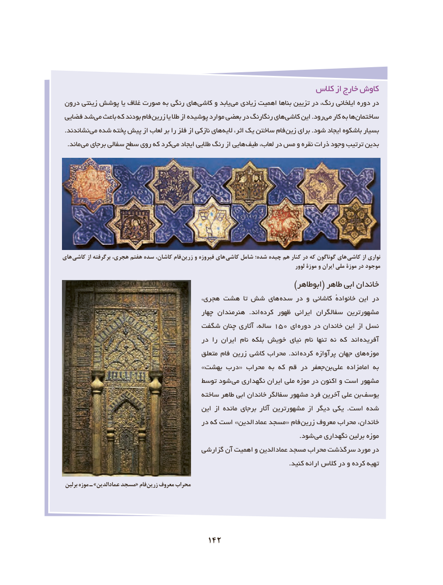

# PDF page 152

كالس از خارج كاوش
 درون زینتی پوشش یا غالف صورت به رنگی های کاشی و یابد می زیادی اهمیت بناها تزیین در ،رنگ ایلخانی دوره در
 فضایی شد می باعث که بودند فام زرین یا طال از پوشیده موارد بعضی در رنگارنگ های کاشی این .رود می کار به ها ساختمان
 .نشاندند می شده پخته پیش از لعاب بر را فلز از نازکی های الیه ،اثر یک ساختن فام زین برای .شود ایجاد باشکوه بسیار
 . ماند می برجای سفالی سطح روی که کرد می ایجاد طالیی رنگ از هایی طیف ،لعاب در مس و نقره ذرات وجود ترتیب بدین

های کاشی از برگرفته هجری، هفتم سده کاشان، فام زرین و فیروزه های  کاشی شامل شده؛ چیده هم کنار در که گوناگون های کاشی از نواری
                                                                                                  لوور موزۀ و ایران ملی موزۀ در موجود
                                                                        )ابوطاهر( طاهر ابی خاندان
                                      ،هجری هشت  تا شش های سده در و کاشانی ٔخانواده این در
                                               چهار هنرمندان  .اند  کرده ظهور ایرانی سفالگران مشهورترین
                              شگفت چنان آثاری ،ساله 150 ای دوره در خاندان این از نسل
                                        در را ایران نام بلکه خویش نیای نام  تنها نه که اند آفریده
                                           متعلق فام زرین کاشی محراب .اند  کرده پرآوازه جهان های موزه
                                        »بهشت درب« محراب به که قم در جعفر بن  علی امامزاده به
                                     توسط شود  می نگهداری ایران ملی موزه در اکنون و است مشهور
                                        ساخته طاهر ابی خاندان سفالگر مشهور فرد آخرین علی بن  یوسف
                                           این از مانده برجای آثار مشهورترین از دیگر یکی .است شده
                                        در که است »الدین  عماد مسجد« فام زرین معروف محراب ،خاندان
                             . شود می نگهداری برلین موزه
                                      گزارشی آن اهمیت و عمادالدین مسجد محراب سرگذشت مورد در
                                                                                                            .کنید ارائه کالس در و کرده تهیه

 برلین موزه ـ »الدین عماد مسجد« فام زرین معروف محراب

                                 142

