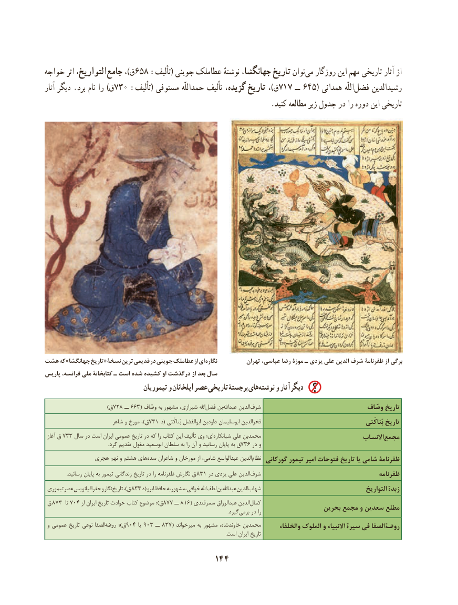

# PDF page 154

خواجه اثر التواریخ،‌جامع ،)ق658 :تألیف( جوینی عطاملک نوشتهٔ جهانگشا، تاریخ توان‌می روزگار این مهم تاریخی آثار از
آثار دیگر .برد نام را )ق730 :تألیف( مستوفی حمداللّه تألیف گزیده، تاریخ ،)ق717 ــ 645( همدانی اللّه‌فضل رشیدالدین
                                                              .کنید مطالعه زیر جدول در را دوره این تاریخی

هشت که »جهانگشا تاریخ « نسخة ترین  قدیمی در جوینی عطاملک از ای نگاره          تهران عباسی، رضا موزۀ ـ يزدی علی الدين شرف ظفرنامۀ از برگی
پاریس فرانسه، ملی کتابخانۀ ـ است شده کشیده او درگذشت از بعد سال
                                 تیموریان و ایلخانان عصر تاریخی برجستۀ هاینوشته‌    و دیگرآثار
                )728ق     ــ 663( وصّاف به مشهور شیرازی، اهلل‌فضل بن‌عبداهلل الدین‌شرف                                 وصّاف تاریخ
                          شاعر و مورخ ،)ق 731 د( بَناکَتی ابوالفضل داودبن ابوسلیمان فخرالدین                                               بَناکَتی تاریخ
 آغاز ق 733 سال در است ایران عمومی تاریخ در که را کتاب این تألیف وی ای؛ ‌شبانکاره علی محمدبن                                  االنساب‌مجمع
                                                       .کرد تقدیم مغول ابوسعید سلطان به را آن و رسانید پایان به ق 736 در و
              هجری نهم و هشتم های‌سده شاعران و مورخان از شامی، عبدالواسع الدین‌نظام گورکانی تیمور امیر فتوحات تاریخ یا شامی ظفرنامة
 . 831رسانید پایان به تیمور زندگانی تاریخ در را ظفرنامه نگارش ق     در یزدی علی الدین‌شرف                                        ظفرنامه
 تیموری عصر جغرافیانویس و نگارتاریخ‌       ،)ق 833 د( ابرو حافظ به مشهور خوافی، اهلللطف‌   بنعبداهلل‌     الدین شهاب‌                                            التواریخ ‌ زبدة
 ق 873  تا 704 از ایران تاریخ حوادث کتاب موضوع ؛)ق877 ــ 816( سمرقندی عبدالرزاق الدین‌کمال                  بحرین مجمع و سعدین مطلع                                                                                                                                                              .گیردبرمی‌    در را
 و عمومی تاریخ نوعی الصفا‌روضة ؛)ق904 یا 903 ــ 837( میرخواند به مشهور خاوندشاه، محمدبن       والخلفاء الملوک و االنبیاء‌سیرة فی الصفا  روضة
                                                                                                                                                            .است ایران تاریخ

                                     144

