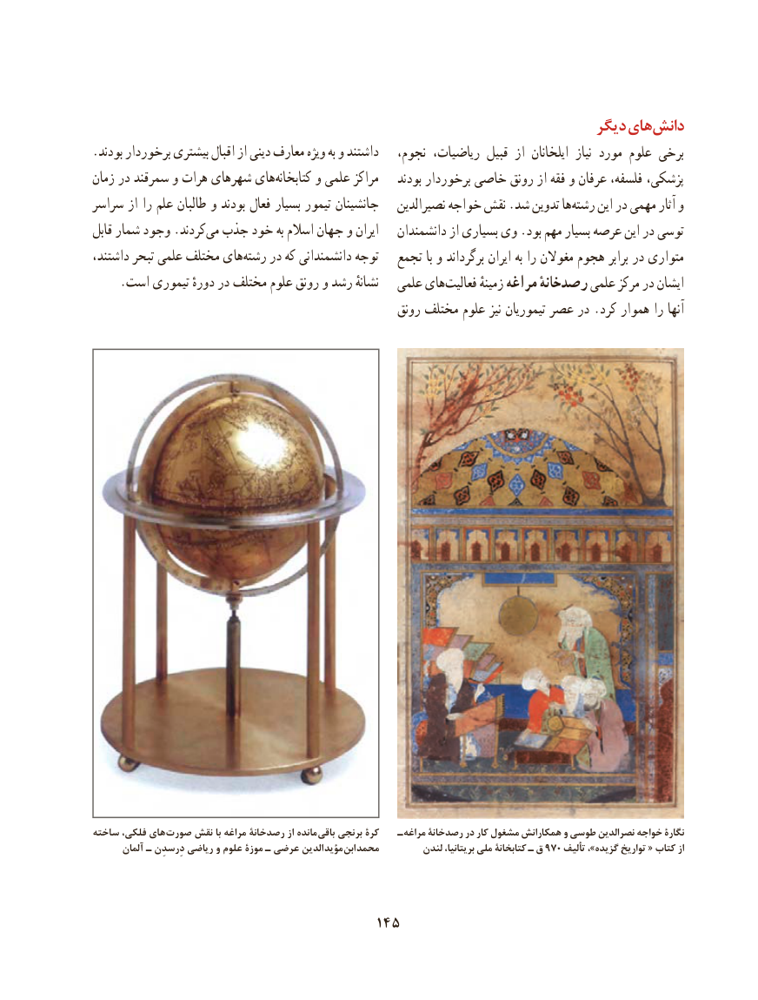

# PDF page 155

دیگر هایدانش‌
.بودند برخوردار بیشتری اقبال از دینی معارف ویژه به و داشتند   نجوم، ریاضیات، قبیل از ایلخانان  نیاز مورد علوم برخی
زمان در سمرقند و هرات شهرهای های ‌کتابخانه و علمی مراکز    بودند برخوردار خاصی رونق از فقه و عرفان فلسفه، پزشکی،
سراسر از را علم طالبان و بودند فعال بسیار تیمور جانشینان   نصیرالدین خواجه نقش .شد تدوین هارشته‌     این در مهمی آثار و
قابل شمار وجود .کردند‌می جذب خود به اسالم جهان و ایران   دانشمندان از بسیاری وی .بود مهم بسیار عرصه این در توسی
داشتند، تبحر علمی مختلف های‌رشته در که دانشمندانی توجه   تجمع با و برگرداند ایران به را مغوالن هجوم برابر در متواری
     .است تیموری دورهٔ در مختلف علوم رونق و رشد نشانهٔ   علمی های ‌فعالیت زمینهٔ مراغه رصدخانهٔ علمی مرکز در ایشان
                                                     رونق مختلف علوم نیز تیموریان عصر در .کرد هموار را آنها

ساخته فلکی، های صورت نقش با مراغه رصدخانة از مانده باقی برنجی کرة   ـ مراغه رصدخانة در کار مشغول همکارانش و طوسی نصرالدین خواجه نگارة
       آلمان ـ دِرسدِن ریاضی و علوم موزة ـ عرضی الدین  مؤید ابن محمد         لندن بریتانیا، ملی کتابخانة ـ ق 970 تألیف ،»گزیده تواریخ « کتاب از

                                     145

