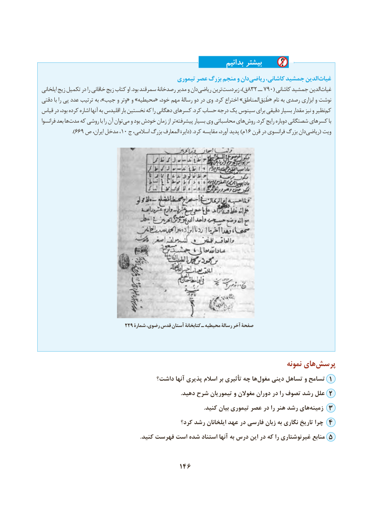

# PDF page 156

بدانیم بیشتر
                                             تیموری عصر بزرگ منجم و دانریاضی‌      کاشانی، جمشید الدینغیاث‌
ایلخانی زیج تکمیل در را خاقانی زیج کتاب او .بود سمرقند رصدخانۀ مدیر و دان ریاضی ترینزبردست‌           ،)ق 832 ــ 790( کاشانی جمشید الدینغیاث‌
دقتی با را پی عدد ترتیب به ،»جیب و وتر« و »محیطیه« خود، مهم رسالۀ دو در وی .کرد اختراع »المناطقطَبَق‌   « نام به رصدی ابزاری و نوشت
قیاس در بود، کرده اشاره آنها به اقلیدس بار نخستین که را دهگانی کسرهای .کرد حساب درجه یک سینوس برای دقیقی بسیار مقدار نیز و نظیر کم
فرانسوا بعد هامدت‌   که روشی با را آن توانمی‌  و بود خودش زمان از ترپیشرفته‌       بسیار وی محاسباتی هایروش‌        .کرد رایج دوباره شصتگانی کسرهای با
            ).669 ص ایران، مدخل ، 10 ج اسالمی، بزرگ المعارف ‌دایرة( .کرد مقایسه آورد، پدید )م 16 قرن در فرانسوی بزرگ دانریاضی‌      ( ویت

                              229 شمارۀ رضوی، قدس آستان کتابخانۀ ـ محیطیه رسالۀ آخر صفحۀ

                                                                                  نمونه های‌پرسش
                                 داشت؟ آنها پذیری اسالم بر تأثیری چه هامغول‌    دینی تساهل و تسامح 1
                                                                                                .دهید شرح تیموریان و مغوالن دوران در را تصوف رشد علل 2
                                                                                                                .کنید بیان تیموری عصر در را هنر رشد های ‌زمینه 3
                                               کرد؟ رشد ایلخانان عهد در فارسی زبان به نگاری تاریخ چرا 4
                                                                    .کنید فهرست است شده استناد آنها به درس این در که را غیرنوشتاری منابع 5

                                     146

