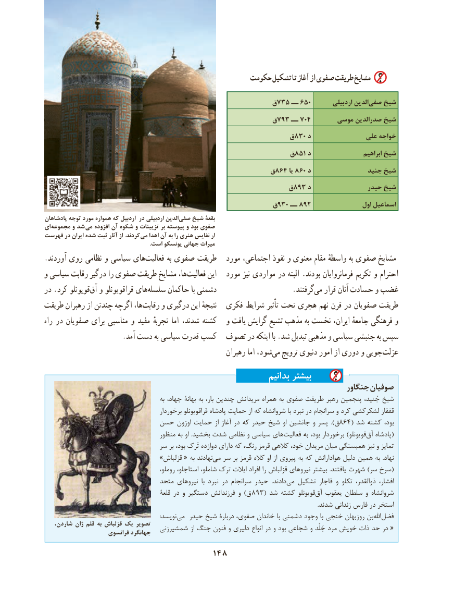

# PDF page 158

حکومت تشکیل تا آغاز از صفوی طریقت مشایخ

                                               ق735 ــ 650        اردبیلی الدین‌صفی شیخ
                                               ق793 ــ 704      موسی صدرالدین شیخ
                                                   ق830 د               علی خواجه
                                                   ق851 د                    ابراهیم شیخ
                                               ق864 یا 860 د                جنید شیخ
                                                   ق893 د                حیدر شیخ
                                                ق930 ــ 892                 اول اسماعیل
پادشاهان توجه مورد همواره که اردبيل در اردبيلی الدين‌صفی شيخ بقعة
ای  مجموعه و شد می افزوده آن شکوه و تزیینات بر پیوسته و بود صفوی
فهرست در ایران شده ثبت آثار از .کردند می اهدا آن به را هنری نفایس ار
                                                                          .است یونسکو جهانی میراث
.آوردند روی نظامی و سیاسی های‌فعالیت به صفوی طریقت   مورد اجتماعی، نفوذ و معنوی مقام واسطهٔ به صفوی مشایخ
و سیاسی رقابت درگیر را صفوی طریقت مشایخ ها،فعالیت‌      این   مورد نیز مواردی در البته .بودند فرمانروایان تکریم و احترام
در .کرد قویونلو ‌آق و قراقویونلو های‌سلسله حاکمان با دشمنی                     .گرفتند ‌می قرار آنان حسادت و غضب
طریقت رهبران از چندتن اگرچه ها،‌رقابت و درگیری این نتیجهٔ  فکری شرایط تأثیر تحت هجری نهم قرن در صفویان طریقت
راه در صفویان برای مناسبی و مفید تجربهٔ اما شدند، کشته   و یافت گرایش تشیع مذهب به نخست ایران، جامعهٔ فرهنگی و
                     .آمد دست به سیاسی قدرت کسب  تصوف در اینکه با .شد تبدیل مذهبی و سیاسی جنبشی به سپس
                                                        رهبران اما شود، ‌می ترویج دنیوی امور از دوری و جویی‌عزلت
                                                                بدانیم بیشتر
                                                                                جنگاور صوفیان
                                              به جهاد، بهانۀ به بار، چندین مریدانش همراه به صفوی طریقت رهبر پنجمین جُنید، شیخ
                                          برخوردار قراقویونلو پادشاه حمایت از که شروانشاه با نبرد در سرانجام و کرد لشکرکشی قفقاز
                        حسن اوزون حمایت از آغاز در که حیدر شیخ او جانشین و پسر ).ق864( شد کشته بود،
                                    منظور به او  .بخشید شدت نظامی و سیاسی های‌فعالیت به بود، برخوردار )قویونلو‌(آق پادشاه
                              سر بر بود، تَرک دوازده دارای که رنگ، قرمز کالهی خود، مریدان میان همبستگی نیز و تمایز
                                »قزلباش « به نهادند‌می سر بر قرمز کاله او از پیروی به که هوادارانش دلیل همین به  .نهاد
                                             روملو، استاجلو، شاملو، ترک ایالت افراد را قزلباش نیروهای بیشتر  .یافتند شهرت )سر سرخ(
                                متحد نیروهای  با نبرد در سرانجام حیدر  .دادند‌می تشکیل قاجار و تکلو ذوالقدر، افشار،
                                           قلعۀ در و دستگیر فرزندانش و )ق  893( شد کشته قویونلو‌آق یعقوب سلطان و شروانشاه
                                                                                                                                                                                                   .شدند زندانی فارس در استخر
                                                                                  :نویسد ‌می حیدر شیخ دربارۀ صفوی، خاندان با دشمنی وجود با خنجی روزبهان بن  اهلل فضل
،یکشاردن ژان قلم به قزلباش     تصویر                                شمشیرزنی از جنگ فنون و دلیری انواع در و بود شجاعی و جَلدۡ مرد خویش ذات حد در «                     فرانسوی جهانگرد
                                    148

