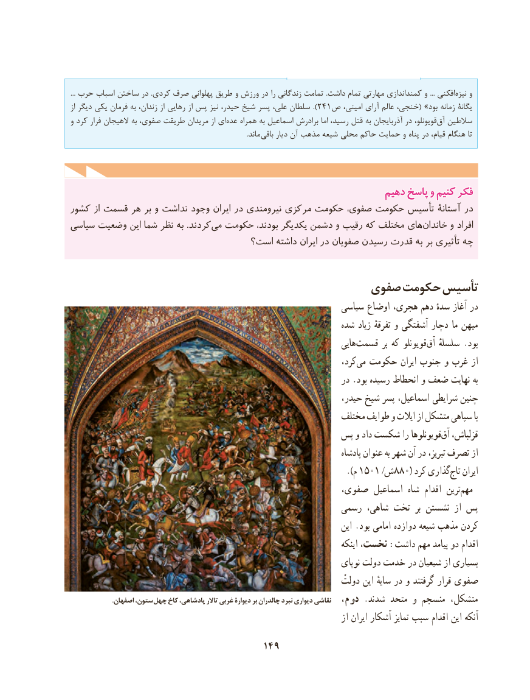

# PDF page 159

... حرب اسباب ساختن در .کردی صرف پهلوانی طریق و ورزش در را زندگانی تمامت  .داشت تمام مهارتی کمنداندازی و ... افکنی ‌نیزه و
از دیگر یکی فرمان به زندان، از رهایی از پس نیز حیدر، شیخ پسر علی، سلطان ).241ص امینی، آرای عالم خنجی،( »بود زمانه یگانۀ
و کرد فرار الهیجان به صفوی، طریقت مریدان از ای‌عده همراه به اسماعیل برادرش اما رسید، قتل به آذربایجان در قویونلو، ‌آق سالطین
                      . ماند باقی دیار آن مذهب شیعه محلی حاکم حمایت و پناه در قیام، هنگام تا

                                                             دهیمدهیم پاسخپاسخ وو کنیمکنیم فکرفکر
کشور از قسمت هر بر و نداشت وجود ایران در نیرومندی مرکزی حکومت صفوی، حکومت تأسیس آستانۀ در
سیاسی وضعیت این شما نظر به .کردندمی‌  حکومت بودند، یکدیگر دشمن و رقیب که مختلف هایخاندان‌      و افراد
                               است؟ داشته ایران در صفویان رسیدن قدرت به بر تأثیری چه

                                       صفوی حکومت تأسیس
                                                            سیاسی اوضاع هجری، دهم سدهٔ آغاز در
                                                              شده زیاد تفرقهٔ و آشفتگی دچار ما میهن
                                                                           هایی قسمت بر که قویونلو آق سلسلهٔ .بود
                                                                         کرد، می حکومت ایران جنوب و غرب از
                                                                  در .بود رسیده انحطاط و ضعف نهایت به
                                                                 حیدر، شیخ پسر اسماعیل، شرایطی چنین
                                                         مختلف طوایف و ایالت از متشکل سپاهی با
                                              پس و داد شکست را قویونلوهاآق‌  قزلباش،
                                                                                   پادشاه عنوان به شهر آن در تبریز، تصرف از
                                                 ).1501م         /ش880( کرد گذاریتاج‌   ایران
                                                   صفوی، اسماعیل شاه  اقدام  ترین‌مهم
                                                     رسمی شاهی، تخت  بر نشستن از پس
                                                                             این .بود امامی دوازده شیعه مذهب کردن
                                                                                   اینکه نخست، :داشت مهم پیامد دو اقدام
                                                                         نوپای دولت خدمت در شیعیان از بسیاری
                                                                          دولتْ این سایهٔ در و گرفتند قرار صفوی
                         .اصفهان ستون، چهل کاخ پادشاهی، تاالر غربی دیوارۀ بر چالدران نبرد دیواری نقاشی  دوم، .شدند متحد و منسجم متشکل،
                                                                               از ایران آشکار تمایز سبب اقدام این آنکه
                                     149

