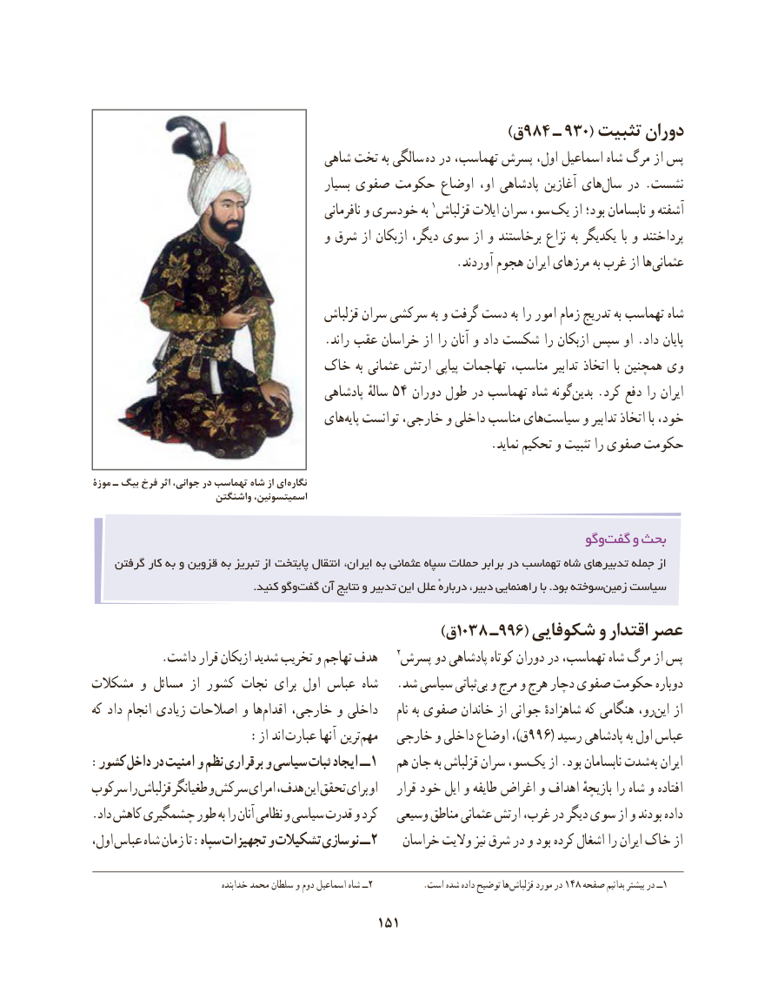

# PDF page 161

)ق 984 ـ 930( تثبیت دوران
                                   شاهی تخت به سالگی ده در تهماسب، پسرش اول، اسماعیل شاه مرگ از پس
                                              بسیار صفوی حکومت اوضاع او، پادشاهی آغازین های ‌سال در .نشست
                                                    نافرمانی و خودسری به 1قزلباش ایالت سران سو، یک از بود؛ نابسامان و آشفته
                                       و شرق از ازبکان دیگر، سوی از و برخاستند نزاع به یکدیگر با و پرداختند
                                                            .آوردند هجوم ایران مرزهای به غرب از هاعثمانی‌

                                         قزلباش سران سرکشی به و گرفت دست به را امور زمام تدریج به تهماسب شاه
                                      .راند عقب خراسان از را آنان و داد شکست را ازبکان سپس او .داد پایان
                           خاک به عثمانی ارتش پیاپی تهاجمات مناسب، تدابیر اتخاذ  با همچنین وی
                                          پادشاهی سالهٔ 54 دوران طول در تهماسب شاه گونه‌بدین .کرد دفع را ایران
                                   های‌پایه توانست خارجی، و داخلی مناسب هایسیاست‌      و تدابیر اتخاذ با خود،
                                                                  .نماید تحکیم و تثبیت را صفوی حکومت

موزة ـ بیگ فرخ اثر جوانی، در تهماسب شاه از ای نگاره
                        واشنگتن اسمیتسونین،

                                                                           وگوگفت‌    و بحث
    گرفتن کار به و قزوین به تبریز از پایتخت انتقال ،ایران به عثمانی سپاه حمالت برابر در تهماسب شاه تدبیرهای جمله از
                                             .کنید وگوگفت‌   آن نتایج و تدبیر این علل ٔدرباره ،دبیر راهنمایی با .بود سوختهزمین‌   سیاست
                                    )1038ق    ـ996( شکوفایی و اقتدار عصر
           .داشت قرار ازبکان شدید تخریب و تهاجم هدف    2پسرش دو پادشاهی کوتاه دوران در تهماسب، شاه مرگ از پس
مشکالت و مسائل از کشور نجات برای اول عباس شاه   .شد سیاسی ثباتیبی‌  و مرج و هرج دچار صفوی حکومت دوباره
که داد انجام زیادی اصالحات و ها‌اقدام خارجی، و داخلی     نام به صفوی خاندان از جوانی شاهزادهٔ که هنگامی رو،این‌   از
         : از اند عبارت آنها‌  ترین‌مهم   خارجی و داخلی اوضاع ،)ق996( رسید پادشاهی به اول عباس
:کشور داخل در امنیت و نظم برقراری و سیاسی ثبات ایجاد ــ 1   هم جان به قزلباش سران سو،یک‌    از .بود نابسامان شدت به ایران
سرکوب را قزلباش طغیانگر و سرکش امرای هدف، این تحقق برای او    قرار خود ایل و طایفه اغراض و اهداف بازیچهٔ را شاه و افتاده
.داد کاهش چشمگیری طور به را آنان نظامی و سیاسی قدرت و کرد   وسیعی مناطق عثمانی ارتش غرب، در دیگر سوی از و بودند داده
اول، عباس شاه زمان تا :سپاه تجهیزات و تشکیالت نوسازی ــ 2    خراسان والیت نیز شرق در و بود کرده اشغال را ایران خاک از

                                   خدابنده محمد سلطان و دوم اسماعیل شاه ــ2           .است شده داده توضیح ها قزلباش مورد در 148 صفحه بدانیم بیشتر در ــ1
                                         151

