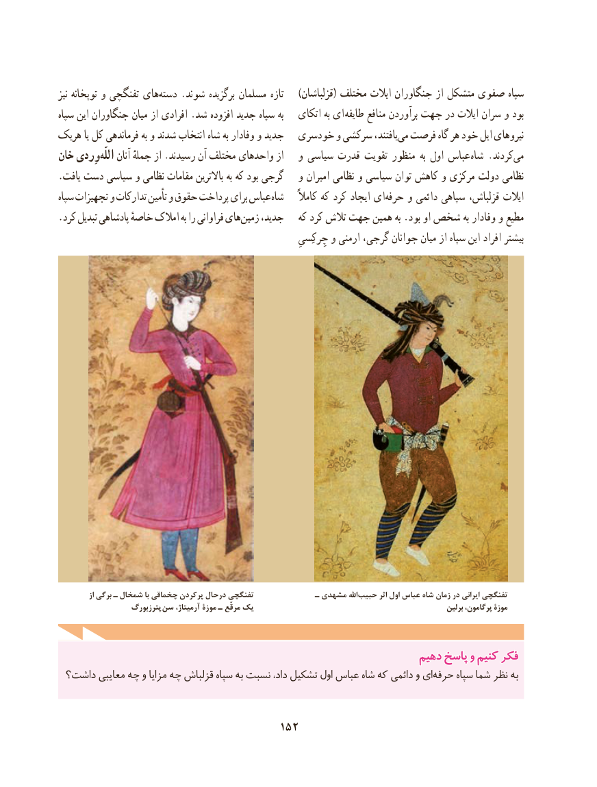

# PDF page 162

نیز توپخانه و تفنگچی های‌دسته .شوند برگزیده مسلمان تازه    )قزلباشان( مختلف ایالت جنگاوران از متشکل صفوی سپاه
سپاه این جنگاوران میان از افرادی .شد افزوده جدید سپاه به   اتکای به ای  طایفه منافع برآوردن جهت در ایالت سران و بود
هریک یا کل فرماندهی به و شدند انتخاب شاه به وفادار و جدید  خودسری و سرکشی یافتند،می‌  فرصت گاه هر خود ایل نیروهای
خان وِردیاللّه‌    آنان جملهٔ از .رسیدند آن مختلف واحدهای از   و سیاسی قدرت تقویت منظور  به اول عباس شاه .کردند‌می
.یافت دست سیاسی و نظامی مقامات باالترین به که بود گرجی   و امیران نظامی و سیاسی توان کاهش و مرکزی دولت نظامی
سپاه تجهیزات و تدارکات تأمین و حقوق پرداخت برای عباس شاه     کامالً که کرد ایجاد ای‌حرفه و دائمی سپاهی قزلباش، ایالت
.کرد تبدیل پادشاهی خاصهٔ امالک به را فراوانی هایزمین‌    جدید،   که کرد تالش جهت همین به .بود او شخص به وفادار و مطیع
                                                                چِرکِسیِ و ارمنی گرجی، جوانان میان از سپاه این افراد بیشتر

           از برگی ـ شمخال با چخماقی پرکردن درحال تفنگچی               ـ مشهدی اهلل حبیب اثر اول عباس شاه زمان در ایرانی تفنگچی
                   پترزبورگ  سن آرمیتاژ، موزة ـ مرقّع یک                                                         برلین پرگامون، موزة

                                                              دهیمدهیم پاسخپاسخ وو کنیمکنیم فکرفکر
 داشت؟ معایبی چه و مزایا چه قزلباش سپاه به نسبت داد، تشکیل اول عباس شاه که دائمی و ایحرفه‌     سپاه شما نظر به

                                     152

