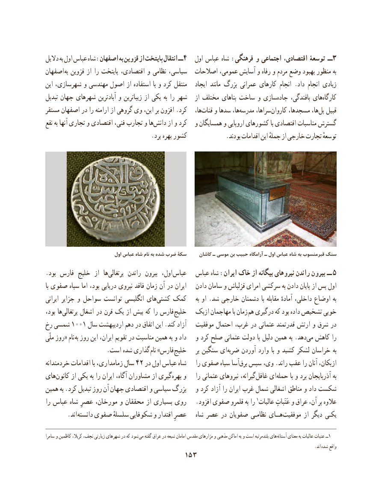

# PDF page 163

دالیل به اول عباس شاه :اصفهان به قزوین از پایتخت انتقال ــ 4   اول عباس شاه :فرهنگی و اجتماعی اقتصادی، توسعۀ ــ3
اصفهان به قزوین از را پایتخت اقتصادی، و نظامی سیاسی،  اصالحات عمومی، آسایش و رفاه و مردم وضع بهبود منظور به
این شهرسازی، و مهندسی اصول از استفاده با و کرد منتقل   ایجاد مانند بزرگ عمرانی کارهای انجام .داد انجام زیادی
تبدیل جهان شهرهای آبادترین و زیباترین از یکی به را شهر   از مختلف بناهای ساخت و سازیجاده‌     بافندگی، هایکارگاه‌
مستقر اصفهان در را ارامنه از گروهی وی این، بر افزون .کرد   ها،قنات‌    و سدها ها،مدرسه‌      سراها، کاروان مسجدها، ها،پل‌  قبیل
نفع به آنها تجاری و اقتصادی فنی، تجارب و هادانش‌     از و کرد   و همسایگان و اروپایی کشورهای با اقتصادی مناسبات گسترش
                                   .برد بهره کشور             .بودند اقدامات این جملهٔ از خارجی تجارت توسعهٔ

                               اول عباس شاه نام به شده ضرب سكۀ     كاشان ـ موسی بن حبيب آرامگاه ـ اول عباس شاه به قبرمنسوب سنگ
.بود فارس خلیج  از  ها‌پرتغالی  راندن  بیرون  اول، عباس   عباس شاه :ایران خاک از بیگانه نیروهای راندن بیرون ــ 5
با صفوی سپاه اما بود، دریایی نیروی فاقد زمان آن در ایران   دادن سامان و قزلباش امرای سرکشی به دادن پایان از پس اول
ایرانی جزایر و سواحل توانست انگلیسی های‌کشتی کمک     به او .شد خارجی دشمنان با مقابله آمادهٔ داخلی، اوضاع به
بود، ها‌پرتغالی اشغال در قرن یک از بیش که را فارس خلیج   ازبک مهاجمان با زمان هم درگیری که بود داده تشخیص خوبی
رخ شمسی ١٠٠١ سال اردیبهشت دهم در اتفاق این .کند آزاد   موفقیت احتمال غرب، در عثمانی قدرتمند ارتش و شرق در
ملّی روز« نام به روز این ایران، تقویم در مناسبت همین به و داد   و کرد صلح عثمانی دولت با دلیل همین به .دهد‌می کاهش را
   . است شده گذاری نام »فارس خلیج     بر سنگین ای‌ضربه آوردن وارد  با و کشید لشکر خراسان به
خردمندانه اقدامات با زمامداری، سال 42 در اول عباس شاه    را صفوی سپاه آسا‌برق سپس وی، .راند عقب را آنان ازبکان،
هایکانون‌     از یکی به را ایران آگاه، مشاوران از گیریبهره‌   و    را عثمانی نیروهای گیرانه،غافل‌    ای‌حمله با و برد آذربایجان به
همین به .کرد تبدیل روز آن جهان اقتصادی و سیاسی بزرگ   و کرد آزاد را ایران غرب شمال اشغالی مناطق و داد شکست
را عباس شاه عصرِ مورخان، و محققان از بسیاری روی   .افزود صفوی قلمرو به را ١عالوهعالیات عَتَباتِ و عراق آن، بر
    . اند دانسته صفوی سلسلهٔ شکوفایی و اقتدار عصرِ   شاه عصر در صفویان نظامـی هــای‌موفقیت از دیگر یکـی

سامرا و کاظمین کربال، نجف، زیارتی شهرهای در که شود می گفته عراق در شیعه امامان مقدس مزارهای و مذهبی اماکن به و است بلندمرتبه های آستانه١معنای به عالیات عتبات ــ
                                                                                                                              .اند  شده واقع
                                   153

