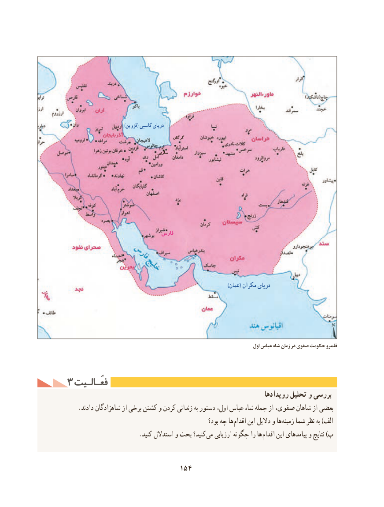

# PDF page 164

)قزوین( کاسپی دریای
                                              گرگان

                                      ساری

                               فارس

                                                                                                 )عمان( مکران دریای

                                                                                    اول عباس شاه زمان در صفوی حکومت قلمرو

3 فعّـالـیتفعّـالـیت
                                                                  رویدادها تحلیل و بررسی
    .دادند شاهزادگان از برخی کشتن و کردن زندانی به دستور اول، عباس شاه جمله از صفوی، شاهان از بعضی
                                                        بود؟ چه ها اقدام این دالیل و ها زمینه شما نظر به )الف
  . کنید استدالل و بحث کنید؟ می ارزیابی چگونه را ها اقدام این پیامدهای و نتایج )ب

                             154

