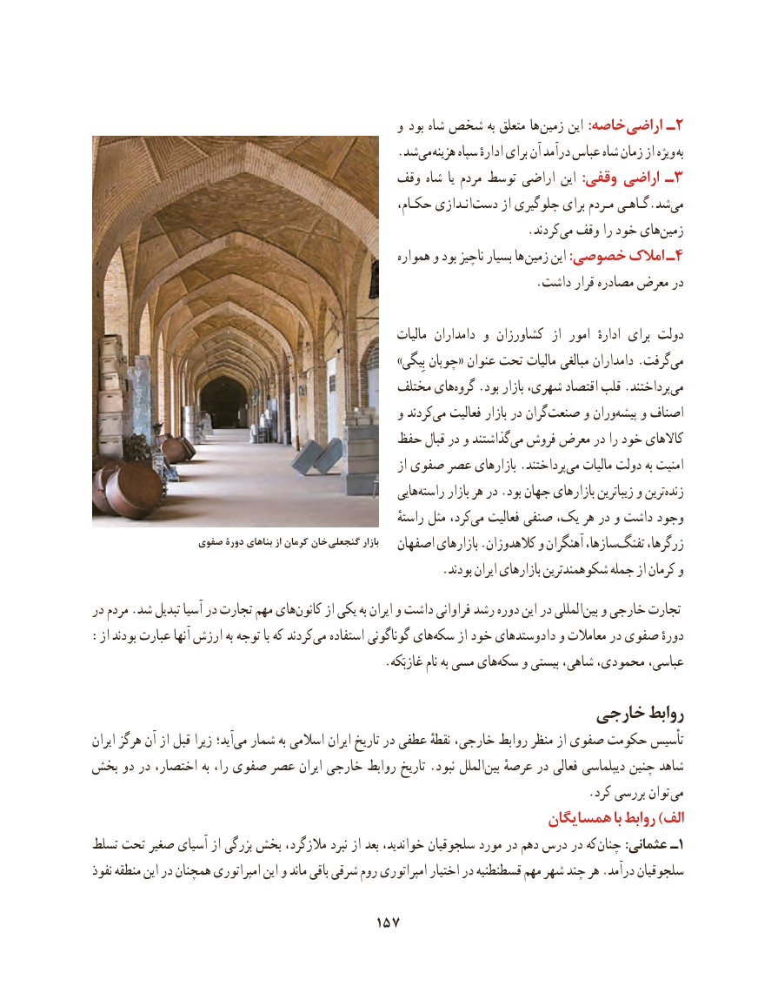

# PDF page 167

و  بود شاه شخص به متعلق ها زمین این :خاصه اراضی ـ2
                                                  .شد‌می هزینه سپاه ادارهٔ برای آن درآمد عباس شاه زمان از ویژه به
                                        وقف شاه  یا مردم توسط اراضی این :وقفی اراضی ـ 3
                                 ،انـدازیحکـام             ‌دست از جلوگیری برای مـردم گـاهـی.شدمی‌
                         .‌کردند می وقف را خود های‌زمین
                                                        همواره و بود ناچیز بسیار ها زمین این :خصوصی امالک ـ4
                                                                         .داشت قرار مصادره معرض در

                                                              مالیات  دامداران و کشاورزان  از امور  ادارهٔ برای دولت
                                                            »بِیگی‌    چوپان« عنوان تحت مالیات مبالغی دامداران .گرفتمی‌
                                             مختلف هایگروه‌   .بود بازار شهری، اقتصاد قلب .پرداختندمی‌
                                                   و کردندمی‌   فعالیت بازار در گران صنعت و ورانپیشه‌    و اصناف
                                     حفظ قبال در و گذاشتندمی‌  فروش معرض در را خود کاالهای
                                                               از صفوی عصر بازارهای .پرداختندمی‌   مالیات دولت به امنیت
                                                           هاییراسته‌      بازار هر در .بود جهان بازارهای زیباترین و ترینزنده‌
                                                                     راستهٔ مثل کرد،می‌   فعالیت صنفی یک، هر در و داشت وجود
                 صفوی دورۀ بناهای از كرمان خان گنجعلی بازار   اصفهان بازارهای .کالهدوزان و آهنگران سازها،تفنگ‌     زرگرها،
                                                          .بودند ایران بازارهای شکوهمندترین جمله از کرمان و
در مردم .شد تبدیل آسیا در تجارت مهم های ‌کانون از یکی به ایران و داشت فراوانی رشد دوره این در المللی ‌بین و خارجی تجارت
:از  بودند عبارت آنها ارزش به توجه با که کردندمی‌   استفاده گوناگونی های‌سکه از خود دادوستدهای و معامالت در صفوی دورهٔ
     .‌غازبَکه نام به مسی هایسکه و بیستی شاهی، محمودی، عباسی،
                                                  خارجی روابط
ایران هرگز آن از قبل زیرا آید؛‌می شمار به اسالمی ایران تاریخ در عطفی نقطهٔ خارجی، روابط منظر از صفوی حکومت تأسیس
بخش دو در اختصار، به را، صفوی عصر ایران خارجی روابط تاریخ .نبود الملل‌بین عرصهٔ در فعالی دیپلماسی چنین شاهد
                                                                                  .کرد بررسی توان  می
                                                         همسایگان با روابط )الف
تسلط تحت صغیر آسیای از بزرگی بخش مالزگرد، نبرد از بعد خواندید، سلجوقیان مورد در دهم درس در که  چنان :عثمانی ـ1
نفوذ منطقه این در همچنان امپراتوری این و ماند باقی شرقی روم امپراتوری اختیار در قسطنطنیه مهم شهر چند هر .درآمد سلجوقیان

                                    157

