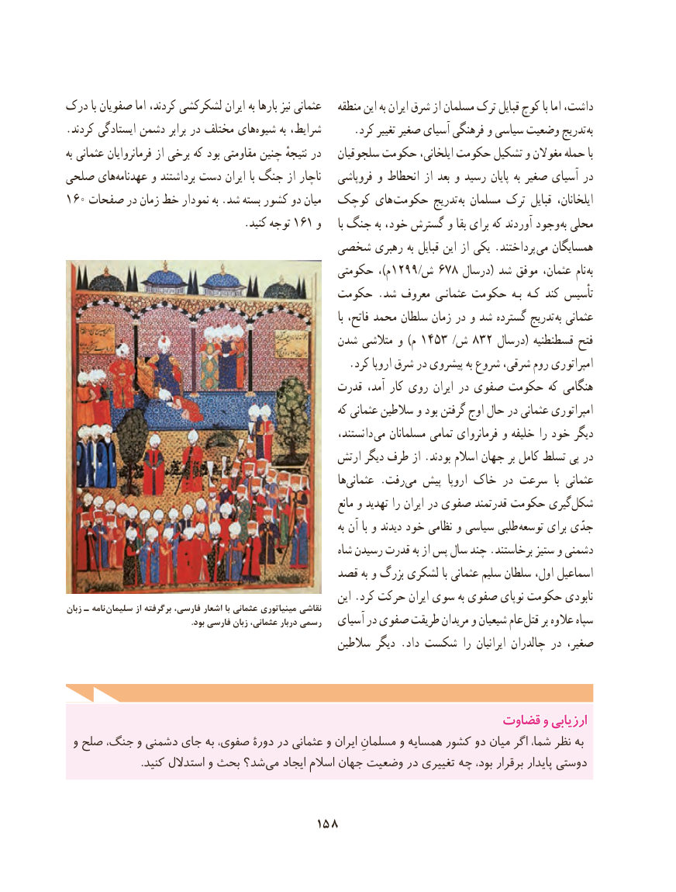

# PDF page 168

درک با صفویان اما کردند، لشکرکشی ایران به بارها نیز عثمانی    منطقه این به ایران شرق از مسلمان ترک قبایل کوچ با اما داشت،
.کردند ایستادگی دشمن برابر در مختلف هایشیوه‌      به شرایط، . کرد تغییر صغیر آسیای فرهنگی و سیاسی وضعیت تدریج به
به عثمانی فرمانروایان از برخی که بود مقاومتی چنین نتیجهٔ در   سلجوقیان حکومت ایلخانی، حکومت تشکیل و مغوالن حمله با
صلحی های‌عهدنامه و برداشتند دست ایران با جنگ از ناچار   فروپاشی و انحطاط از بعد و رسید پایان به صغیر آسیای در
160 صفحات در زمان خط نمودار به .شد بسته کشور دو میان  کوچک های  حکومت تدریج به مسلمان ترک قبایل ایلخانان،
          .161کنید توجه     و      با جنگ به خود، گسترش و بقا برای که آوردند وجود  به محلی
                                 شخصی رهبری به قبایل این از یکی .پرداختند  می همسایگان
                                              حکومتی ،)م ١نام٩٩٢/ش ٨٧٦ درسال( شد موفق عثمان،      به
                                       حکومت .شد معروف عثمانـی حکومت  بـه کـه کند تأسیس
                                                                                                   با فاتح، محمد سلطان زمان در و شد گسترده تدریج  به عثمانی
                                          شدن متالشی و )م ١فتح٣٥٤ /ش ٢٣٨ درسال( قسطنطنیه
                                                     .کرد اروپا شرق در پیشروی به شروع شرقی، روم امپراتوری
                                             قدرت آمد، کار روی ایران در صفوی حکومت که هنگامی
                                                          که عثمانی سالطین و بود گرفتن اوج حال در عثمانی امپراتوری
                                                              دانستند، ‌می مسلمانان تمامی فرمانروای و خلیفه را خود دیگر
                                              ارتش دیگر طرف از .بودند اسالم جهان بر کامل تسلط پی در
                                                                 ها‌عثمانی .رفت ‌می پیش  اروپا خاک در سرعت  با عثمانی
                                                                      مانع و تهدید را ایران در صفوی قدرتمند حکومت گیریشکل‌
                                                                                  به آن با و دیدند خود نظامی و سیاسی طلبی ‌ توسعه برای جدّی
                                                          شاه رسیدن قدرت به از پس سال چند .برخاستند ستیز و دشمنی
                                         قصد به و بزرگ لشکری با عثمانی سلیم سلطان اول، اسماعیل
                                                              این .کرد حرکت ایران سوی به صفوی نوپای حکومت نابودیزبان ـ نامه سلیمان از برگرفته فارسی، اشعار با عثمانی مینیاتوری نقاشی
                                                           .بود فارسی زبان عثمانی، دربار رسمی   آسیای در صفوی طریقت مریدان و شیعیان عام قتل بر عالوه سپاه
                                                  سالطین دیگر .داد شکست را ایرانیان چالدران در صغیر،

                                                         قضاوتقضاوت وو ارزیابیارزیابی
 و صلح جنگ، و دشمنی جای به صفوی، دورۀ در عثمانی و ایران مسلمانِ و همسایه کشور دو میان اگر شما، نظر به
 .‌کنید استدالل و بحث شد؟می ایجاد اسالم جهان وضعیت در تغییری چه بود، برقرار پایدار دوستی

                                   158

