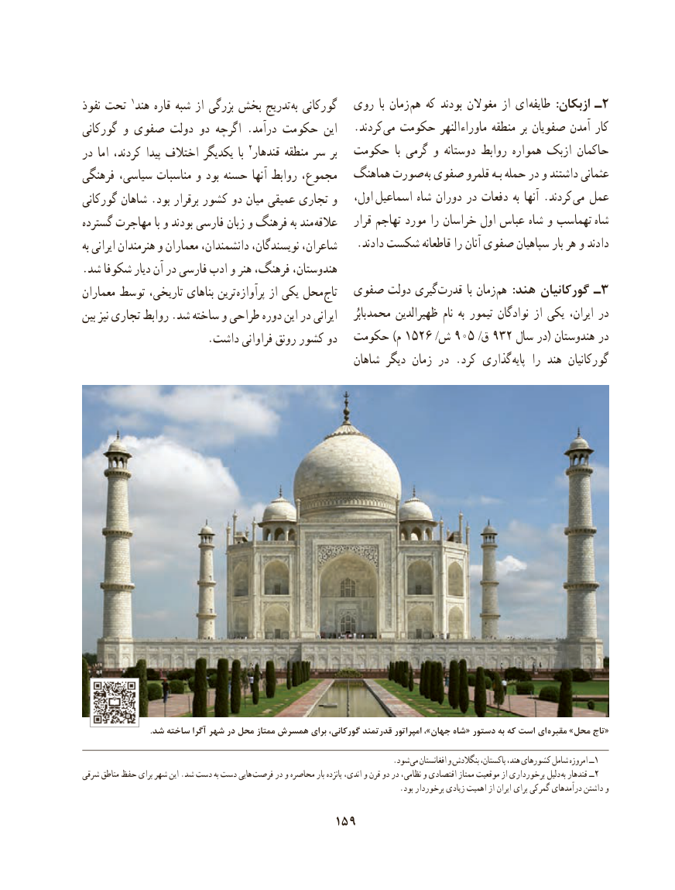

# PDF page 169

نفوذ١تدریجتحت  هند قاره شبه از بزرگی بخش           به گورکانی  روی  با زمان هم که بودند مغوالن از ای طایفه  :ازبکان ـ2
گورکانی و صفوی دولت دو اگرچه .درآمد حکومت این   .کردند  می حکومت النهر  ماوراء منطقه بر صفویان آمدن کار
در اما کردند، پیدا اختالف یکدیگر  با 2قندهار منطقه سر بر  حکومت  با گرمی و دوستانه روابط همواره ازبک حاکمان
فرهنگی سیاسی، مناسبات و بود حسنه آنها روابط مجموع،   هماهنگ صورت  به صفوی قلمرو بـه حمله در و داشتند عثمانی
گورکانی شاهان .بود برقرار کشور دو میان عمیقی تجاری و   اول، اسماعیل شاه دوران در دفعات به آنها .کردند می عمل
گسترده مهاجرت با و بودند فارسی زبان و فرهنگ به مند  عالقه    قرار تهاجم مورد را خراسان اول عباس شاه و تهماسب  شاه
به ایرانی هنرمندان و معماران دانشمندان، نویسندگان، شاعران،    .دادند شکست قاطعانه را آنان صفوی سپاهیان بار هر و دادند
.شد شکوفا دیار آن در فارسی ادب و هنر فرهنگ، هندوستان،
معماران توسط تاریخی، بناهای ترین پرآوازه از یکی محل  تاج  صفوی دولت گیری ­قدرت با زمان هم  :هند گورکانیان ـ 3
بین نیز تجاری روابط .شد ساخته و طراحی دوره این در ایرانی       بابُر محمد ظهیرالدین نام به تیمور نوادگان از یکی ایران، در
                       .داشت فراوانی رونق کشور دو  حکومت )م ١٦٢٥ /ش 905 /ق 932 سال در( هندوستان در
                                                    شاهان دیگر زمان در .کرد گذاری پایه را هند گورکانیان

                                .شد ساخته آگرا شهر در محل ممتاز همسرش برای گورکانی، قدرتمند امپراتور ،»جهان شاه« دستور به که است  ای «مقبره »محل تاج

                                                                                .شود می١افغانستان و بنگالدش پاکستان، هند، کشورهای شامل امروزه ــ
شرقی مناطق حفظ برای شهر این .شد دست به دست هایی فرصت در و محاصره بار پانزده اندی، و قرن دو در نظامی، و اقتصادی ممتاز موقعیت از برخورداری دلیل  به قندهار ــ2
                                                                                  .بود برخوردار زیادی اهمیت از ایران برای گمرکی درآمدهای داشتن و
                                     159

