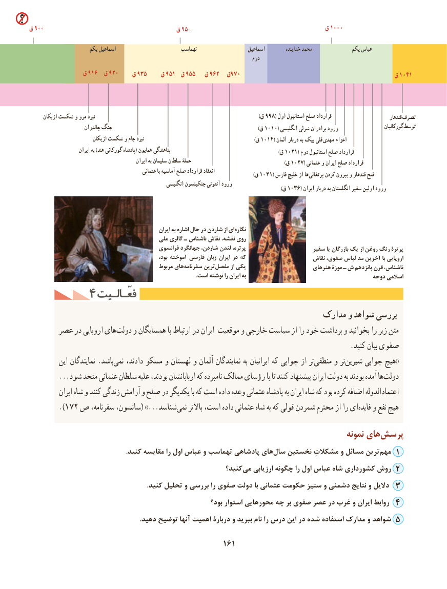

# PDF page 171

ق 900                                     ق 950                                      ق 1000

                      یکم اسماعیل                        تهماسب                     اسماعیل          خدابنده محمد               یکم عباس
                                                                                      دوم
               ق 916  ق 920    ق 935    ق 951  ق 955   ق 962  ق970                                           ق 1041

      ازبکان شکست و مرو نبرد                                              )998(ق     اول استانبول صلح قرارداد                            قندهار تصرف
                        چالدران جنگ                                                                                            (ق 1010( انگلیسی شرلی برادران ورود                      گورکانیان توسط
                           ازبکان شکست و جام نبرد                                                                      (ق 1014( آلمان دربار به بیک قلی  مهدی اعزام
                      ایران به )هند گورکانی پادشاه( همایون پناهندگی                                                                    (ق 1021( دوم استانبول صلح قرارداد
                                                ایران به سلیمان سلطان حملۀ                                                           (ق 1027( عثمانی و ایران صلح قرارداد
                                                  عثمانی با آماسیه صلح قرارداد انعقاد                                                                                                                                              (ق 1031( فارس خلیج از ها  پرتغالی کردن بیرون و قندهار فتح
                                                        انگلیسی جنکینسون آنتونی ورود                                                                                                                                                               (ق 1036( ایران دربار به انگلستان سفیر اولین ورود

                                                         ایران به اشاره حال در شاردن از ای نگاره
                                          ملی گالری ـ ناشناس نقاش نقشه، روی
                                             فرانسوی جهانگرد شاردن، لندن پرتره،                      سفیر یا بازرگان یک از روغن رنگ پرترة
                                                           بود، آموخته فارسی زبان ایران در که                      نقاش صفوی، لباس مد آخرین با اروپایی
                                              مربوط های سفرنامه ترین مفصل از یکی                      هنرهای موزة ـ ش پانزدهم قرن ناشناس،
                                                                                                                       .است نوشته را ایران به                                        دوحه اسالمی
        4 فعّـالـیتفعّـالـیت
                                                                مدارک و شواهد بررسی
      عصر در اروپایی هایدولت‌    و همسایگان با ارتباط در ایران موقعیت و خارجی سیاست از را خود برداشت و بخوانید را زیر متن
                                                                                         .کنید بیان صفوی
          این نمایندگان .باشدنمی‌    دادند، مسکو و لهستان و آلمان نمایندگان به ایرانیان که جوابی از ترمنطقی‌     و ترشیرین‌«جوابی هیچ
        ...شود متحد عثمانی سلطان علیه بودند، اربابانشان که نامبرده ممالک رؤسای با تا کنند پیشنهاد ایران دولت به بودند آمده هادولت‌
           ایران شاه و کنند زندگی آرامش و صلح در یکدیگر با که است داده وعده عثمانی پادشاه به ایران شاه که بود کرده اضافه اعتمادالدوله
        ).172 ص سفرنامه، سانسون،( ...»شناسدنمی‌    باالتر است، داده عثمانی شاه به که قولی شمردن محترم از را ایفایده‌    و نفع هیچ
                                                                                          نمونه های‌پرسش
 .‌کنید مقایسه را اول عباس و تهماسب پادشاهی هایسال نخستین مشکالتِ و مسائل ترینمهم‌   1
                                                          کنید؟‌می ارزیابی چگونه را اول عباس شاه کشورداری روش 2
                                                                     .کنید تحلیل و بررسی را صفوی دولت با عثمانی حکومت ستیز و دشمنی نتایج و دالیل 3
                                                           بود؟ استوار محورهایی چه بر صفوی عصر در غرب و ایران روابط 4
                                                                 .دهید توضیح آنها اهمیت دربارۀ و ببرید نام را درس این در شده استفاده مدارک و شواهد 5
                                                 161

