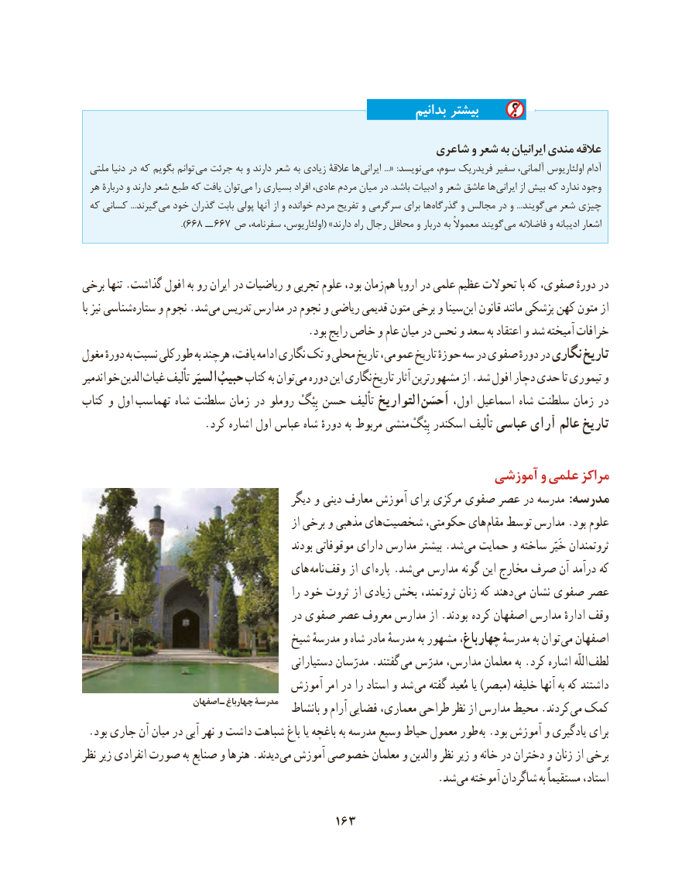

# PDF page 173

بدانیم بیشتر

                                                     شاعری و شعر به ایرانیان مندی عالقه
  ملتی دنیا در که بگویم توانم می جرئت به و دارند شعر به زیادی عالقۀ ها ایرانی «... :نویسد می سوم، فریدریک سفیر آلمانی، اولئاریوس آدام
 هر دربارۀ و دارند شعر طبع که یافت توان می را بسیاری افراد عادی، مردم میان در .باشد ادبیات و شعر عاشق ها ایرانی از بیش که ندارد وجود
 که کسانی ...گیرند می خود گذران بابت پولی آنها از و خوانده مردم تفریح و سرگرمی برای ها گذرگاه و مجالس در و ...گویند می شعر چیزی
                                   ).۶۶۸ ــ ۶۶۷  ص سفرنامه، اولئاریوس،( »دارند راه رجال محافل و دربار به معموالً گویند می فاضالنه و ادیبانه اشعار

برخی تنها .گذاشت افول به رو ایران در ریاضیات و تجربی علوم بود، زمان هم اروپا در علمی عظیم تحوالت با که صفوی، دورهٔ در
با نیز شناسی ستاره و نجوم .شد می تدریس مدارس در نجوم و ریاضی قدیمی متون برخی و سینا ابن قانون مانند پزشكی كهن متون از
                                          .بود رایج خاص و عام میان در نحس و سعد به اعتقاد و شد آمیخته خرافات
مغول دورهٔ به نسبت طورکلی به هرچند یافت، ادامه نگاری تک و محلی تاریخ عمومی، تاریخ حوزهٔ سه در صفوی دورهٔ در نگاری تاریخ
خواندمیر الدین غیاث تألیف السیَر حبیبُتوانکتاب به        می دوره این نگاری تاریخ آثار مشهورترین از .شد افول دچار حدی تا تیموری و
کتاب و اول  تهماسب شاه سلطنت زمان در روملو بِیْگْ حسن تألیف التواریخ  اَحسَن اول، اسماعیل شاه سلطنت زمان در
                       . كرد اشاره اول عباس شاه دورهٔ به مربوط منشی  بِیْگْتاریخاسکندر تألیف عباسی آرای عالم

                                                        آموزشی و علمی مراكز
                                           دیگر و دینی معارف آموزش برای مرکزی صفوی عصر در مدرسه :مدرسه
                                                 از برخی و مذهبی های شخصیت حکومتی، های مقام توسط مدارس .بود علوم
                                                 بودند موقوفاتی دارای مدارس بیشتر .شد می حمایت و ساخته خَیّر ثروتمندان
                                   های نامه وقف از ای پاره .شد می مدارس گونه این مخارج صرف آن درآمد که
                                                را خود ثروت از زیادی بخش ثروتمند، زنان كه دهند  می نشان صفوی عصر
                                       در صفوی عصر معروف مدارس از .بودند  کرده اصفهان مدارس ادارهٔ وقف
                                 شیخ مدرسهٔ و شاه مادر مدرسهٔ به مشهور چهارباغ، مدرسهٔ به توان می اصفهان
                                             دستیارانی مدرّسان .گفتند می مدرّس مدارس، معلمان به .كرد اشاره اللّه لطف
                                  آموزش امر در را استاد و شد می گفته مُعید یا )مبصر( خلیفه آنها به که داشتند
                         اصفهان ـ چهارباغ مدرسة   بانشاط و آرام فضایی معماری، طراحی نظر از مدارس محیط .کردند می کمک
. بود جاری آن میان در آبی نهر و داشت شباهت باغ یا باغچه به مدرسه وسیع حیاط معمول طور به .بود آموزش و یادگیری برای
نظر زیر انفرادی صورت به صنایع و هنرها .دیدند می آموزش خصوصی معلمان و والدین نظر زیر و خانه در دختران و زنان از برخی
                                 . شد می آموخته شاگردان به مستقیماً استاد،

                                    163

