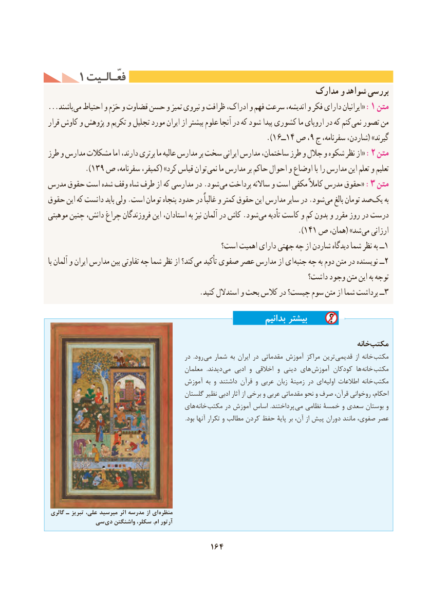

# PDF page 174

1 فعّـالـیتفعّـالـیت
                                                          مدارک و شواهد بررسی
...باشند :می احتیاط و حَزم و قضاوت حسن و تمیز نیروی و ظرافت ادراک، و فهم سرعت اندیشه، و فکر دارای ایرانیان« 1 متن
قرار کاوش و پژوهش و تکریم و تجلیل مورد ایران از بیشتر علوم آنجا در که شود پیدا کشوری ما اروپای در که کنم نمی تصور من
                                                           ).16ــ14 ص ، 9 ج سفرنامه، شاردن،( »گیرند
طرز و مدارس مشکالت اما دارند، برتری ما عالیه مدارس بر سخت ایرانی مدارس ساختمان، طرز و جالل و شکوه نظر از« :2 متن
          ).139 ص سفرنامه، کمپفر،( »کرد قیاس توان نمی ما مدارس بر حاکم احوال و اوضاع با را مدارس این تعلم و تعلیم
مدرس حقوق است شده وقف شاه طرف از که مدارسی در .شود :می پرداخت ساالنه و است مکفی کامالً مدرس حقوق« 3 متن
حقوق این که دانست باید ولی .است تومان پنجاه حدود در غالباً و کمتر حقوق این مدارس سایر در .شود می بالغ تومان صد یک به
موهبتی چنین دانش، چراغ فروزندگان این استادان، به نیز آلمان در کاش .شود می تأدیه کاست و کم بدون و مقرر روز در درست
                                                                 ).141 ص همان،( »شد می ارزانی
                                          است؟ اهمیت دارای جهتی چه از شاردن دیدگاه شما نظر به ــ1
با آلمان و ایران مدارس بین تفاوتی چه شما نظر از کند؟ می تأکید صفوی عصر مدارس از ای جنبه چه به دوم متن در نویسنده ــ2
                                                                  داشت؟ وجود متن این به توجه
  .3کنید استدالل و بحث کالس در چیست؟ سوم متن از شما برداشت ــ
                                                               بدانیم بیشتر
                                                                                             خانهمکتب
                                              در  .رود می شمار به ایران در مقدماتی آموزش مراکز ترین  قدیمی از خانه مکتب
                                             معلمان   .دیدند  می ادبی و اخالقی و دینی های  آموزش کودکان ها خانه مکتب
                                      آموزش به و داشتند قرآن و عربی زبان زمینۀ در ای  اولیه اطالعات خانه مکتب
                                           گلستان نظیر ادبی آثار از برخی و عربی مقدماتی نحو و صرف قرآن، روخوانی احکام،
                                      های  خانه مکتب در آموزش اساس  .پرداختند  می نظامی خمسۀ و سعدی بوستان و
                                                                                                   .بود آنها تکرار و مطالب کردن حفظ پایۀ بر آن، از پیش دوران مانند صفوی، عصر

 گالری ـ تبریز علی، میرسید اثر مدرسه از ای  منظره
           سی دی واشنگتن سکلر، .ام آرتور

                                     164

