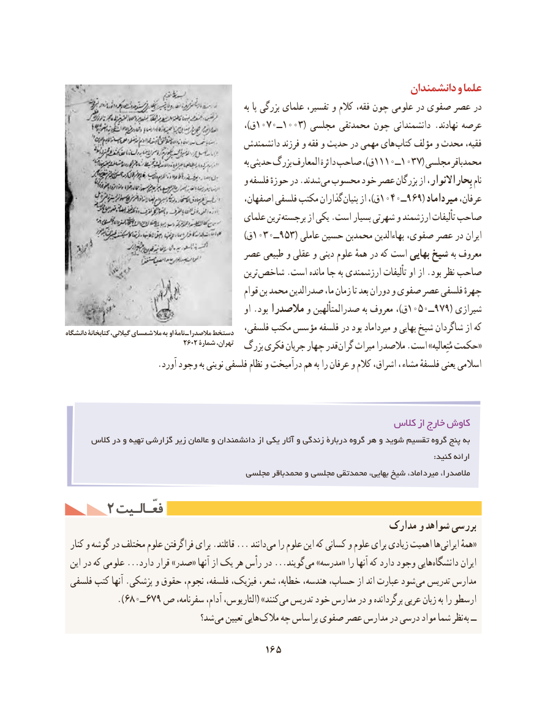

# PDF page 175

دانشمندان و علما
                                                                   به پا بزرگی علمای تفسیر، و کالم فقه، چون علومی در صفوی عصر در
                                                      ،)ق 1070ــ1003( مجلسی محمدتقی چون دانشمندانی .نهادند عرصه
                                        دانشمندش فرزند و فقه و حدیث در مهمی های كتاب مؤلف و محدث فقیه،
                                                                   به حدیثی بزرگ المعارف دائرة صاحب ،)ق1110ــ1037( مجلسی محمدباقر
                                          و فلسفه حوزهٔ در .شدند می محسوب خود عصر بزرگان از بِحاراالنوار، نام
                                          اصفهان، فلسفی مکتب گذاران بنیان از ،)ق1040ــ969( میرداماد عرفان،
                                          علمای ترین برجسته از یکی .است بسیار شهرتی و ارزشمند تألیفات صاحب
                                                             )ق 1030ــ953( عاملی حسین محمدبن بهاءالدین صفوی، عصر در ایران
                                عصر طبیعی و عقلی و دینی علوم همهٔ در كه است بهایی شیخ به معروف
                                                   ترین شاخص .است مانده جا به ارزشمندی تألیفات او از .بود نظر صاحب
                                                  قوام بن محمد صدرالدین ما، زمان تا بعد دوران و صفوی عصر فلسفی چهرهٔ
                                                     او .بود مالصدرا و صدرالمتألهین به معروف ،)ق1050ــ979( شیرازی
دانشگاه كتابخانۀ ،دستخطگيالني شمساي مال به او نامۀ ـ مالصدرا        فلسفی، مکتب مؤسس فلسفه در بود میرداماد و بهایی شیخ شاگردان از كه
                                 2602 شمارۀ تهران،  بزرگ فکری جریان چهار قدر «گران میراث مالصدرا .است »مُتِعالیه حکمت
                      .آورد وجود به نوینی فلسفی نظام و درآمیخت هم به را عرفان و کالم اشراق، ، مشاء فلسفهٔ یعنی اسالمی

                                                            كالس از خارج كاوش
      کالس در و تهیه گزارشی زیر عالمان و دانشمندان از یکی آثار و زندگی دربارۀ گروه هر و شوید تقسیم گروه پنج به
                                                                                                                                                  :کنید ارائه
                                      مجلسی محمدباقر و مجلسی محمدتقی ،بهایی شیخ ،میرداماد ،مالصدرا

     2 فعّـالـیتفعّـالـیت
                                                           مدارک و شواهد بررسی
  کنار و گوشه در مختلف علوم فراگرفتن برای .قائلند ... دانند می را علوم این که کسانی و علوم برای زیادی اهمیت ها «ایرانی همهٔ
 این در که علومی ...دارد قرار »صدر« آنها از یک هر رأس در ...گویند می »مدرسه« را آنها که دارد وجود هایی دانشگاه ایران
 فلسفی کتب آنها .پزشکی و حقوق نجوم، فلسفه، فیزیک، شعر، خطابه، هندسه، حساب، از اند عبارت شود می تدریس مدارس
           ).680ــ679 ص سفرنامه، آدام، الئاریوس،( »کنند می تدریس خود مدارس در و برگردانده عربی زبان به را ارسطو
                              شد؟ می تعیین هایی مالک چه براساس صفوی عصر مدارس در درسی مواد شما نظر به ــ

                                     165

