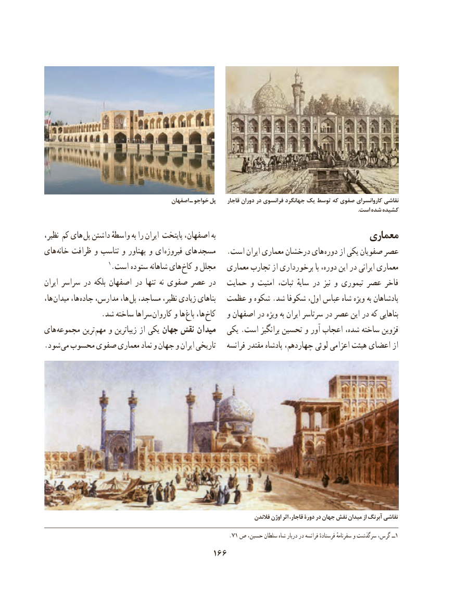

# PDF page 176

اصفهان ـ خواجو پل     قاجار دوران در فرانسوی جهانگرد یک توسط که صفوی کاروانسرای نقاشی
                                                                                                                                                                                                                              .است شده کشیده
نظیر، کم های پل داشتن واسطهٔ به را ایران پایتخت اصفهان، به                               معماری
های خانه ظرافت و تناسب و پهناور و ای فیروزه های  مسجد   .است ایران معماری درخشان های دوره از یکی صفویان عصر
                    1.است ستوده شاهانه های کاخ و مجلل   معماری تجارب از برخورداری با دوره، این در ایرانی معماری
ایران سراسر در بلکه اصفهان در تنها  نه صفوی عصر در   حمایت و امنیت ثبات،  سایهٔ در  نیز و تیموری عصر فاخر
ها، میدان ها، جاده مدارس، ها،  پل مساجد، نظیر، زیادی بناهای  عظمت و شکوه .شد شكوفا اول، عباس شاه ویژه به پادشاهان
  . شد ساخته سراها کاروان و ها باغ ها، کاخ   و اصفهان در ویژه به ایران سرتاسر در عصر این در که بناهایی
های مجموعه ترین  مهم و زیباترین از یکی جهان نقش میدان   یکی .است برانگیز تحسین و آور اعجاب شده، ساخته قزوین
.شود می محسوب صفوی معماری نماد و جهان و ایران تاریخی    فرانسه مقتدر پادشاه چهاردهم، لوئی اعزامی هیئت اعضای از

                                                                                فالندن اوژن اثر قاجار، دورۀ در جهان نقش ميدان از آبرنگ نقاشی
                                                            .71 ص حسین، سلطان شاه دربار در فرانسه فرستادهٔ سفرنامهٔ و سرگذشت گرس، ــ1
                                      166

