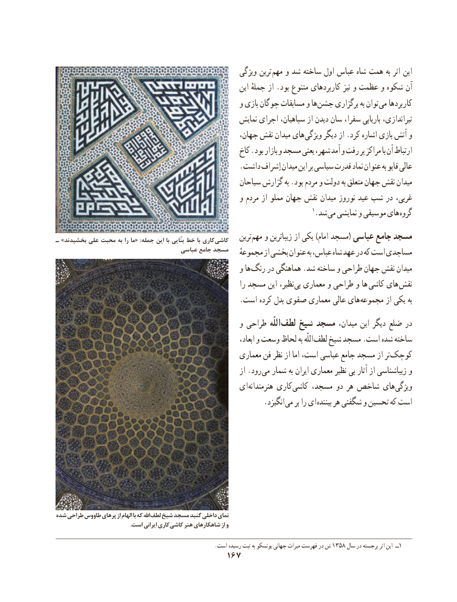

# PDF page 177

ویژگی ترین مهم و شد ساخته اول عباس شاه همت به اثر این
                                                            این جملهٔ از .بود متنوع کاربردهای نیز و عظمت و شكوه آن
                                                  و بازی چوگان مسابقات و ها جشن برگزاری به توان می کاربردها
                                                    نمایش اجرای سپاهیان، از دیدن سان سفرا، باریابی تیراندازی،
                                                 جهان، نقش میدان های ویژگی دیگر از .کرد اشاره بازی آتش و
                                                     کاخ .بود بازار و مسجد یعنی شهر، آمد و رفت پر مراکز با آن ارتباط
                                                  .داشت اِشراف میدان این بر سیاسی قدرت نماد عنوان به قاپو عالی
                                                   سیاحان گزارش به .بود مردم و دولت به متعلق جهان نقش میدان
                                                  و مردم از مملو جهان نقش میدان نوروز عید شب در غربی،
                                                                                               ١.شد می نمایشی و موسیقی های گروه
ـ »بخشیدند علی محبت به را ما« :جمله این با بنّایی خط با کاری  کاشی    ترین مهم و زیباترین از یکی )امام مسجد( عباسی جامع مسجد
                                     عباسی جامع مسجد   مجموعهٔ از بخشی عنوان به عباس، شاه عهد در که است مساجدی
                                                  و ها رنگ در هماهنگی .شد ساخته و طراحی جهان نقش میدان
                                                               را مسجد این نظیر، بی معماری و طراحی و ها كاشی های نقش
   . است کرده بدل صفوی معماری عالی های مجموعه از یکی به
                                                  و طراحی اللّه لطف شیخ مسجد میدان، این دیگر ضلع در
                                                                         ابعاد، و وسعت لحاظ به اللّه لطف شیخ مسجد .است شده ساخته
                                                   معماری فن نظر از اما است، عباسی جامع مسجد از تر کوچک
                                                               از .رود می شمار به ایران معماری نظیر بی آثار از زیباشناسی و
                                            ای هنرمندانه کاری کاشی مسجد، دو هر شاخص های ویژگی
                  . انگیزد می بر را ای بیننده هر شگفتی و تحسین که است

شده طراحی طاووس پرهای از الهام با که اهلل لطف شیخ مسجد گنبد داخلی نمای
    . است ایرانی کاریکاشی هنر شاهکارهای از و

      .1358است رسیده ثبت به یونسکو جهانی میراث فهرست در ش سال١در برجسته اثر این  ــ
                                     167

