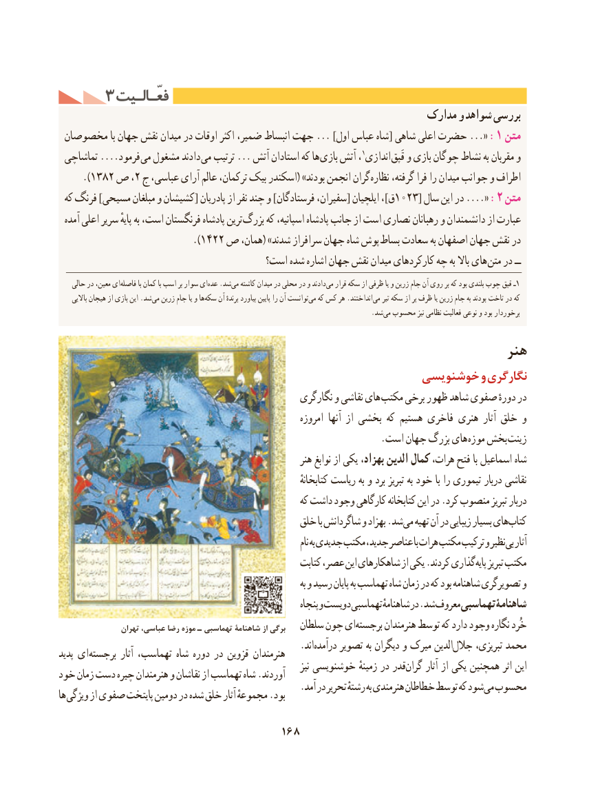

# PDF page 178

3 فعّـالـیتفعّـالـیت
                                                             مدارکمدارک وو شواهدشواهد بررسیبررسی
 مخصوصان با جهان نقش میدان در اوقات اکثر ضمیر، انبساط جهت ... ]اول عباس شاه[ شاهی اعلی حضرت «... :1 متن
 تماشاچی ....فرمود می مشغول دادند می ترتیب ... آتش استادان که ها بازی آتش ،1اندازی قَپق و بازی چوگان نشاط به مقربان و
     ).1382 ص ،2 ج عباسی، آرای عالم ترکمان، بیک اسکندر( »بودند انجمن گران نظاره گرفته، فرا را میدان جوانب و اطراف
 که فرنگ ]مسیحی مبلغان و كشیشان[ پادریان از نفر چند و ]فرستادگان سفیران،[ ایلچیان ،]ق1023[ سال این در «.... :2 متن
  آمده اعلی سریر پایهٔ به است، فرنگستان پادشاه ترین بزرگ که اسپانیه، پادشاه جانب از است نصاری رهبانان و دانشمندان از عبارت
                         ).1422 ص همان،( »شدند سرافراز جهان شاه پوش بساط سعادت به اصفهان جهان نقش در
                                      است؟ شده اشاره جهان نقش میدان كاركردهای چه به باال های متن در ــ
    حالی در معین، ایفاصله‌         با کمان با اسب بر سوار ای‌عده .شدمی‌  کاشته میدان در محلی در و دادند‌می قرار سکه از ظرفی یا و زرین جام آن روی بر که بود بلندی چوب قپق ـ1
     باالیی هیجان از بازی این .شد ‌می زرین جام یا و ها‌سکه آن برندهٔ بیاورد پایین را ‌آن توانستمی‌  که کس هر .انداختند ‌می تیر سکه از پر ظرف یا زرین جام به بودند تاخت در که
                                              .‌شد می محسوب نیز نظامی فعالیت نوعی و بود برخوردار

                                                                  هنر
                                                  خوشنویسی و نگارگری
                                                    نگارگری و نقاشی های مکتب برخی ظهور شاهد صفوی دورهٔ در
                                                              امروزه آنها از بخشی که هستیم فاخری هنری آثار خلق و
       . است جهان بزرگ های موزه بخش زینت
                                                            هنر نوابغ از یكی بهزاد، الدین کمال هرات، فتح با اسماعیل شاه
                                                                              کتابخانهٔ ریاست به و برد تبریز به خود با را تیموری دربار نقاشی
                                                         که داشت وجود کارگاهی کتابخانه این در .كرد منصوب تبریز دربار
                                            خلق با شاگردانش و بهزاد .شد می تهیه آن در زیبایی بسیار های كتاب
                                                                                  نام به جدیدی مکتب جدید، عناصر با هرات مکتب ترکیب و نظیر بی آثار
                                                         کتابت عصر، این شاهکارهای از یکی .کردند گذاری پایه تبریز مکتب
                                                                                 به و رسید پایان به تهماسب شاه زمان در كه بود شاهنامه تصویرگری و
                                                                 پنجاه و دویست تهماسبی شاهنامهٔ در .شد معروف تهماسبی شاهنامۀ
                 تهران عباسی، رضا موزه ـ تهماسبی شاهنامة از برگی   سلطان چون ای برجسته هنرمندان توسط که دارد وجود نگاره خُرد
                              . انددرآمده تصویر به دیگران و میرک الدین جالل تبریزی، محمدپدید ای برجسته آثار تهماسب، شاه دوره در قزوین هنرمندان
                                                                             نیز خوشنویسی زمینهٔ در قدر گران آثار از یكی همچنین اثر اینخود زمان دست چیره هنرمندان و نقاشان از تهماسب شاه .آوردند
                                                  .آمد در تحریر رشتهٔ به هنرمندی خطاطان توسط که شود می محسوبها ویژگی از صفوی پایتخت دومین در شده خلق آثار مجموعهٔ .بود

                                    168

