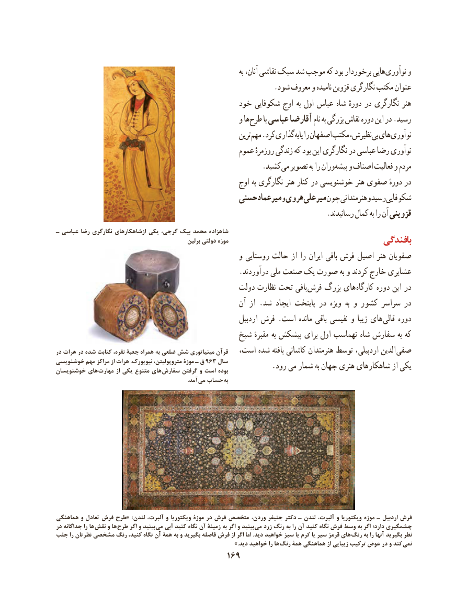

# PDF page 179

به آنان، نقاشی سبک شد موجب كه بود برخوردار هایی نوآوری و
                                                            .شود معروف و نامیده قزوین نگارگری مکتب عنوان
                                           خود شکوفایی اوج به اول عباس شاه دورهٔ در نگارگری هنر
                                                  و ها طرح با عباسی آقارضا نام به بزرگی نقاش دوره این در .رسید
                                                              ترین مهم .کرد گذاری پایه را اصفهان مکتب نظیرش، بی های نوآوری
                                                 عموم روزمرهٔ زندگی که بود این نگارگری در عباسی رضا نوآوری
                    . كشید می تصویر به را وران پیشه و اصناف فعالیت و مردم
                                                      اوج به نگارگری هنر کنار در خوشنویسی هنر صفوی دورهٔ در
                                        حسنی میرعماد و هروی میرعلی چون هنرمندانی و رسید شکوفایی
                                                                          .رسانیدند کمال به را آن قزوینی
ـ عباسی رضا نگارگری ازشاهكارهای يكی ،شاهزادهگرجی بيک محمد
                                                   برلین دولتی موزه                                      بافندگی
                                                  و روستایی حالت از را ایران بافی فرش اصیل هنر صفویان
                                                  .درآوردند ملی صنعت یک صورت به و كردند خارج عشایری
                                              دولت نظارت تحت بافی  فرش بزرگ های کارگاه دوره این در
                                                       آن از .شد ایجاد پایتخت در ویژه  به و کشور سراسر در
                                                           اردبیل فرش .است مانده باقی نفیسی و زیبا های  قالی دوره
                                           شیخ مقبرهٔ به پیشکش برای اول تهماسب شاه سفارش به که
در هرات در شده کتابت نقره، جعبة همراه به ضلعی شش مینیاتوری قرآن   است، شده بافته کاشانی هنرمندان توسط اردبیلی، الدین صفی
خوشنویسی         مهم                مراکز                           از                   هرات                                                     .نیویورک                                      متروپولیتن،                                               موزة ـ                                 ق                                         963 سال
                             مهارت                              از                   یکی                           متنوع های                                                                       سفارش گرفتن                                                     و                                       است                                                                بوده            .رود می شمار به جهان هنری شاهکارهای از یكیخوشنویسان          های
                                                                                             .آمد می حساب به

هماهنگی و تعادل فرش طرح«  :لندن آلبرت، و ویکتوریا موزۀ در فرش متخصص وردن، جنیفر دکتر ـ لندن آلبرت، و ویکتوریا موزه ـ اردبیل فرش
در جداگانه را ها نقش و ها طرح اگر و بینید می آبی کنید نگاه آن زمینۀ به اگر و بینید می زرد رنگ به را آن کنید نگاه فرش وسط به اگر دارد؛ چشمگیری
جلب را نظرتان مشخصی رنگ کنید، نگاه آن همۀ به و بگیرید فاصله فرش از اگر اما .دید خواهید سبز یا کرم یا سیر قرمز های رنگ به را آنها بگیرید نظر
            .» دید خواهید را ها رنگ همۀ هماهنگی از زیبایی ترکیب عوض در و کند نمی
                                      169

