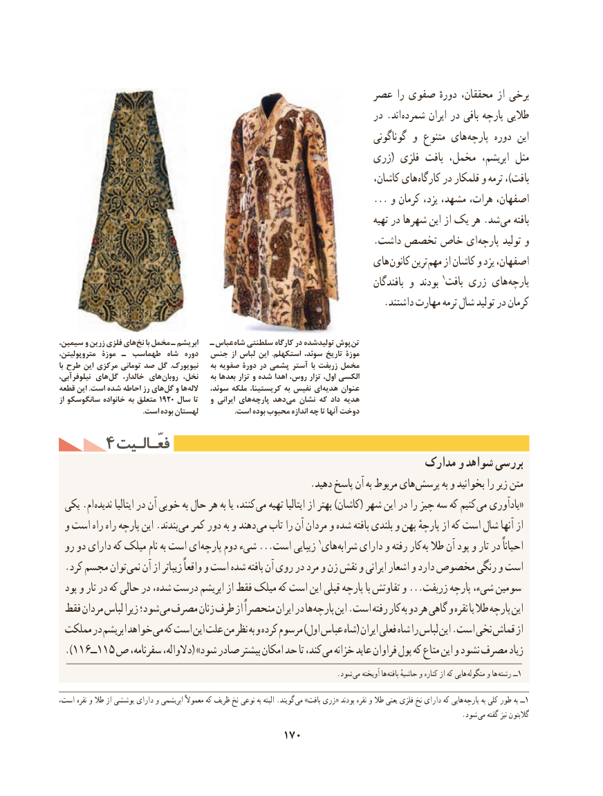

# PDF page 180

عصر را صفوی دورهٔ محققان، از برخی
                                                                   در .اند شمرده ایران در بافی پارچه طالیی
                                                                           گوناگونی و متنوع های پارچه دوره این
                                                     زری( فلزی بافت مخمل،  ابریشم، مثل
                                                                        کاشان، های کارگاه در قلمکار و ترمه ،)بافت
                                                                  ... و كرمان یزد، مشهد، هرات، اصفهان،
                                                                                      تهیه در شهرها این از یک هر .شد می بافته
                                                                 .داشت تخصص خاص ای پارچه تولید و
                                                            های کانون ترین مهم از کاشان و یزد اصفهان،
                                                                                    بافندگان و بودند 1بافت زری های پارچه
                                                                   .داشتند مهارت ترمه شال تولید در کرمان

سیمین، و زرین فلزی های نخ با مخمل ـ ابریشم   ـ عباس شاه سلطنتی کارگاه در شده تولید پوش تن
متروپولیتن،  موزة ـ طهماسب  شاه  دوره  جنس از لباس این  .استکهلم سوئد، تاریخ موزة
با طرح این مرکزی تومانی صد گل  .نیویورک    به صفویه دورة در پشمی آستر با زربفت مخمل
نیلوفرآبی، های گل  خالدار، های روبان نخل،    به بعدها تزار و شده اهدا روس، تزار اول، الکسی
قطعه این .است شده احاطه رز های گل و ها الله   سوئد، ملکه کریستینا، به نفیس ای هدیه عنوان
از سانگوسکو خانواده به متعلق 1920 سال تا   و ایرانی های پارچه دهد می نشان که داد هدیه
                                             .است بوده لهستان                   .است بوده محبوب اندازه چه تا آنها دوخت
     4 فعّـالـیتفعّـالـیت
                                                           مدارک و شواهد بررسی
     . دهید پاسخ آن به مربوط های پرسش به و بخوانید را زیر متن
 یکی .ام ندیده ایتالیا در آن خوبی به حال هر به یا کنند، می تهیه ایتالیا از بهتر )کاشان( شهر این در را چیز سه که کنیم «می یادآوری
 و است راه راه پارچه این .بندند می کمر دور به و دهند می تاب را آن مردان و شده بافته بلندی و پهن پارچهٔ از که است شال آنها از
 رو دو دارای که میلک نام به است ای پارچه دوم شیء ...است زیبایی 1های شرابه دارای و رفته کار به طال آن پود و تار در احیاناً
. کرد مجسم توان نمی آن از زیباتر واقعاً و است شده بافته آن روی در مرد و زن نقش و ایرانی اشعار و دارد مخصوص رنگی و است
 پود و تار در که حالی در شده، درست ابریشم از فقط میلک که است این قبلی پارچه با تفاوتش و ...زربفت پارچه شیء، سومین
 فقط مردان لباس زیرا شود؛ می مصرف زنان طرف از منحصراً ایران در ها پارچه این .است رفته کار به دو هر گاهی و نقره یا طال پارچه این
 مملکت در ابریشم خواهد می که است این علت من نظر به و کرده مرسوم )اول عباس شاه( ایران فعلی شاه را لباس این .است نخی قماش از
 ).116ــ115 ص سفرنامه، دالواله،( »شود صادر بیشتر امکان حد تا کند، می خزانه عاید فراوان پول که متاع این و نشود مصرف زیاد
                                                                                 .شود می آویخته ها بافته حاشیهٔ و کناره از که هایی  منگوله و ها رشته ــ1

است، نقره و طال از پوششی دارای و ابریشمی معموالً که ظریف نخ نوعی به البته .گویند  می »بافت زری« بودند نقره و طال یعنی فلزی نخ دارای که هایی  پارچه به کلی طور به ــ1
                                                                                                                     .شود می گفته نیز گالبتون
                                        170

