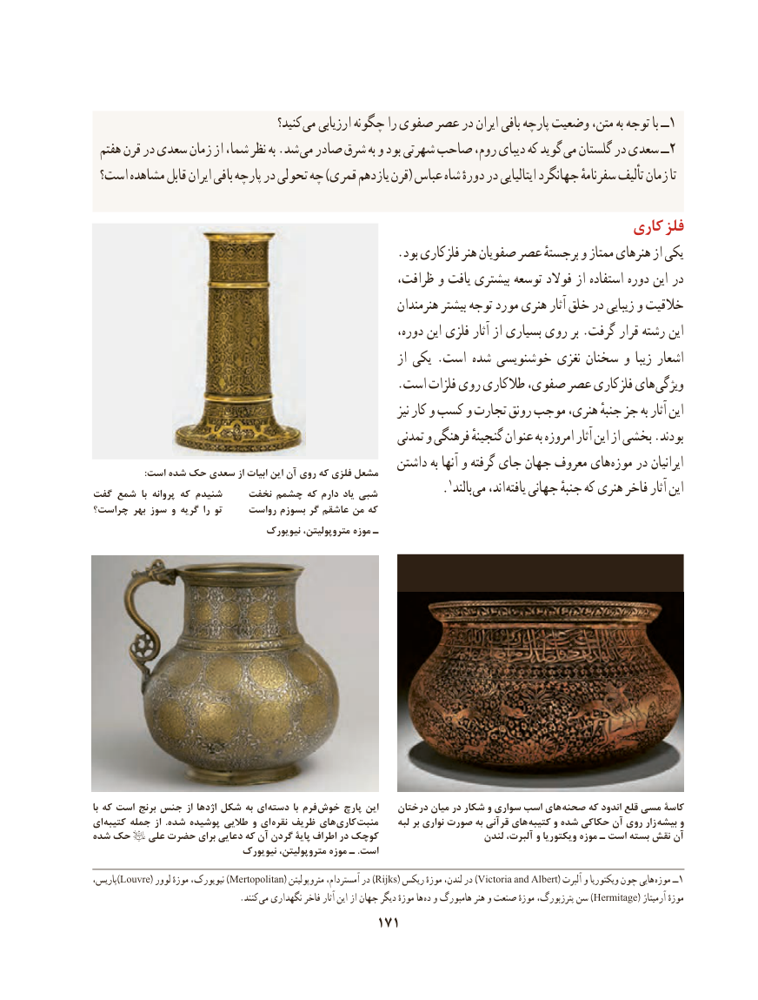

# PDF page 181

کنید؟ می ارزیابی چگونه را صفوی عصر در ایران بافی پارچه وضعیت متن، به توجه با ــ1
 هفتم قرن در سعدی زمان از شما، نظر به .شد می صادر شرق به و بود شهرتی صاحب روم، دیبای كه گوید می گلستان در سعدی ــ2
 است؟ مشاهده قابل ایران بافی پارچه در تحولی چه )قمری یازدهم قرن( عباس شاه دورهٔ در ایتالیایی جهانگرد سفرنامهٔ تألیف زمان تا

                                                                       کاری فلز
                                                  .بود فلزکاری هنر صفویان عصر برجستهٔ و ممتاز هنرهای از یکی
                                                  ظرافت، و یافت بیشتری توسعه فوالد از استفاده دوره این در
                                                           هنرمندان بیشتر توجه مورد هنری آثار خلق در زیبایی و خالقیت
                                                          دوره، این فلزی آثار از بسیاری روی بر .گرفت قرار رشته این
                                                               از یکی .است  شده خوشنویسی نغزی سخنان و زیبا اشعار
                                                  .است فلزات روی طالکاری صفوی، عصر فلزکاری های ویژگی
                                                                             نیز كار و کسب و تجارت رونق موجب هنری، جنبهٔ جز به آثار این
                                                         تمدنی و فرهنگی گنجینهٔ عنوان به امروزه آثار این از بخشی .بودند
                                                   داشتن به آنها و گرفته جای جهان معروف های موزه در ایرانیان                      :است شده حک سعدی از ابیات این آن روی که فلزی مشعل
گفت شمع  با پروانه که شنیدم    نخفت چشمم که دارم یاد شبی            .1بالند می اند، یافته جهانی جنبهٔ که هنری فاخر آثار این
چراست؟ بهر سوز و گریه را تو     رواست بسوزم گر عاشقم من که
                                    نیویورک متروپولیتن، موزه ـ

با که است برنج جنس از اژدها شکل به ای  دسته با فرم خوش پارچ این    درختان میان در شکار و سواری اسب های  صحنه که اندود قلع مسی کاسۀ
ای کتیبه جمله از  .شده پوشیده طالیی و ای نقره ظریف های  کاری منبت     لبه بر نواری صورت به قرآنی های  کتیبه و شده حکاکی آن روی زار بیشه و
شده حک   علی حضرت برای دعایی که آن گردن پایۀ اطراف در کوچک                     لندن آلبرت، و ویکتوریا موزه ـ است بسته نقش آن
                               نیویورک متروپولیتن، موزه ـ .است
پاریس،)Louvre( لوور موزهٔ نیویورک، )Mertopolitan( متروپولیتن آمستردام، در )Rijks( ریکس موزهٔ لندن، در )Victoria and Albert( آلبرت و ویکتوریا چون هایی موزه ــ1
                                  .کنند  می نگهداری فاخر آثار این از جهان دیگر موزهٔ ها  )ده و هامبورگ هنر و صنعت موزهٔ پترزبورگ، سن Hermitage( آرمیتاژ موزهٔ
                                         171

