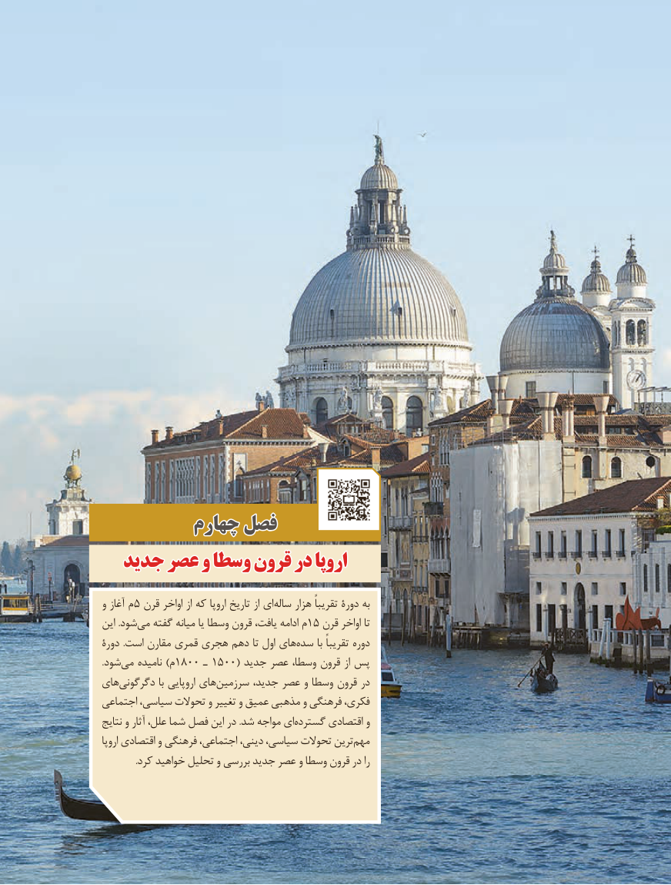

# PDF page 183

چهارمچهارم فصلفصل
  جدیدجدید عصرعصر وو وسطاوسطا قرونقرون دردر اروپااروپا

و آغاز م 5 قرن اواخر از که اروپا تاریخ از ای ساله هزار تقریباً دورۀ به
این .شودمی‌  گفته میانه یا وسطا قرون یافت، ادامه م 15 قرن اواخر تا
دورۀ .است مقارن قمری هجری دهم تا اول هایسده‌      با تقریباً دوره
.شودمی‌   نامیده )م 1800 ـ 1500( جدید عصر وسطا، قرون از پس
هایدگرگونی‌             با اروپایی هایسرزمین‌       جدید، عصر و وسطا قرون در
اجتماعی سیاسی، تحوالت و تغییر و عمیق مذهبی و فرهنگی فکری،
نتایج و آثار علل، شما فصل این در .شد مواجه ایگسترده‌      اقتصادی و
اروپا اقتصادی و فرهنگی اجتماعی، دینی، سیاسی، تحوالت ترینمهم‌
               .کرد خواهید تحلیل و بررسی جدید عصر و وسطا قرون در را

                                173

