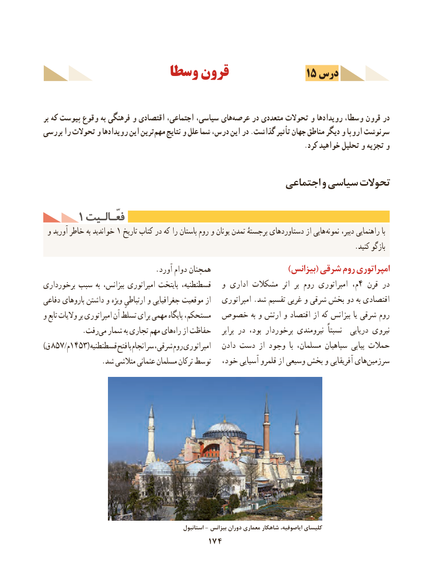

# PDF page 184

وسطا قرون              15 درس

بر که پیوست وقوع به فرهنگی و اقتصادی اجتماعی، سیاسی، هایعرصه‌     در متعددی تحوالت و رویدادها وسطا، قرون در
بررسی را تحوالت و رویدادها این ترین ‌مهم نتایج و علل شما درس، این در .گذاشت تأثیر جهان مناطق دیگر و اروپا سرنوشت
                                                                               .کرد خواهید تحلیل و تجزیه و

                                                اجتماعی و سیاسی تحوالت

     1 فعّـالـیتفعّـالـیت
 و آورید خاطر به خواندید 1 تاریخ کتاب در که را باستان روم و یونان تمدن برجستۀ دستاوردهای از هایی نمونه دبیر، راهنمایی با
                                                                                       .کنید بازگو
                              .آورد دوام همچنان                      )بیزانس( شرقی روم امپراتوری
برخورداری سبب به بیزانس، امپراتوری پایتخت قسطنطنیه،   و اداری مشکالت  اثر  بر روم امپراتوری م،4 قرن در
دفاعی باروهای داشتن و ویژه ارتباطیِ و جغرافیایی موقعیت از   امپراتوری .شد تقسیم غربی و شرقی بخش دو به اقتصادی
و تابع والیات بر امپراتوری آن تسلط برای مهمی پایگاه مستحکم،  خصوص به و ارتش و اقتصاد از که بیزانس یا شرقی روم
           .رفتمی‌  شمار به تجاری مهم هایراه‌   از حفاظت    برابر در بود، برخوردار نیرومندی‌            نسبتاً   دریایی نیروی
)ق 857 /م1453( قسطنطنیه فتح با سرانجام شرقی، روم امپراتوری   دادن دست از وجود  با مسلمان، سپاهیان پیاپی حمالت
                .شد متالشی عثمانی مسلمان ترکان توسط   خود، آسیایی قلمرو از وسیعی بخش و آفریقایی هایسرزمین‌

                                                      استانبول - بیزانس دوران معماری شاهكار ایاصوفیه، كلیسای
                                    174

