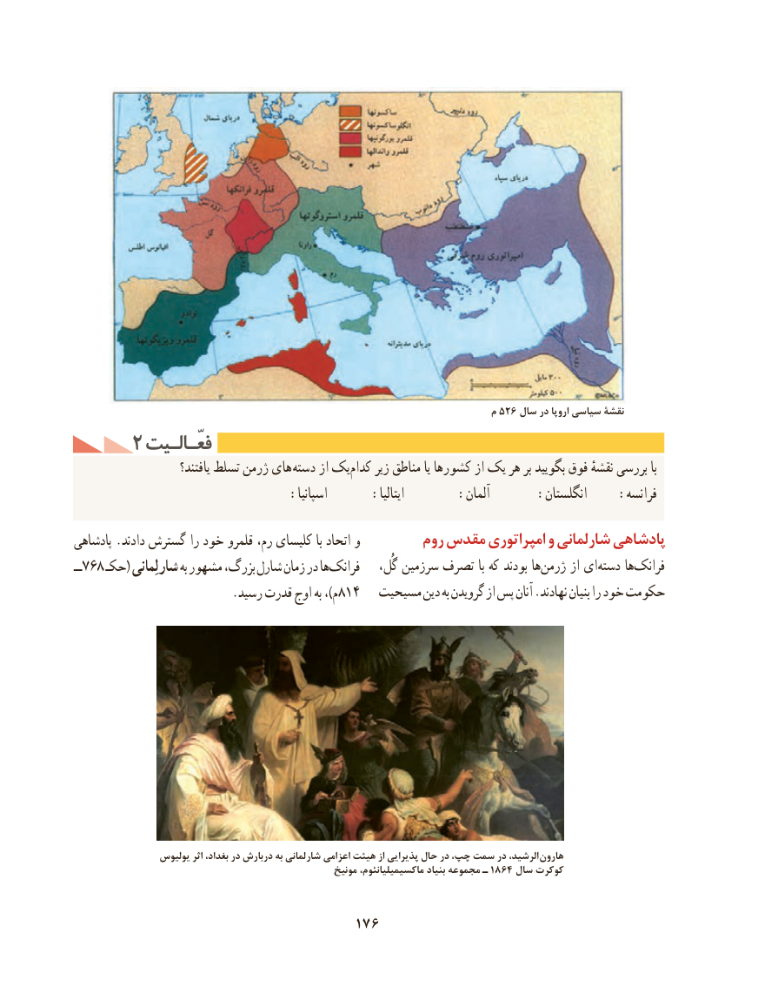

# PDF page 186

م۵۲۶ سال در اروپا سیاسی نقشۀ
     2 فعّـالـیتفعّـالـیت
                         یافتند؟ تسلط ژرمن های دسته از یککدام‌    زیر مناطق یا کشورها از یک هر بر بگویید فوق نقشهٔ بررسی با
                            :اسپانیا      :ایتالیا       :آلمان      :انگلستان    :فرانسه
پادشاهی .دادند گسترش را خود قلمرو رم، کلیسای با اتحاد و         روم مقدس امپراتوری و شارلمانی پادشاهی
ــ768 حکـ( شارلِمانی به مشهور بزرگ، شارل زمان در هافرانک‌          گُل، سرزمین تصرف با که بودند هاژرمن‌     از ای دسته هافرانک‌
                          .رسید قدرت اوج به ،)م814   مسیحیت دین به گرویدن از پس آنان .نهادند بنیان را خود حکومت

                 یولیوس اثر بغداد، در دربارش به شارلمانی اعزامی هیئت از پذیرایی حال در چپ، سمت در الرشید،  هارون
             مونیخ۱۸۶۴ماکسیمیلیانئوم، بنیاد مجموعه ـ     سال کوکرت

                                    176

