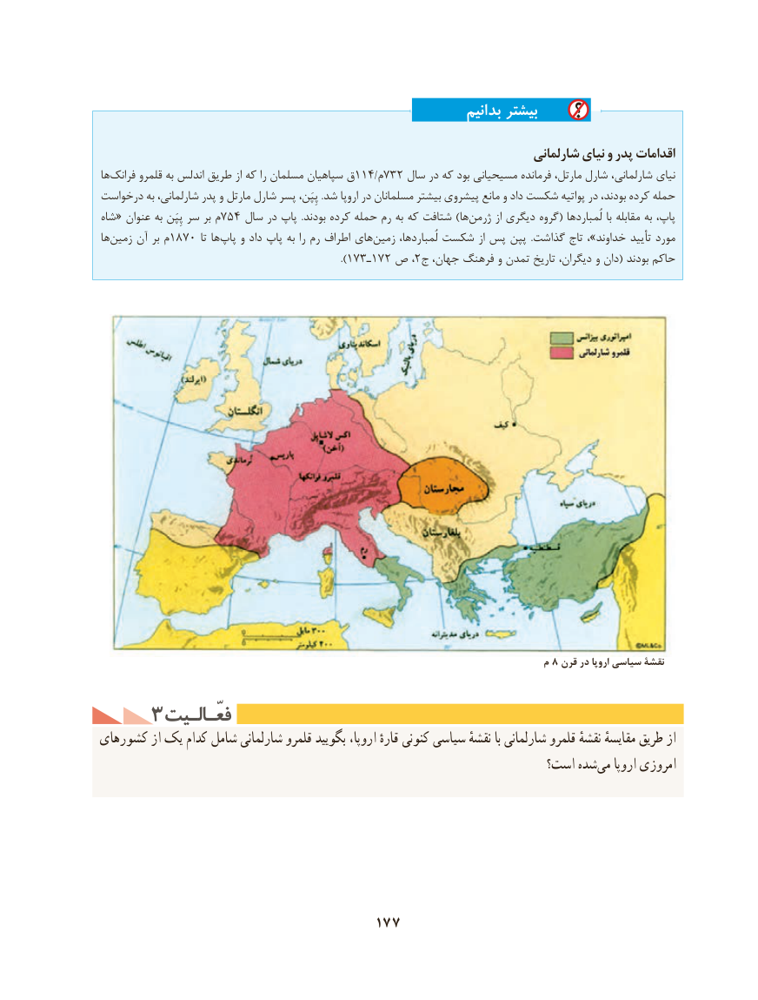

# PDF page 187

بدانیم بیشتر
                                                                          شارلمانی نیای و پدر اقدامات
ها ‌فرانک قلمرو به اندلس طریق از که را مسلمان سپاهیان ق114/م732 سال در که بود مسیحیانی فرمانده مارتل، شارل شارلمانی، نیای
درخواست به شارلمانی، پدر و مارتل شارل پسر پِپَن، .شد اروپا در مسلمانان بیشتر پیشروی مانع و داد شکست پواتیه در بودند، کرده حمله
شاه« عنوان به پِپَن سر بر م754 سال در پاپ  .بودند کرده حمله رم به که شتافت )ها ‌ژرمن از دیگری گروه( لُمباردها با مقابله به پاپ،
ها ‌زمین آن بر م1870 تا ها‌پاپ و داد پاپ به را رم اطراف های‌زمین لُمباردها، شکست از پس پپن  .گذاشت تاج ،»خداوند تأیید مورد
                                             ).173ـ172 ص ،2ج جهان، فرهنگ و تمدن تاریخ دیگران، و دان( بودند حاکم

                                                                                م 8 قرن در اروپا سیاسی نقشۀ

    3 فعّـالـیتفعّـالـیت
کشورهای از یک کدام شامل شارلمانی قلمرو بگویید اروپا، قارهٔ کنونی سیاسی نقشهٔ با شارلمانی قلمرو نقشهٔ مقایسهٔ طریق از
                                                                است؟ شده‌می اروپا امروزی

                                  177

