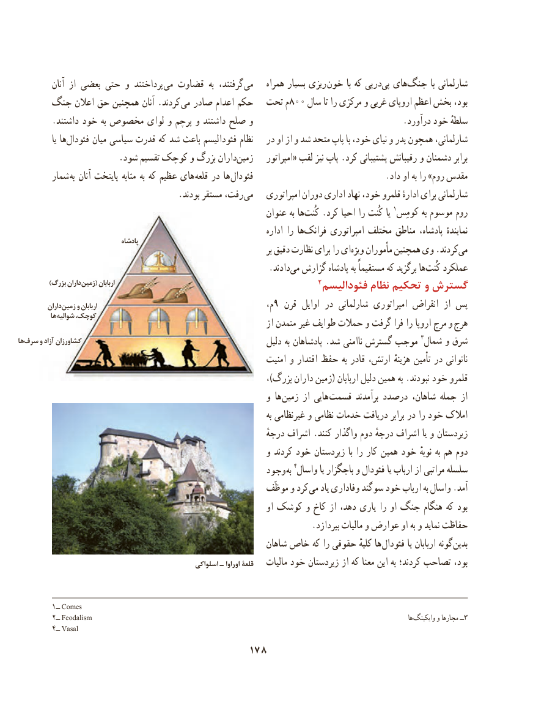

# PDF page 188

آنان از بعضی حتی و پرداختند می قضاوت  به گرفتند، می    همراه بسیار ریزی خون  با که پیدر‌   ‌پی های‌جنگ  با شارلمانی
     جنگ اعالن حق همچنین آنان .کردند می صادر اعدام حکم  تحت م800 سال تا را مرکزی و غربی اروپای اعظم بخش بود،
        .داشتند خود به مخصوص لوای و پرچم و داشتند صلح و                                   .درآورد خود سلطهٔ
               یا ها ‌فئودال میان سیاسی قدرت که شد باعث فئودالیسم نظام   در او از و شد متحد پاپ با خود، نیای و پدر همچون شارلمانی،
  .‌شود تقسیم کوچک و بزرگ دارانزمین    امپراتور« لقب نیز پاپ .کرد پشتیبانی رقیبانش و دشمنان برابر
        شمار به آنان پایتخت مثابه به که عظیم های قلعه در ها فئودال                               .داد او به را »روم مقدس
     . بودند مستقر رفت، می   امپراتوری دوران اداری نهاد خود، قلمرو ادارهٔ برای شارلمانی
                                                              عنوان به ها ‌کُنت .کرد احیا را کُنت یا 1کومِس به موسوم روم
                                                                           اداره را ها‌فرانک امپراتوری مختلف مناطق پادشاه، نمایندهٔ                                    پادشاه
                                                                                        بر دقیق نظارت برای را ای ‌ویژه مأموران همچنین وی .کردند‌می
                     .‌دادندمی گزارش پادشاه به مستقیماً که برگزید هاکُنت‌    عملکرد
           )بزرگ داران زمین( اربابان                                                        2فئودالیسم نظام تحکیم و گسترش
          داران زمین و اربابان                                                م،9 قرن اوایل در شارلمانی امپراتوری انقراض  از پس
           ها شوالیه کوچک،                                                                        از متمدن غیر طوایف حمالت و گرفت فرا را اروپا مرج و هرج
ها سرف و آزاد کشاورزان                                                                  دلیل به پادشاهان .شد ناامنی گسترش موجب 3شمال و شرق
                                                               امنیت و اقتدار حفظ به قادر ارتش، هزینهٔ تأمین در ناتوانی
                                                                           ،)بزرگ داران زمین( اربابان دلیل همین به .نبودند خود قلمرو
                                                           و ها زمین از هایی  قسمت برآمدند درصدد شاهان، جمله از
                                                                                             به غیرنظامی و نظامی خدمات دریافت برابر در را خود امالک
                                                                    درجهٔ اشراف .کنند واگذار دوم درجهٔ اشراف یا و زیردستان
                                                           و کردند خود زیردستان  با را کار همین خود نوبهٔ به هم دوم
                                                   وجود به 4واسال یا باجگزار و فئودال یا ارباب از مراتبی سلسله
                                                        موظّف و کرد می یاد وفاداری سوگند خود ارباب به واسال .آمد
                                                                         او کوشک و کاخ از دهد، یاری را او جنگ هنگام که بود
                                                                     .بپردازد مالیات و عوارض او به و نماید حفاظت
                                                             شاهان خاص که را حقوقی کلیهٔ ها فئودال یا اربابان گونه بدین
                                                     اسلواکی ـ اوراوا قلعۀ    مالیات خود زیردستان از که معنا این به کردند؛ تصاحب بود،

         1ــ Comes
         2ــ Feodalism                                                                                                                                   ها وایکینگ و مجارها ــ3
         4ــ Vasal
                                        178

