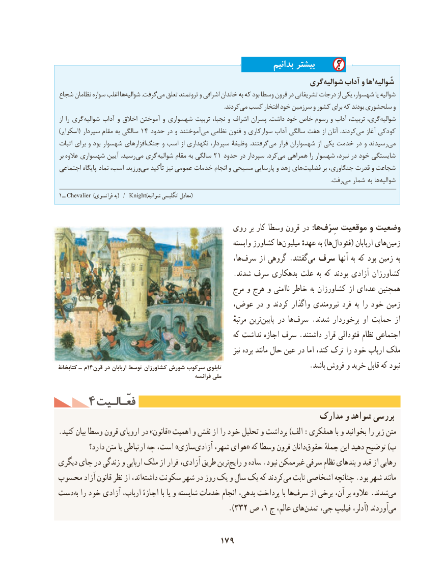

# PDF page 189

بدانیم بیشتر
                                                       گریشوالیه‌     آداب و ها 1شُوالیه
شجاع نظامان سواره اغلب هاشوالیه‌           .گرفتمی‌  تعلق ثروتمند و اشرافی خاندان به که بود وسطا قرون در تشریفاتی درجات از یکی شهسوار، یا شوالیه
                                                                                                                         .کردندمی‌ کسب افتخار خود سرزمین و کشور برای که بودند سلحشوری و
از را گری ‌شوالیه آداب و اخالق آموختن و شهسواری تربیت نجبا، و اشراف پسران  .داشت خود خاص رسوم و آداب تربیت، گری،شوالیه‌
)اسکوایر( سپردار مقام به سالگی 14 حدود در و آموختند‌می نظامی فنون و سوارکاری آداب سالگی هفت از آنان  .کردندمی‌   آغاز کودکی
اثبات برای و بود شهسوار افزارهای‌جنگ و اسب از نگهداری سپردار، وظیفۀ  .گرفتندمی‌    قرار شهسواران از یکی خدمت در و رسیدندمی‌
بر   عالوه شهسواری آیین .رسید ‌می گری ‌شوالیه مقام به سالگی 21 حدود در سپردار .کردمی‌  همراهی را شهسوار نبرد، در خود شایستگی
اجتماعی پایگاه نماد اسب، .ورزید ‌می تأکید نیز عمومی خدمات انجام و مسیحی پارسایی و زهد های ‌فضلیت بر جنگاوری، قدرت و شجاعت
                                      .‌رفتمی شمار به ها‌شوالیه
1ــ Chevalier  )فرانسوی به(  /  Knight(شوالیه انگلیسی معادل)

                                        روی بر کار وسطا قرون در :هاسِرْف‌    موقعیت و وضعیت
                                                           وابسته کشاورز هامیلیون‌      عهدهٔ به )هافئودال‌       ( اربابان های‌زمین
                                                               ها،‌سرف از گروهی .گفتند‌می سرف آنها به که بود زمین به
                                                 .شدند سرف بدهکاری علت به که بودند آزادی کشاورزان
                                                 مرج و هرج و ناامنی خاطر به کشاورزان از ای ‌عده همچنین
                                   عوض، در و کردند واگذار نیرومندی فرد به را خود زمین
                                                                                مرتبهٔ ترین‌پایین در هاسرف‌     .شدند برخوردار او حمایت از
                                                        که نداشت اجازه سرف .داشتند قرار فئودالی نظام اجتماعی
                                                                           نیز برده مانند حال عین در اما کند، ترک را خود ارباب ملک
کتابخانۀ ـ م14 قرن در اربابان توسط كشاورزان شورش سرکوب تابلوی                         .باشد فروش و خرید قابل که نبود
                                                   فرانسه ملی
    4 فعّـالـیتفعّـالـیت
                                                         مدارک و شواهد بررسی
.کنید بیان وسطا قرون اروپای در »قانون« اهمیت و نقش از را خود تحلیل و برداشت )الف :همفکری با و بخوانید را زیر متن
          دارد؟ متن با ارتباطی چه است، »سازیآزادی‌     شهر، هوای« که وسطا قرون دانانحقوق‌      جملهٔ این دهید توضیح )ب
دیگری جای در زندگی و اربابی ملک از فرار آزادی، طریق ترینرایج‌   و ساده .نبود غیرممکن سرفی نظام بندهای و قید از رهایی
محسوب آزاد قانون نظر از اند،‌داشته سکونت شهر در روز یک و سال یک که کردندمی‌   ثابت اشخاصی چنانچه .بود شهر مانند
دست به را خود آزادی ارباب، اجازهٔ با یا و شایسته خدمات انجام بدهی، پرداخت با هاسرف‌     از برخی آن، بر عالوه .شدندمی‌
                                            ).332 ص ،1 ج عالم، هایتمدن‌   جی، فیلیپ آدلر،( آوردندمی‌

                                    179

