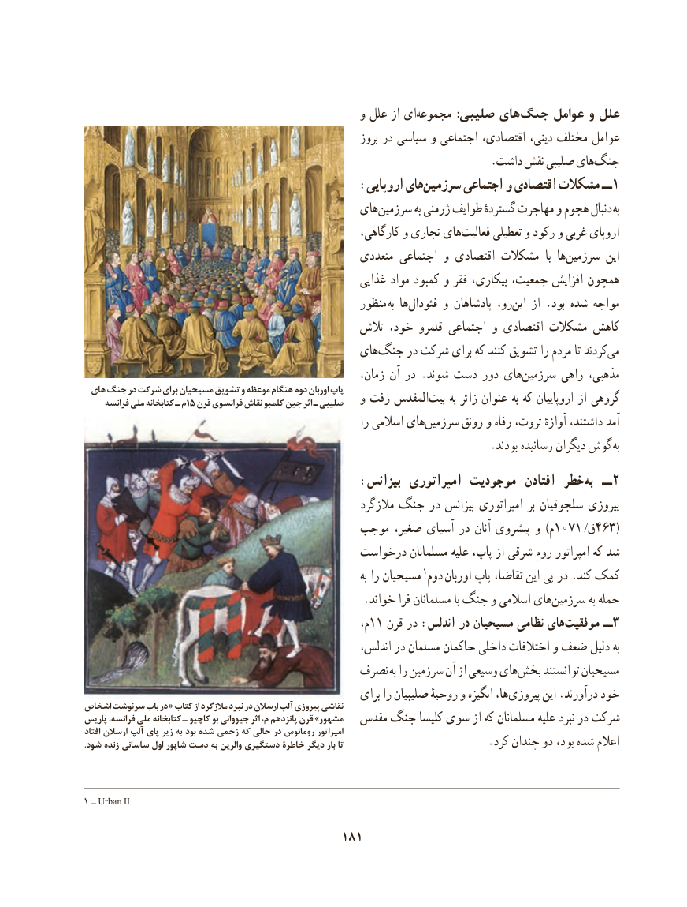

# PDF page 191

و علل از ایمجموعه‌            :صلیبی های جنگ عوامل و علل
                                                             بروز در سیاسی و اجتماعی اقتصادی، دینی، مختلف عوامل
                                                                          .داشت نقش صلیبی هایجنگ‌
                                        :اروپایی هایسرزمین‌      اجتماعی و اقتصادی مشکالت ــ1
                                              های‌سرزمین به ژرمنی طوایف گستردهٔ مهاجرت و هجوم دنبال  به
                                                       کارگاهی، و تجاری های ‌فعالیت تعطیلی و رکود و غربی اروپای
                                                  متعددی اجتماعی و اقتصادی مشکالت  با ها ‌سرزمین این
                                                      غذایی مواد کمبود و فقر بیکاری، جمعیت، افزایش همچون
                                                    منظور به ها‌فئودال و پادشاهان رو، این‌    از .بود شده مواجه
                                               تالش خود، قلمرو اجتماعی و اقتصادی مشکالت کاهش
                                              های‌جنگ در شرکت برای که کنند تشویق را مردم تا کردندمی‌
                                                         زمان، آن در .شوند دست دور های‌سرزمین راهی مذهبی،
 هاي جنگ در شركت برای مسیحیان تشویق و موعظه هنگام دوم اوربان پاپ     فرانسه ملی کتابخانه ـ م15 قرن فرانسوي نقاش كلمبو جين اثر ـ صليبي   و رفت المقدس‌بیت به زائر عنوان به که اروپاییان از گروهی
                                                              را اسالمی هایسرزمین‌      رونق و رفاه ثروت، آوازهٔ داشتند، آمد
       . بودند رسانیده دیگران گوش به
                                        :بیزانس امپراتوری موجودیت  افتادن خطر به  ــ 2
                                                         مالزگرد جنگ در بیزانس امپراتوری بر سلجوقیان پیروزی
                                      موجب صغیر، آسیای در آنان پیشروی و )م1071 /ق463(
                                          درخواست مسلمانان علیه پاپ، از شرقی روم امپراتور که شد
                                                                                 به را مسیحیان ١کمکدوم اوربان پاپ تقاضا، این پی در .کند
   .‌خواند فرا مسلمانان با جنگ و اسالمی هایسرزمین به حمله
                                                             م،11 قرن در :اندلس در مسیحیان نظامی هایموفقیت‌        ــ 3
   ،بهاندلس در مسلمان حاکمان داخلی اختالفات و ضعف دلیل
                                       تصرف به را سرزمین آن از وسیعی های‌بخش توانستند مسیحیان
                                                       برای را صلیبیان روحیهٔ و انگیزه ها،پیروزی‌       این .درآورند خوداشخاص سرنوشت باب در « کتاب از مالزگرد نبرد در ارسالن آلپ پیروزی نقاشی
پاریس فرانسه، ملی کتابخانه ـ کاچیو بو جیووانی اثر م، پانزدهم قرن »مشهور  مقدس جنگ کلیسا سوی از که مسلمانان علیه نبرد در شرکت
افتاد ارسالن آلپ پای زیر به بود شده زخمی که حالی در رومانوس امپراتور
.شود زنده ساسانی اول شاپور دست به والرین دستگیری خاطرة دیگر بار تا                          .کرد چندان دو بود، شده اعالم

1 ــ Urban II

                                        181

