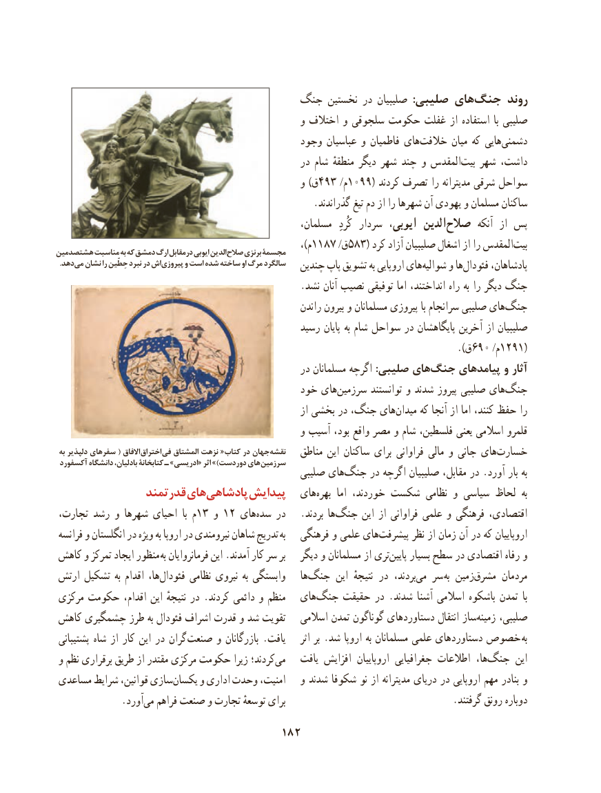

# PDF page 192

جنگ نخستین در صلیبیان  :صلیبی های جنگ روند
                                                   و اختالف و سلجوقی حکومت غفلت از استفاده  با صلیبی
                                             وجود عباسیان و فاطمیان های‌خالفت میان که هایی ‌دشمنی
                                                    در شام منطقهٔ دیگر شهر چند و المقدس ‌بیت شهر داشت،
                                                   و )ق493 /م1099( کردند تصرف را مدیترانه شرقی سواحل
     .‌گذراندند تیغ دم از را شهرها آن یهودی و مسلمان ساکنان
                                                      مسلمان،   کُردِ سردار ایوبی،  الدینصالح‌        آنکه  از پس
                                                                  ،)م1187 /ق583( کرد آزاد صلیبیان اشغال از را المقدس‌بیتهشتصدمین مناسبت به که دمشق ارگ درمقابل ایوبی الدین صالح برنزی مجسمة
. دهدمی نشان را حِطّین نبرد در اش پیروزی و است شده ساخته او مرگ سالگرد   چندین پاپ تشویق به اروپایی های‌شوالیه و ها‌فئودال پادشاهان،
                                                   .نشد آنان نصیب توفیقی اما انداختند، راه به را دیگر جنگ
                                                          راندن بیرون و مسلمانان پیروزی با سرانجام صلیبی های ‌جنگ
                                                 رسید پایان به شام سواحل در پایگاهشان آخرین از صلیبیان
                                                             ).690ق      /م1291(
                                                    در مسلمانان اگرچه :صلیبی هایجنگ‌     پیامدهای و آثار
                                           خود هایسرزمین‌        توانستند و شدند پیروز صلیبی هایجنگ‌
                                                               از بخشی در جنگ، های ‌میدان که آنجا از اما کنند، حفظ را
                                                   و آسیب بود، واقع مصر و شام فلسطین، یعنی اسالمی قلمرو
 به دلپذیر سفرهای ( االفاق اختراق فی المشتاق نزهت «کتاب در جهان نقشه                                                       مناطق این ساکنان برای فراوانی مالی و جانی های‌خسارت آکسفورد دانشگاه بادلیان، کتابخانة ـ »ادریسی« اثر )»دوردست های سرزمین
                                                  صلیبی های ‌جنگ در اگرچه صلیبیان مقابل، در .آورد بار به
               قدرتمند هایپادشاهی‌      پیدایش   های‌بهره  اما خوردند، شکست نظامی و سیاسی لحاظ  به
 تجارت، رشد و شهرها احیای  با م13 و 12 های‌سده در   .بردند هاجنگ‌      این از فراوانی علمی و فرهنگی اقتصادی،
 فرانسه و انگلستان در ویژه به اروپا در نیرومندی شاهان تدریج به   فرهنگی و علمی های ‌پیشرفت نظر از زمان آن در که اروپاییان
 کاهش و تمرکز ایجاد منظور  به فرمانروایان این .آمدند کار سر بر   دیگر و مسلمانان از تریپایین‌    بسیار سطح در اقتصادی رفاه و
 ارتش تشکیل به اقدام ها،‌فئودال نظامی نیروی به وابستگی    ها‌جنگ این  نتیجهٔ در  بردند،می‌   سر به زمینمشرق‌      مردمان
 مرکزی حکومت اقدام، این نتیجهٔ در .کردند دائمی و منظم   های‌جنگ حقیقت در .شدند آشنا اسالمی باشکوه تمدن  با
 کاهش چشمگیری طرز به فئودال اشراف قدرت و شد تقویت   اسالمی تمدن گوناگون های ‌دستاورد انتقال ساز‌زمینه صلیبی،
 پشتیبانی شاه از کار این در گران  صنعت و بازرگانان .یافت     اثر بر .شد اروپا به مسلمانان علمی دستاوردهای خصوص  به
 و نظم برقراری طریق از مقتدر مرکزی حکومت زیرا کردند؛می‌     یافت افزایش  اروپاییان جغرافیایی اطالعات  ها،جنگ‌      این
 مساعدی شرایط قوانین، سازییکسان‌     و اداری وحدت امنیت،   و شدند شکوفا نو از مدیترانه دریای در اروپایی مهم بنادر و
              .آورد‌می فراهم صنعت و تجارت توسعهٔ برای                                   .گرفتند رونق دوباره
                                     182

