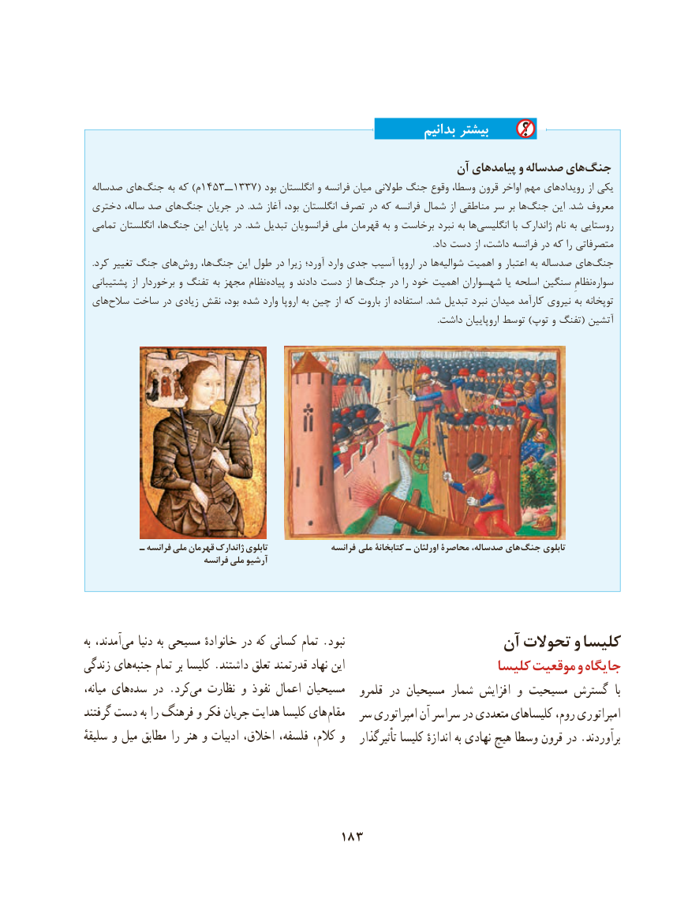

# PDF page 193

بدانیم بیشتر
                                                         آن پیامدهای و صدساله هایجنگ‌
  صدساله های ‌جنگ به که )م1453ــ1337( بود انگلستان و فرانسه میان طوالنی جنگ وقوع وسطا، قرون اواخر مهم رویدادهای از یکی
 دختری ساله، صد های ‌جنگ جریان در  .شد آغاز بود، انگلستان تصرف در که فرانسه شمال از مناطقی سر بر ها‌جنگ این  .شد معروف
  تمامی انگلستان ها، ‌جنگ این پایان در  .شد تبدیل فرانسویان ملی قهرمان به و برخاست نبرد به ها ‌انگلیسی با ژاندارک نام به روستایی
                                                                                                                                                                    .داد دست از داشت، فرانسه در که را متصرفاتی
    .کرد تغییر جنگ های‌روش ها،‌جنگ این طول در زیرا آورد؛ وارد جدی آسیب اروپا در ها‌شوالیه اهمیت و اعتبار به صدساله های ‌جنگ
  پشتیبانی از برخوردار و تفنگ به مجهز نظام‌پیاده و دادند دست از ها جنگ در را خود اهمیت شهسواران یا اسلحه سنگین نظامِ‌سواره
 های‌سالح ساخت در زیادی نقش بود، شده وارد اروپا به چین از که باروت از استفاده  .شد تبدیل نبرد میدان کارآمد نیروی به توپخانه
                                                                                                                                                                      .داشت اروپاییان توسط )توپ و تفنگ( آتشین

           ـ فرانسه ملی قهرمان ژاندارک تابلوی               فرانسه ملی کتابخانۀ ـ اورلئان محاصرۀ صدساله، هاي جنگ تابلوی
                             فرانسه ملی آرشیو

به آمدند، می دنیا به مسیحی خانوادهٔ در که کسانی تمام .نبود                  آن تحوالت و کلیسا
زندگی هایجنبه‌     تمام بر کلیسا .داشتند تعلق قدرتمند نهاد این                       کلیسا موقعیت و جایگاه
میانه، هایسده‌    در .کردمی‌   نظارت و نفوذ اعمال مسیحیان   قلمرو در مسیحیان شمار افزایش و مسیحیت گسترش  با
گرفتند دست به را فرهنگ و فکر جریان هدایت کلیسا های مقام  سر امپراتوری آن سراسر در متعددی کلیساهای روم، امپراتوری
سلیقهٔ و میل مطابق را هنر و ادبیات اخالق، فلسفه، کالم، و   تأثیرگذار کلیسا اندازهٔ به نهادی هیچ وسطا قرون در .برآوردند

                                   183

