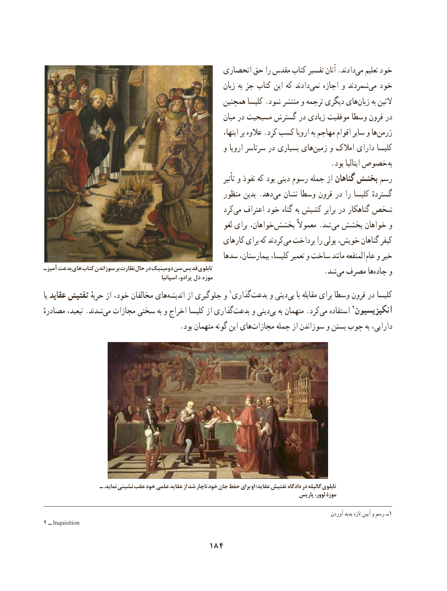

# PDF page 194

انحصاری حق را مقدس کتاب تفسیر آنان .دادندمی‌   تعلیم خود
                                                              زبان به جز کتاب این که دادند ‌نمی اجازه و شمردندمی‌  خود
                                                 همچنین کلیسا .شود منتشر و ترجمه دیگری های ‌زبان به التین
                                                             میان در مسیحیت گسترش در زیادی موفقیت وسطا قرون در
                                                                        اینها، بر عالوه .کرد کسب اروپا به مهاجم اقوام سایر و ها‌ژرمن
                                                  و اروپا سرتاسر در بسیاری های ‌زمین و امالک دارای کلیسا
          . بود ایتالیا خصوص به
                                                                                تأثیر و نفوذ که بود دینی رسوم جمله از گناهان بخشش رسم
                                                    منظور بدین .دهدمی‌   نشان وسطا قرون در را کلیسا گستردهٔ
                                                      کردمی‌   اعتراف خود گناه به کشیش برابر در گناهکار شخص
                                                              لغو برای خواهان،‌بخشش معموالً .شد می بخشش خواهان و
                                                   کارهای برای که کردند‌می پرداخت را پولی خویش، گناهان کیفر
                                                  سدها بیمارستان، کلیسا، تعمیر و ساخت مانند المنفعه  عام و خیر
آميزـ بدعت هاي كتاب سوزاندن بر نظارت حال در دومينيك سن قديس تابلوی                               .شد‌می مصرف هاجاده‌    و                                                     اسپانیا پرادو، دل موزه
یا عقاید تفتیش حربهٔ از خود، مخالفان های ‌اندیشه از جلوگیری و 1گذاری‌بدعت و دینیبی‌    با مقابله برای وسطا قرون در کلیسا
مصادرهٔ تبعید، .شدند‌می مجازات سختی به و اخراج کلیسا از گذاری‌بدعت و دینی‌بی به متهمان .کردمی‌   استفاده 2انکیزیسیون
    .‌بود متهمان گونه این هایمجازات جمله از سوزاندن و بستن چوب به دارایی،

                  ـ .نمايد نشيني عقب خود علمي عقايد از شد ناچار خود جان حفظ براي او عقايد؛ تفتيش دادگاه در گاليله تابلوی
                                                                                      پاریس لوور، موزۀ

                                                                                                                     آوردن پدید تازه آیین و رسم ــ1
2 ــ Inquisition
                                    184

